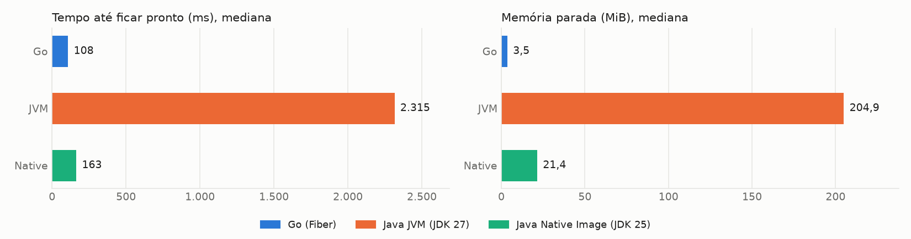
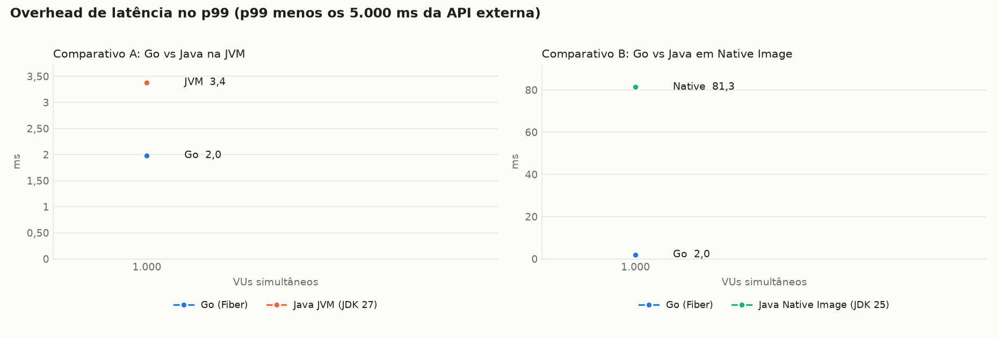
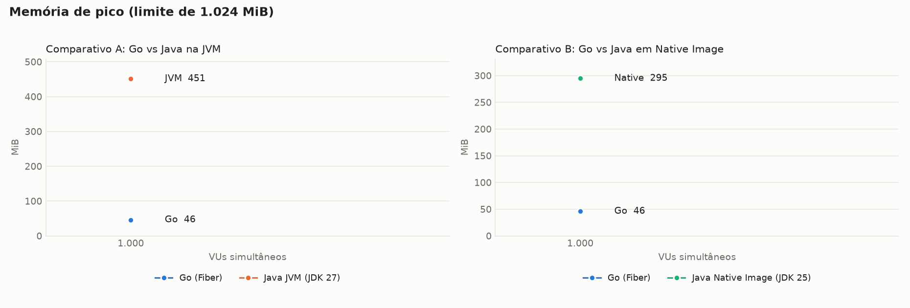
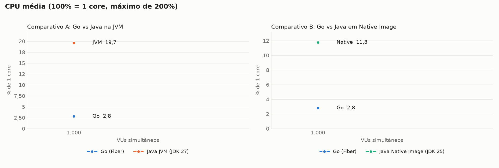
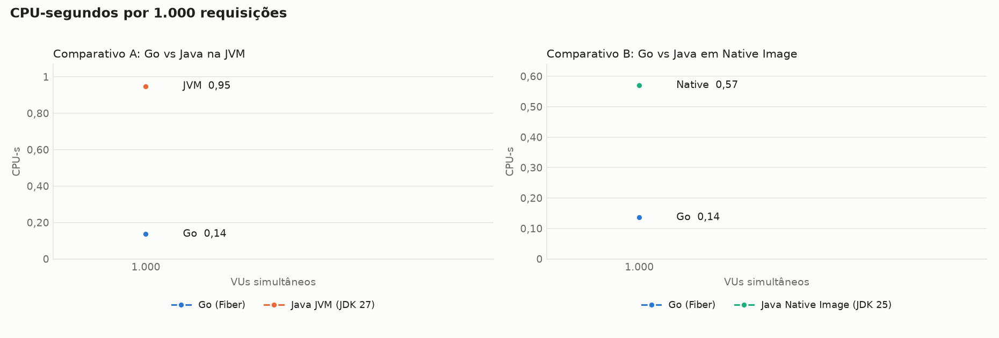
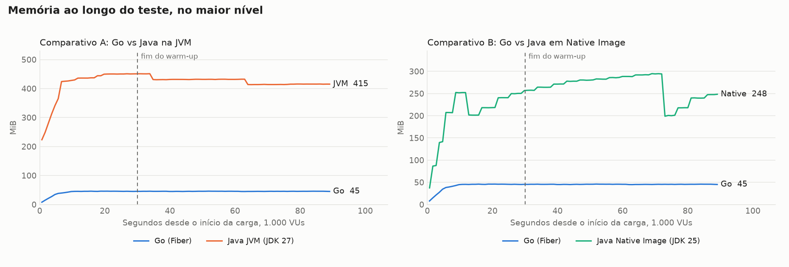
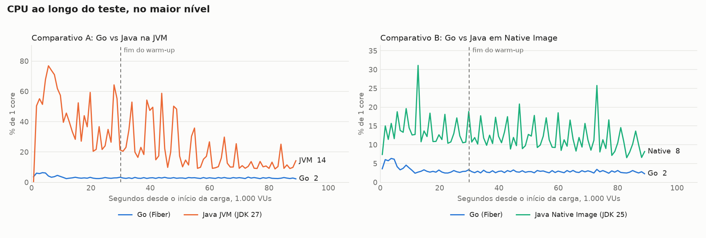

# Benchmark de I/O: Java com virtual threads vs Go com Fiber

Cada requisição chama uma API externa com 5s de latência fixa e devolve a resposta, sem trabalho de CPU no handler. Os valores são a **mediana das repetições**, restritos à janela medida (sem warm-up). CPU em % de 1 core, com máximo de 200%. O Native Image usa JDK 25, e a variante JVM usa JDK 27.

## Ambiente

| Item | Valor |
|---|---|
| CPU | 16 vCPU, x86_64 |
| Memória | 30,8 GiB |
| Sistema operacional | Ubuntu 24.04.5 LTS, kernel 7.0.0-1014-aws |
| Docker | 29.9.2 |
| Níveis de VUs | 1000 |
| Repetições | 1 |
| Warm-up e janela medida | 30s e 60s |
| Execuções de startup | 3 |

## Startup

| Alvo | Pronto, mediana (ms) | Pronto, p90 (ms) | Autodeclarado (ms) | 1ª requisição (ms além dos 5s) | Memória parada (MiB) | Imagem (MB) | Execuções |
|---|---|---|---|---|---|---|---|
| Go (Fiber) | 108 | 121 | 0 | 6,1 | 3,5 | 20,3 | 3 |
| Java JVM (JDK 27) | 2.315 | 2.455 | 2.126 | 99,4 | 204,9 | 512,6 | 3 |
| Java Native Image (JDK 25) | 163 | 179 | 43 | 8,1 | 21,4 | 131,2 | 3 |

O tempo até ficar pronto é medido de fora, do start do container até o primeiro `/health` com 200, e inclui o custo do Docker. O tempo autodeclarado do Go parte de uma variável de pacote e não inclui o início do runtime, por isso não é comparável ao do Java.

## Comparativo A: Go vs Java na JVM

### Latência e throughput

| VUs | Alvo | req/s real | req/s ideal | Erros | p50 (ms) | p90 (ms) | p99 (ms) | max (ms) | Overhead p99 (ms) |
|---|---|---|---|---|---|---|---|---|---|
| 1.000 | Go (Fiber) | 199,9 | 200 | 0 (0,00%) | 5.001,2 | 5.001,7 | 5.002,0 | 5.002,3 | 2,0 |
| 1.000 | Java JVM (JDK 27) | 199,9 | 200 | 0 (0,00%) | 5.002,2 | 5.002,8 | 5.003,4 | 5.028,2 | 3,4 |

### Memória e CPU

| VUs | Alvo | Memória parada (MiB) | Memória média (MiB) | Memória pico (MiB) | CPU média (%) | CPU pico (%) | CPU-s por 1.000 req | OOMs |
|---|---|---|---|---|---|---|---|---|
| 1.000 | Go (Fiber) | 3,5 | 45,4 | 46,0 | 2,8 | 3,4 | 0,136 | 0 |
| 1.000 | Java JVM (JDK 27) | 204,9 | 425,5 | 451,3 | 19,7 | 58,7 | 0,949 | 0 |

## Comparativo B: Go vs Java em Native Image

### Latência e throughput

| VUs | Alvo | req/s real | req/s ideal | Erros | p50 (ms) | p90 (ms) | p99 (ms) | max (ms) | Overhead p99 (ms) |
|---|---|---|---|---|---|---|---|---|---|
| 1.000 | Go (Fiber) | 199,9 | 200 | 0 (0,00%) | 5.001,2 | 5.001,7 | 5.002,0 | 5.002,3 | 2,0 |
| 1.000 | Java Native Image (JDK 25) | 200,0 | 200 | 0 (0,00%) | 5.002,2 | 5.003,1 | 5.081,3 | 5.188,2 | 81,3 |

### Memória e CPU

| VUs | Alvo | Memória parada (MiB) | Memória média (MiB) | Memória pico (MiB) | CPU média (%) | CPU pico (%) | CPU-s por 1.000 req | OOMs |
|---|---|---|---|---|---|---|---|---|
| 1.000 | Go (Fiber) | 3,5 | 45,4 | 46,0 | 2,8 | 3,4 | 0,136 | 0 |
| 1.000 | Java Native Image (JDK 25) | 21,4 | 264,8 | 294,8 | 11,8 | 25,8 | 0,570 | 0 |

## Gráficos

## Sanidade do ambiente

Sem ocorrências: nenhuma saturação de mock-api ou k6, nenhum erro, nenhum OOM e throughput sempre acima de 95% do ideal.

### Consumo de mock-api e k6 por rodada

| VUs | Alvo | Rep | mock-api CPU média (%) | mock-api CPU pico (%) | k6 CPU média (%) | k6 CPU pico (%) | k6 memória pico (MiB) |
|---|---|---|---|---|---|---|---|
| 1.000 | Go | 1 | 4,2 | 5,8 | 5,5 | 19,9 | 265 |
| 1.000 | JVM | 1 | 3,9 | 4,9 | 5,4 | 19,3 | 265 |
| 1.000 | Native | 1 | 3,4 | 4,7 | 5,0 | 20,0 | 264 |

## Todas as rodadas

| VUs | Alvo | Rep | Requisições | req/s | Erros | p50 (ms) | p99 (ms) | max (ms) | Mem. média (MiB) | Mem. pico (MiB) | CPU média (%) | CPU-s/1.000 | Blocked p99 (ms) | Blocked max (ms) | OOM |
|---|---|---|---|---|---|---|---|---|---|---|---|---|---|---|---|
| 1.000 | Go | 1 | 11.995 | 199,9 | 0 | 5.001,2 | 5.002,0 | 5.002,3 | 45,4 | 46,0 | 2,8 | 0,136 | 0,4 | 11,8 | não |
| 1.000 | JVM | 1 | 11.997 | 199,9 | 0 | 5.002,2 | 5.003,4 | 5.028,2 | 425,5 | 451,3 | 19,7 | 0,949 | 0,3 | 11,1 | não |
| 1.000 | Native | 1 | 12.000 | 200,0 | 0 | 5.002,2 | 5.081,3 | 5.188,2 | 264,8 | 294,8 | 11,8 | 0,570 | 0,4 | 11,0 | não |
