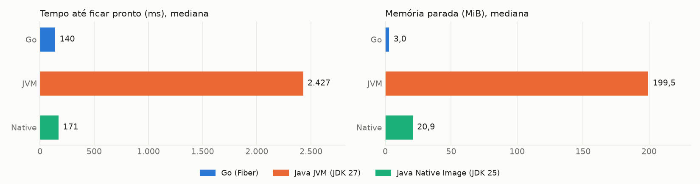
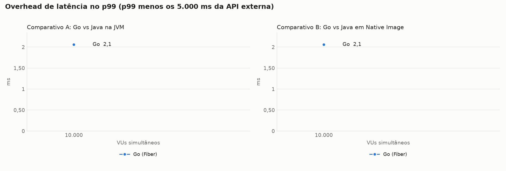
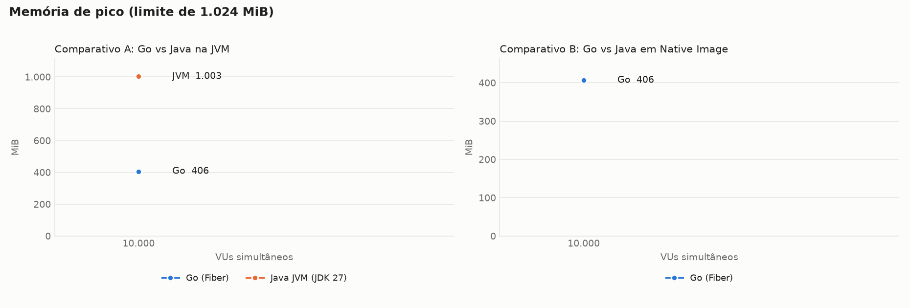
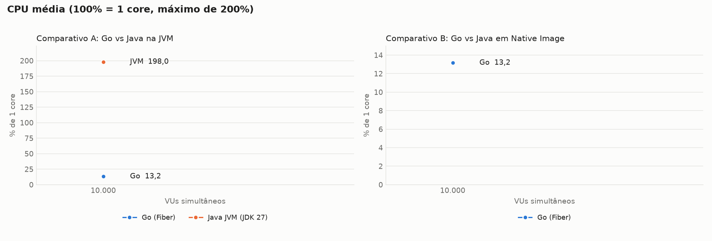
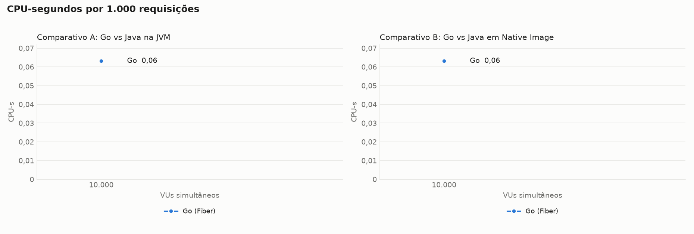
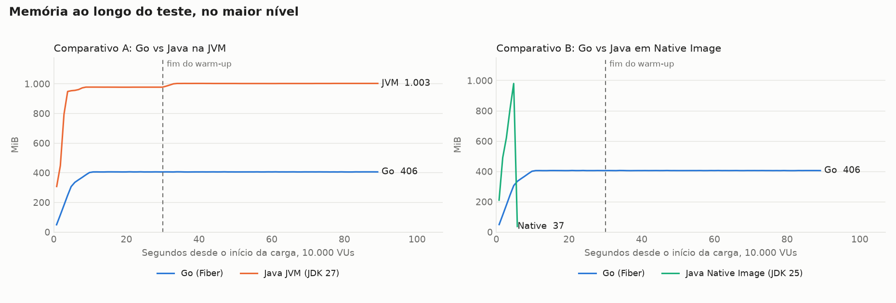
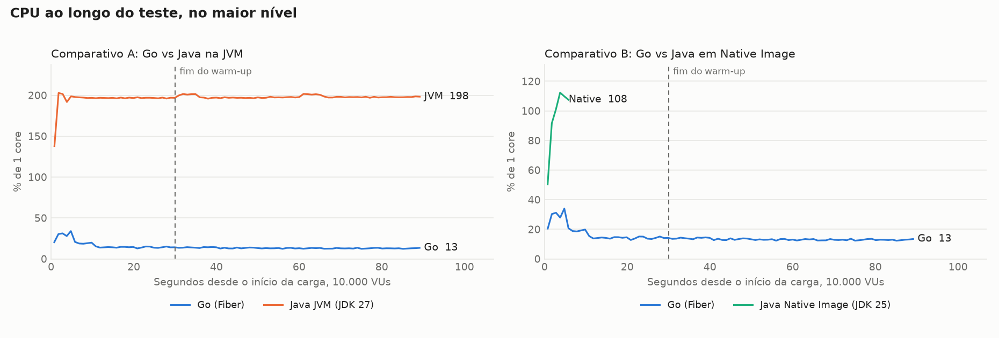

# Benchmark de I/O: Java com virtual threads vs Go com Fiber

Cada requisição chama uma API externa com 5s de latência fixa e devolve a resposta, sem trabalho de CPU no handler. Os valores são a **mediana das repetições**, restritos à janela medida (sem warm-up). CPU em % de 1 core, com máximo de 200%. O Native Image usa JDK 25, e a variante JVM usa JDK 27.

## Ambiente

| Item | Valor |
|---|---|
| CPU | 16 vCPU, x86_64 |
| Memória | 30,8 GiB |
| Sistema operacional | Ubuntu 24.04.5 LTS, kernel 7.0.0-1014-aws |
| Docker | 29.9.2 |
| Níveis de VUs | 10000 |
| Repetições | 1 |
| Warm-up e janela medida | 30s e 60s |
| Execuções de startup | 1 |

## Startup

| Alvo | Pronto, mediana (ms) | Pronto, p90 (ms) | Autodeclarado (ms) | 1ª requisição (ms além dos 5s) | Memória parada (MiB) | Imagem (MB) | Execuções |
|---|---|---|---|---|---|---|---|
| Go (Fiber) | 140 | 140 | 0 | 2,7 | 3,0 | 20,3 | 1 |
| Java JVM (JDK 27) | 2.427 | 2.427 | 2.237 | 101,6 | 199,5 | 512,6 | 1 |
| Java Native Image (JDK 25) | 171 | 171 | 43 | 8,1 | 20,9 | 131,2 | 1 |

O tempo até ficar pronto é medido de fora, do start do container até o primeiro `/health` com 200, e inclui o custo do Docker. O tempo autodeclarado do Go parte de uma variável de pacote e não inclui o início do runtime, por isso não é comparável ao do Java.

## Comparativo A: Go vs Java na JVM

### Latência e throughput

| VUs | Alvo | req/s real | req/s ideal | Erros | p50 (ms) | p90 (ms) | p99 (ms) | max (ms) | Overhead p99 (ms) |
|---|---|---|---|---|---|---|---|---|---|
| 10.000 | Go (Fiber) | 1.999,4 | 2.000 | 0 (0,00%) | 5.001,1 | 5.001,6 | 5.002,1 | 5.010,4 | 2,1 |
| 10.000 | Java JVM (JDK 27) | 0,0 | 2.000 | 20.000 (100,00%) | - | - | - | - | - |

### Memória e CPU

| VUs | Alvo | Memória parada (MiB) | Memória média (MiB) | Memória pico (MiB) | CPU média (%) | CPU pico (%) | CPU-s por 1.000 req | OOM kill | OOM de heap |
|---|---|---|---|---|---|---|---|---|---|
| 10.000 | Go (Fiber) | 3,0 | 405,9 | 406,5 | 13,2 | 14,5 | 0,063 | 0 | 0 |
| 10.000 | Java JVM (JDK 27) | 199,5 | 1.001,9 | 1.002,8 | 198,0 | 201,6 | - | 0 | 1 |

## Comparativo B: Go vs Java em Native Image

### Latência e throughput

| VUs | Alvo | req/s real | req/s ideal | Erros | p50 (ms) | p90 (ms) | p99 (ms) | max (ms) | Overhead p99 (ms) |
|---|---|---|---|---|---|---|---|---|---|
| 10.000 | Go (Fiber) | 1.999,4 | 2.000 | 0 (0,00%) | 5.001,1 | 5.001,6 | 5.002,1 | 5.010,4 | 2,1 |
| 10.000 | Java Native Image (JDK 25) | 0,0 | 2.000 | 20.416 (100,00%) | - | - | - | - | - |

### Memória e CPU

| VUs | Alvo | Memória parada (MiB) | Memória média (MiB) | Memória pico (MiB) | CPU média (%) | CPU pico (%) | CPU-s por 1.000 req | OOM kill | OOM de heap |
|---|---|---|---|---|---|---|---|---|---|
| 10.000 | Go (Fiber) | 3,0 | 405,9 | 406,5 | 13,2 | 14,5 | 0,063 | 0 | 0 |
| 10.000 | Java Native Image (JDK 25) | 20,9 | - | - | - | - | - | 1 | 1 |

## Gráficos

## Sanidade do ambiente

8 ocorrências:

| Rodada | Ocorrência |
|---|---|
| JVM 10.000 VUs, rep 1 | 20.000 erros (100,00%), 20.000 de transporte |
| JVM 10.000 VUs, rep 1 | throughput de 0,0 req/s, abaixo de 95% do ideal (2.000) |
| JVM 10.000 VUs, rep 1 | `OutOfMemoryError` no log do alvo (heap esgotado) |
| Native 10.000 VUs, rep 1 | 20.416 erros (100,00%), 20.416 de transporte |
| Native 10.000 VUs, rep 1 | throughput de 0,0 req/s, abaixo de 95% do ideal (2.000) |
| Native 10.000 VUs, rep 1 | alvo encerrado pelo kernel por falta de memória (OOM kill) |
| Native 10.000 VUs, rep 1 | `OutOfMemoryError` no log do alvo (heap esgotado) |
| Native 10.000 VUs, rep 1 | coleta incompleta: 0 amostras em 60s |

### Consumo de mock-api e k6 por rodada

| VUs | Alvo | Rep | mock-api CPU média (%) | mock-api CPU pico (%) | k6 CPU média (%) | k6 CPU pico (%) | k6 memória pico (MiB) |
|---|---|---|---|---|---|---|---|
| 10.000 | Go | 1 | 16,5 | 25,2 | 37,2 | 196,2 | 2.546 |
| 10.000 | JVM | 1 | 0,0 | 0,0 | 11,6 | 128,2 | 2.156 |
| 10.000 | Native | 1 | 0,0 | 0,0 | 3,7 | 95,4 | 2.177 |

## Todas as rodadas

| VUs | Alvo | Rep | Requisições | req/s | Erros | p50 (ms) | p99 (ms) | max (ms) | Mem. média (MiB) | Mem. pico (MiB) | CPU média (%) | CPU-s/1.000 | Blocked p99 (ms) | Blocked max (ms) | OOM |
|---|---|---|---|---|---|---|---|---|---|---|---|---|---|---|---|
| 10.000 | Go | 1 | 119.963 | 1.999,4 | 0 | 5.001,1 | 5.002,1 | 5.010,4 | 405,9 | 406,5 | 13,2 | 0,063 | 0,1 | 60,4 | não |
| 10.000 | JVM | 1 | 20.000 | 0,0 | 20.000 | - | - | - | 1.001,9 | 1.002,8 | 198,0 | - | 0,4 | 159,9 | heap |
| 10.000 | Native | 1 | 20.416 | 0,0 | 20.416 | - | - | - | - | - | - | - | 90,7 | 117,0 | kill |
