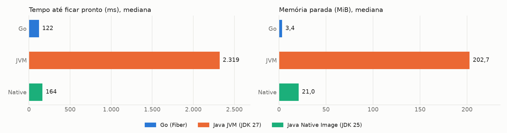
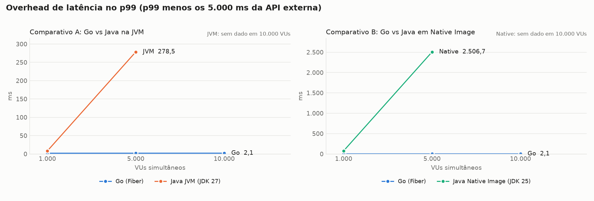
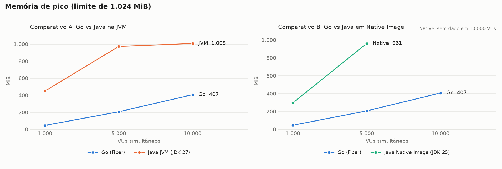
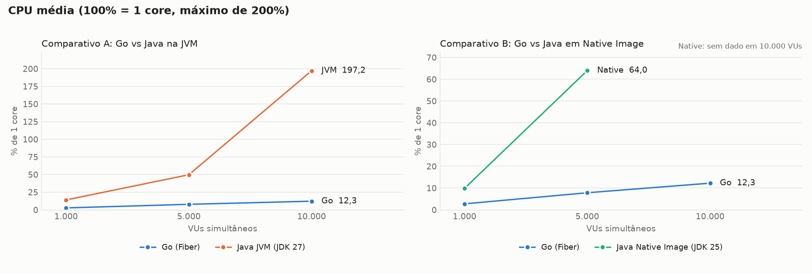
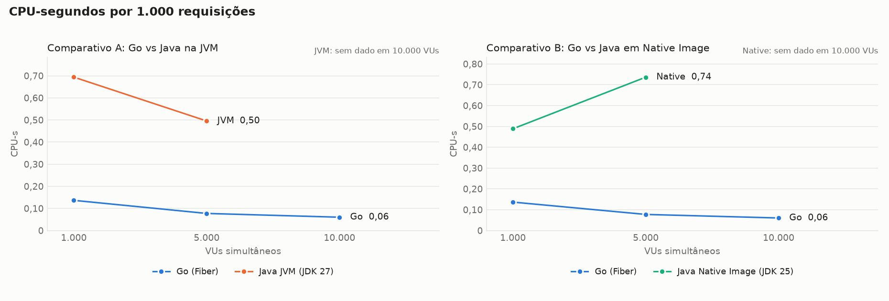
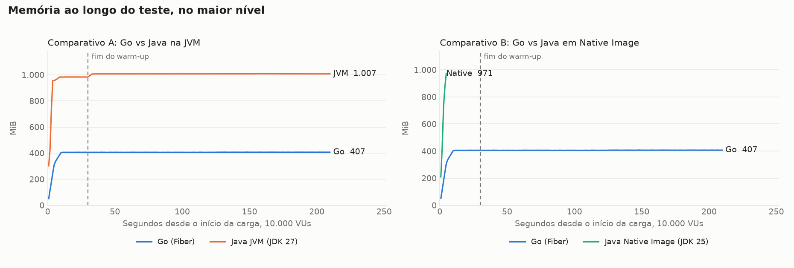
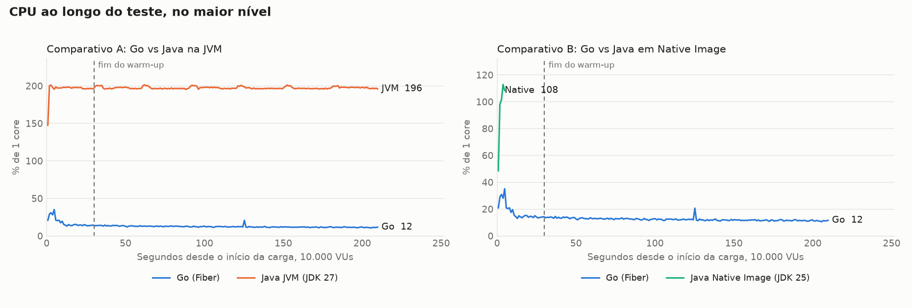

# Benchmark de I/O: Java com virtual threads vs Go com Fiber

Cada requisição chama uma API externa com 5s de latência fixa e devolve a resposta, sem trabalho de CPU no handler. Os valores são a **mediana das repetições**, restritos à janela medida (sem warm-up). CPU em % de 1 core, com máximo de 200%. CPU-s por 1.000 requisições conta só respostas 200. O traço indica ausência de dado: nenhuma resposta 200 ou alvo já encerrado na janela. O Native Image usa JDK 25, e a variante JVM usa JDK 27.

## Ambiente

| Item | Valor |
|---|---|
| CPU | 16 vCPU, x86_64 |
| Memória | 30,8 GiB |
| Sistema operacional | Ubuntu 24.04.5 LTS, kernel 7.0.0-1014-aws |
| Docker | 29.9.2 |
| Níveis de VUs | 1000 5000 10000 |
| Repetições | 3 |
| Warm-up e janela medida | 30s e 180s |
| Execuções de startup | 10 |

## Análise

### Conclusões

- **Só o Go atendeu aos três níveis dentro de 2 vCPU e 1 GB.** Com 10.000 VUs, fez 1.999,6 de 2.000 req/s, sem erros, com overhead p99 de 2,1 ms e 407 MiB de pico. As duas variantes Java tiveram 100% de erros nesse nível, nas 3 repetições.
- **Com 1.000 VUs, os três entregaram o throughput ideal, e a diferença está no custo.** Memória de pico: Go 46 MiB, Native 297 MiB, JVM 450 MiB. CPU-s por 1.000 requisições: Go 0,137, Native 0,489, JVM 0,694. Overhead p99: Go 2,0 ms, JVM 8,2 ms, Native 76,0 ms.
- **Com 5.000 VUs, a JVM superou o Native Image em throughput, latência e CPU, com memória de pico equivalente.** A JVM fez 994,1 req/s (99,4% do ideal), com overhead p99 de 278,5 ms. O Native fez 866,6 req/s (86,7%), com overhead p99 de 2.506,7 ms. O Go fez 999,8 req/s, com overhead p99 de 2,0 ms e 207 MiB de pico, contra cerca de 970 MiB das duas variantes Java.
- **O Native Image ganha da JVM no startup e na memória parada.** Ficou pronto em 164 ms, contra 2.319 ms da JVM e 122 ms do Go. Parado, usa 21,0 MiB, contra 202,7 MiB da JVM e 3,4 MiB do Go.

### O que explica os resultados

- **Native com 5.000 VUs, abaixo de 95% do ideal e com 0 erros.** Rodadas de diagnóstico com log de GC mostram 47,8% do tempo em pausa, com Full GCs de cerca de 600 ms em sequência no Serial GC. Na JVM, com G1, foram 8,7%, com mediana de 18 ms. Como os VUs esperam a resposta antes de repetir, a latência maior reduz o throughput: 5.000 VUs / 5,67 s dá cerca de 880 req/s, próximo do medido. O host não é a causa: mock-api e k6 ficaram folgados, e sobraram mais de 26 GB livres.
- **Mais memória ajuda, mas não resolve.** Com 2 GB, só como contraprova, o Native fez 912,8 req/s, ainda abaixo de 95%, com 26,1% do tempo em pausa e 1.523 MiB de pico. Essa rodada não faz parte dos resultados. Ela indica que o Serial GC pesa além do tamanho do heap, mas uma única rodada de 60s não separa os dois efeitos.
- **Java com 10.000 VUs.** A memória esgota nos primeiros segundos de subida dos VUs, antes do fim do warm-up. A JVM passa de 900 MiB em cerca de 4s e não cai: registra `OutOfMemoryError`, permanece em cerca de 197% de CPU e não responde mais. O Native é encerrado pelo kernel por volta de 5s, nas 3 repetições, sem `OutOfMemoryError` no log. No teste de limite, feito à parte, ele registrou esse erro antes de ser encerrado. Por isso as tabelas não têm latência nem memória do Native nesse nível, e o gráfico de série temporal mostra a queda.

### Limites destas conclusões

- **Os resultados valem para este limite e estas configurações.** O fracasso do Java com 10.000 VUs é um resultado com 1 GB e sem ajuste de heap ou de buffers, e não mostra que ele não suporte essa carga com mais memória. A memória exigida com 10.000 VUs não foi medida.
- **O comparativo B mistura duas diferenças.** O Native Image usa JDK 25 e Serial GC, e a JVM usa JDK 27 e G1. Os dados não separam o efeito da versão do JDK do efeito do GC. A GraalVM CE não oferece G1.
- **A memória da JVM não é o mínimo necessário.** O G1 ocupa o heap disponível antes de coletar, então os cerca de 970 MiB com 5.000 VUs mostram o que ela usou, não o que precisaria.
- **O cenário é só de espera de I/O.** Não há trabalho de CPU no handler, nem TLS, serialização ou acesso a banco.
- **O tempo autodeclarado do Go (0 ms) não é comparável.** Ele não inclui o início do runtime. Use o tempo até ficar pronto.

### Rodadas e anomalias

- **Rodada completa:** 27 rodadas, nenhuma repetida ou descartada. Na janela medida, mock-api e k6 ficaram abaixo de 320% de CPU, e a memória disponível no host nunca ficou abaixo de 26 GB. Fora da janela, o k6 teve uma única amostra de 370%, em Native com 10.000 VUs, rep 2, cerca de 1s depois de o alvo cair. Como o alvo já estava encerrado, isso não afeta o resultado.
- **OOMs:** 3 OOM kills no Native e 3 execuções com `OutOfMemoryError` de heap na JVM, todos com 10.000 VUs.
- **Rodadas à parte:** validação, teste de limite e diagnósticos estão em diretórios separados e não entram nas medianas. Os diagnósticos estão em `diagnosticos/`.

## Startup

| Alvo | Pronto, mediana (ms) | Pronto, p90 (ms) | Autodeclarado (ms) | 1ª requisição (ms além dos 5s) | Memória parada (MiB) | Imagem (MB) | Execuções |
|---|---|---|---|---|---|---|---|
| Go (Fiber) | 122 | 126 | 0 | 6,0 | 3,4 | 20,3 | 10 |
| Java JVM (JDK 27) | 2.319 | 2.374 | 2.137 | 105,0 | 202,7 | 512,6 | 10 |
| Java Native Image (JDK 25) | 164 | 167 | 43 | 8,2 | 21,0 | 131,2 | 10 |

O tempo até ficar pronto é medido de fora, do start do container até o primeiro `/health` com 200, e inclui o custo do Docker. O tempo autodeclarado do Go parte de uma variável de pacote e não inclui o início do runtime, por isso não é comparável ao do Java.

## Comparativo A: Go vs Java na JVM

### Latência e throughput

| VUs | Alvo | req/s real | req/s ideal | Erros | p50 (ms) | p90 (ms) | p99 (ms) | max (ms) | Overhead p99 (ms) |
|---|---|---|---|---|---|---|---|---|---|
| 1.000 | Go (Fiber) | 200,0 | 200 | 0 (0,00%) | 5.001,2 | 5.001,7 | 5.002,0 | 5.002,5 | 2,0 |
| 1.000 | Java JVM (JDK 27) | 199,9 | 200 | 0 (0,00%) | 5.002,1 | 5.002,7 | 5.008,2 | 5.031,8 | 8,2 |
| 5.000 | Go (Fiber) | 999,8 | 1.000 | 0 (0,00%) | 5.001,2 | 5.001,7 | 5.002,0 | 5.009,2 | 2,0 |
| 5.000 | Java JVM (JDK 27) | 994,1 | 1.000 | 0 (0,00%) | 5.004,3 | 5.061,5 | 5.278,5 | 5.323,8 | 278,5 |
| 10.000 | Go (Fiber) | 1.999,6 | 2.000 | 0 (0,00%) | 5.001,1 | 5.001,7 | 5.002,1 | 5.014,5 | 2,1 |
| 10.000 | Java JVM (JDK 27) | 0,0 | 2.000 | 60.000 (100,00%) | - | - | - | - | - |

### Memória e CPU

| VUs | Alvo | Memória parada (MiB) | Memória média (MiB) | Memória pico (MiB) | CPU média (%) | CPU pico (%) | CPU-s por 1.000 req | OOM kill | OOM de heap |
|---|---|---|---|---|---|---|---|---|---|
| 1.000 | Go (Fiber) | 3,4 | 45,7 | 46,4 | 2,8 | 3,6 | 0,137 | 0 | 0 |
| 1.000 | Java JVM (JDK 27) | 202,7 | 405,9 | 449,9 | 14,1 | 62,0 | 0,694 | 0 | 0 |
| 5.000 | Go (Fiber) | 3,4 | 206,0 | 207,2 | 7,9 | 12,0 | 0,077 | 0 | 0 |
| 5.000 | Java JVM (JDK 27) | 202,7 | 968,0 | 972,8 | 49,8 | 110,8 | 0,495 | 0 | 0 |
| 10.000 | Go (Fiber) | 3,4 | 406,2 | 407,3 | 12,3 | 19,7 | 0,060 | 0 | 0 |
| 10.000 | Java JVM (JDK 27) | 202,7 | 1.007,1 | 1.007,9 | 197,2 | 201,0 | - | 0 | 3 |

## Comparativo B: Go vs Java em Native Image

### Latência e throughput

| VUs | Alvo | req/s real | req/s ideal | Erros | p50 (ms) | p90 (ms) | p99 (ms) | max (ms) | Overhead p99 (ms) |
|---|---|---|---|---|---|---|---|---|---|
| 1.000 | Go (Fiber) | 200,0 | 200 | 0 (0,00%) | 5.001,2 | 5.001,7 | 5.002,0 | 5.002,5 | 2,0 |
| 1.000 | Java Native Image (JDK 25) | 199,9 | 200 | 0 (0,00%) | 5.002,4 | 5.005,0 | 5.076,0 | 5.188,9 | 76,0 |
| 5.000 | Go (Fiber) | 999,8 | 1.000 | 0 (0,00%) | 5.001,2 | 5.001,7 | 5.002,0 | 5.009,2 | 2,0 |
| 5.000 | Java Native Image (JDK 25) | 866,6 | 1.000 | 0 (0,00%) | 5.671,3 | 6.348,3 | 7.506,7 | 8.211,8 | 2.506,7 |
| 10.000 | Go (Fiber) | 1.999,6 | 2.000 | 0 (0,00%) | 5.001,1 | 5.001,7 | 5.002,1 | 5.014,5 | 2,1 |
| 10.000 | Java Native Image (JDK 25) | 0,0 | 2.000 | 61.582 (100,00%) | - | - | - | - | - |

### Memória e CPU

| VUs | Alvo | Memória parada (MiB) | Memória média (MiB) | Memória pico (MiB) | CPU média (%) | CPU pico (%) | CPU-s por 1.000 req | OOM kill | OOM de heap |
|---|---|---|---|---|---|---|---|---|---|
| 1.000 | Go (Fiber) | 3,4 | 45,7 | 46,4 | 2,8 | 3,6 | 0,137 | 0 | 0 |
| 1.000 | Java Native Image (JDK 25) | 21,0 | 261,9 | 297,0 | 9,9 | 27,8 | 0,489 | 0 | 0 |
| 5.000 | Go (Fiber) | 3,4 | 206,0 | 207,2 | 7,9 | 12,0 | 0,077 | 0 | 0 |
| 5.000 | Java Native Image (JDK 25) | 21,0 | 891,8 | 960,8 | 64,0 | 123,4 | 0,736 | 0 | 0 |
| 10.000 | Go (Fiber) | 3,4 | 406,2 | 407,3 | 12,3 | 19,7 | 0,060 | 0 | 0 |
| 10.000 | Java Native Image (JDK 25) | 21,0 | - | - | - | - | - | 3 | 0 |

## Gráficos

## Sanidade do ambiente

24 ocorrências:

| Rodada | Ocorrência |
|---|---|
| JVM 10.000 VUs, rep 1 | 60.000 erros (100,00%), 60.000 de transporte |
| JVM 10.000 VUs, rep 1 | throughput de 0,0 req/s, abaixo de 95% do ideal (2.000) |
| JVM 10.000 VUs, rep 1 | `OutOfMemoryError` no log do alvo (heap esgotado) |
| JVM 10.000 VUs, rep 2 | 60.000 erros (100,00%), 60.000 de transporte |
| JVM 10.000 VUs, rep 2 | throughput de 0,0 req/s, abaixo de 95% do ideal (2.000) |
| JVM 10.000 VUs, rep 2 | `OutOfMemoryError` no log do alvo (heap esgotado) |
| JVM 10.000 VUs, rep 3 | 60.000 erros (100,00%), 60.000 de transporte |
| JVM 10.000 VUs, rep 3 | throughput de 0,0 req/s, abaixo de 95% do ideal (2.000) |
| JVM 10.000 VUs, rep 3 | `OutOfMemoryError` no log do alvo (heap esgotado) |
| Native 10.000 VUs, rep 1 | 61.570 erros (100,00%), 61.570 de transporte |
| Native 10.000 VUs, rep 1 | throughput de 0,0 req/s, abaixo de 95% do ideal (2.000) |
| Native 10.000 VUs, rep 1 | alvo encerrado pelo kernel por falta de memória (OOM kill) |
| Native 10.000 VUs, rep 1 | coleta incompleta: 0 amostras em 180s |
| Native 10.000 VUs, rep 2 | 61.810 erros (100,00%), 61.810 de transporte |
| Native 10.000 VUs, rep 2 | throughput de 0,0 req/s, abaixo de 95% do ideal (2.000) |
| Native 10.000 VUs, rep 2 | alvo encerrado pelo kernel por falta de memória (OOM kill) |
| Native 10.000 VUs, rep 2 | coleta incompleta: 0 amostras em 180s |
| Native 10.000 VUs, rep 3 | 61.582 erros (100,00%), 61.582 de transporte |
| Native 10.000 VUs, rep 3 | throughput de 0,0 req/s, abaixo de 95% do ideal (2.000) |
| Native 10.000 VUs, rep 3 | alvo encerrado pelo kernel por falta de memória (OOM kill) |
| Native 10.000 VUs, rep 3 | coleta incompleta: 0 amostras em 180s |
| Native 5.000 VUs, rep 1 | throughput de 825,2 req/s, abaixo de 95% do ideal (1.000) |
| Native 5.000 VUs, rep 2 | throughput de 866,6 req/s, abaixo de 95% do ideal (1.000) |
| Native 5.000 VUs, rep 3 | throughput de 874,4 req/s, abaixo de 95% do ideal (1.000) |

### Consumo de mock-api e k6 por rodada

| VUs | Alvo | Rep | mock-api CPU média (%) | mock-api CPU pico (%) | k6 CPU média (%) | k6 CPU pico (%) | k6 memória pico (MiB) |
|---|---|---|---|---|---|---|---|
| 1.000 | Go | 1 | 4,1 | 5,5 | 5,4 | 21,9 | 302 |
| 1.000 | Go | 2 | 4,2 | 5,8 | 5,5 | 21,9 | 302 |
| 1.000 | Go | 3 | 4,1 | 5,5 | 5,4 | 21,1 | 302 |
| 1.000 | JVM | 1 | 3,5 | 5,2 | 5,1 | 21,3 | 302 |
| 1.000 | JVM | 2 | 3,7 | 5,4 | 5,2 | 19,0 | 302 |
| 1.000 | JVM | 3 | 3,4 | 5,1 | 5,0 | 21,4 | 302 |
| 1.000 | Native | 1 | 2,9 | 4,8 | 4,5 | 21,0 | 292 |
| 1.000 | Native | 2 | 2,6 | 4,8 | 4,3 | 21,4 | 303 |
| 1.000 | Native | 3 | 2,7 | 4,8 | 4,3 | 20,5 | 303 |
| 5.000 | Go | 1 | 10,3 | 15,9 | 20,4 | 101,5 | 1.480 |
| 5.000 | Go | 2 | 10,6 | 15,5 | 20,6 | 100,1 | 1.473 |
| 5.000 | Go | 3 | 10,4 | 15,4 | 20,4 | 99,1 | 1.471 |
| 5.000 | JVM | 1 | 5,3 | 12,0 | 14,3 | 95,7 | 1.443 |
| 5.000 | JVM | 2 | 5,3 | 11,5 | 14,4 | 99,4 | 1.452 |
| 5.000 | JVM | 3 | 5,4 | 15,8 | 14,4 | 99,9 | 1.446 |
| 5.000 | Native | 1 | 3,9 | 15,1 | 11,2 | 111,4 | 1.364 |
| 5.000 | Native | 2 | 4,0 | 12,0 | 11,6 | 101,0 | 1.431 |
| 5.000 | Native | 3 | 4,1 | 13,4 | 11,6 | 104,5 | 1.416 |
| 10.000 | Go | 1 | 14,9 | 25,0 | 33,1 | 197,5 | 2.924 |
| 10.000 | Go | 2 | 15,2 | 26,4 | 33,8 | 191,0 | 2.906 |
| 10.000 | Go | 3 | 15,2 | 26,3 | 33,6 | 193,9 | 2.932 |
| 10.000 | JVM | 1 | 0,1 | 6,3 | 9,2 | 197,9 | 2.433 |
| 10.000 | JVM | 2 | 0,1 | 6,3 | 8,3 | 94,7 | 2.406 |
| 10.000 | JVM | 3 | 0,1 | 8,1 | 8,3 | 101,1 | 2.406 |
| 10.000 | Native | 1 | 0,0 | 0,8 | 4,9 | 129,3 | 2.624 |
| 10.000 | Native | 2 | 0,0 | 1,0 | 5,0 | 249,4 | 2.692 |
| 10.000 | Native | 3 | 0,0 | 0,9 | 5,2 | 289,6 | 2.796 |

## Todas as rodadas

| VUs | Alvo | Rep | Requisições | req/s | Erros | p50 (ms) | p99 (ms) | max (ms) | Mem. média (MiB) | Mem. pico (MiB) | CPU média (%) | CPU-s/1.000 | Blocked p99 (ms) | Blocked max (ms) | OOM |
|---|---|---|---|---|---|---|---|---|---|---|---|---|---|---|---|
| 1.000 | Go | 1 | 35.993 | 200,0 | 0 | 5.001,2 | 5.002,0 | 5.002,5 | 45,6 | 46,4 | 2,7 | 0,133 | 0,2 | 10,9 | não |
| 1.000 | Go | 2 | 35.994 | 200,0 | 0 | 5.001,2 | 5.002,0 | 5.002,5 | 45,7 | 46,4 | 2,8 | 0,137 | 0,2 | 10,2 | não |
| 1.000 | Go | 3 | 35.989 | 199,9 | 0 | 5.001,2 | 5.002,0 | 5.002,5 | 45,7 | 46,5 | 2,8 | 0,137 | 0,2 | 7,4 | não |
| 1.000 | JVM | 1 | 35.979 | 199,9 | 0 | 5.002,1 | 5.014,5 | 5.031,8 | 399,5 | 446,8 | 14,0 | 0,688 | 0,1 | 5,3 | não |
| 1.000 | JVM | 2 | 35.981 | 199,9 | 0 | 5.002,1 | 5.005,0 | 5.027,4 | 408,1 | 451,2 | 14,2 | 0,696 | 0,2 | 9,5 | não |
| 1.000 | JVM | 3 | 35.995 | 200,0 | 0 | 5.002,1 | 5.008,2 | 5.038,0 | 405,9 | 449,9 | 14,1 | 0,694 | 0,1 | 9,9 | não |
| 1.000 | Native | 1 | 35.989 | 199,9 | 0 | 5.002,4 | 5.076,0 | 5.188,9 | 261,6 | 297,9 | 10,7 | 0,528 | 0,1 | 8,8 | não |
| 1.000 | Native | 2 | 35.988 | 199,9 | 0 | 5.002,4 | 5.075,8 | 5.186,2 | 261,9 | 297,0 | 9,7 | 0,479 | 0,1 | 9,4 | não |
| 1.000 | Native | 3 | 35.978 | 199,9 | 0 | 5.002,5 | 5.077,3 | 5.195,3 | 261,9 | 295,0 | 9,9 | 0,489 | 0,2 | 12,8 | não |
| 5.000 | Go | 1 | 179.961 | 999,8 | 0 | 5.001,2 | 5.002,0 | 5.008,8 | 205,7 | 206,5 | 7,8 | 0,077 | 0,1 | 30,4 | não |
| 5.000 | Go | 2 | 179.961 | 999,8 | 0 | 5.001,2 | 5.002,0 | 5.009,4 | 206,4 | 207,2 | 8,0 | 0,078 | 0,1 | 28,0 | não |
| 5.000 | Go | 3 | 179.961 | 999,8 | 0 | 5.001,1 | 5.002,0 | 5.009,2 | 206,0 | 207,2 | 7,9 | 0,077 | 0,1 | 21,3 | não |
| 5.000 | JVM | 1 | 179.056 | 994,8 | 0 | 5.004,6 | 5.277,1 | 5.310,2 | 985,7 | 987,8 | 50,0 | 0,495 | 0,1 | 29,5 | não |
| 5.000 | JVM | 2 | 178.939 | 994,1 | 0 | 5.004,3 | 5.279,8 | 5.323,8 | 968,0 | 972,8 | 49,8 | 0,492 | 0,1 | 27,2 | não |
| 5.000 | JVM | 3 | 178.368 | 990,9 | 0 | 5.004,3 | 5.278,5 | 5.336,1 | 964,9 | 970,4 | 49,7 | 0,497 | 0,1 | 25,9 | não |
| 5.000 | Native | 1 | 148.533 | 825,2 | 0 | 5.761,7 | 8.033,6 | 9.069,3 | 887,3 | 962,6 | 64,0 | 0,769 | 0,1 | 30,6 | não |
| 5.000 | Native | 2 | 155.983 | 866,6 | 0 | 5.671,3 | 7.450,6 | 8.110,0 | 893,1 | 960,8 | 63,5 | 0,725 | 0,1 | 19,0 | não |
| 5.000 | Native | 3 | 157.385 | 874,4 | 0 | 5.654,7 | 7.506,7 | 8.211,8 | 891,8 | 960,6 | 65,2 | 0,736 | 0,1 | 30,9 | não |
| 10.000 | Go | 1 | 359.920 | 1.999,6 | 0 | 5.001,1 | 5.002,1 | 5.014,5 | 407,0 | 408,2 | 12,0 | 0,059 | 0,1 | 52,5 | não |
| 10.000 | Go | 2 | 359.927 | 1.999,6 | 0 | 5.001,1 | 5.002,1 | 5.015,0 | 406,2 | 407,3 | 12,3 | 0,060 | 0,1 | 58,1 | não |
| 10.000 | Go | 3 | 359.935 | 1.999,6 | 0 | 5.001,1 | 5.002,1 | 5.013,7 | 406,0 | 407,3 | 12,3 | 0,060 | 0,1 | 68,5 | não |
| 10.000 | JVM | 1 | 60.000 | 0,0 | 60.000 | - | - | - | 1.000,7 | 1.001,2 | 196,0 | - | 0,3 | 65,3 | heap |
| 10.000 | JVM | 2 | 60.000 | 0,0 | 60.000 | - | - | - | 1.009,1 | 1.009,9 | 197,2 | - | 0,3 | 56,8 | heap |
| 10.000 | JVM | 3 | 60.000 | 0,0 | 60.000 | - | - | - | 1.007,1 | 1.007,9 | 197,4 | - | 0,3 | 61,6 | heap |
| 10.000 | Native | 1 | 61.570 | 0,0 | 61.570 | - | - | - | - | - | - | - | 0,4 | 153,7 | kill |
| 10.000 | Native | 2 | 61.810 | 0,0 | 61.810 | - | - | - | - | - | - | - | 91,0 | 117,2 | kill |
| 10.000 | Native | 3 | 61.582 | 0,0 | 61.582 | - | - | - | - | - | - | - | 53,2 | 119,9 | kill |
