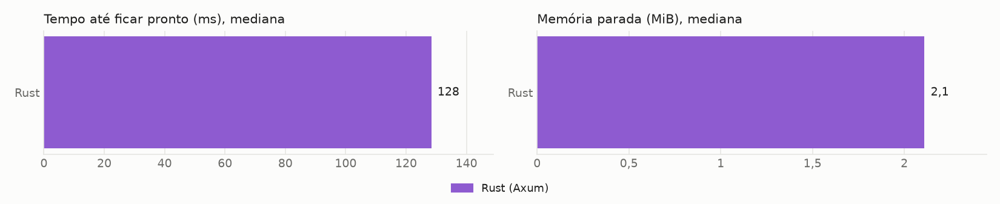

# Benchmark de I/O: Java com virtual threads, Go com Fiber e Rust com Axum

**Carga por VUs:** o nível é o número de usuários virtuais simultâneos.

Cada requisição chama uma API externa com 5s de latência fixa e devolve a resposta, sem trabalho de CPU no handler. Os valores são a **mediana das repetições**, restritos à janela medida (sem warm-up). CPU em % de 1 core, com máximo de 200%. CPU-s por 1.000 requisições conta só respostas 200. O traço indica ausência de dado: nenhuma resposta 200 ou alvo já encerrado na janela. O Native Image usa JDK 25, e a variante JVM usa JDK 27, quando presentes nesta rodada.

## Ambiente

| Item | Valor |
|---|---|
| CPU | 16 vCPU, x86_64 |
| Memória | 30,8 GiB |
| Sistema operacional | Ubuntu 24.04.5 LTS, kernel 7.0.0-1014-aws |
| Docker | 29.9.2 |
| Níveis de VUs | 10000 |
| Repetições | 1 |
| Warm-up e janela medida | 30s e 60s |
| Execuções de startup | 1 |

## Startup

| Alvo | Pronto, mediana (ms) | Pronto, p90 (ms) | Autodeclarado (ms) | 1ª requisição (ms além dos 5s) | Memória parada (MiB) | Imagem (MB) | Execuções |
|---|---|---|---|---|---|---|---|
| Rust (Axum) | 128 | 128 | 0 | 6,9 | 2,1 | 40,4 | 1 |

O tempo até ficar pronto é medido de fora, do start do container até o primeiro `/health` com 200, e inclui o custo do Docker. Os tempos autodeclarados do Go e do Rust partem do código do programa e não incluem o início do runtime, por isso não são comparáveis ao do Java.

## Gráficos

## Sanidade do ambiente

Sem ocorrências: nenhuma saturação de mock-api ou k6, nenhum erro, nenhum OOM e throughput sempre acima de 95% do ideal.

### Consumo de mock-api e k6 por rodada

| Nível | Alvo | Rep | mock-api CPU média (%) | mock-api CPU pico (%) | k6 CPU média (%) | k6 CPU pico (%) | k6 memória pico (MiB) |
|---|---|---|---|---|---|---|---|
| 10.000 | Rust | 1 | 16,2 | 24,8 | 36,9 | 191,9 | 2.548 |

## Todas as rodadas

| Nível | Alvo | Rep | Requisições | req/s | Erros | p50 (ms) | p99 (ms) | max (ms) | Mem. média (MiB) | Mem. pico (MiB) | CPU média (%) | CPU-s/1.000 | Blocked p99 (ms) | Blocked max (ms) | OOM |
|---|---|---|---|---|---|---|---|---|---|---|---|---|---|---|---|
| 10.000 | Rust | 1 | 119.976 | 1.999,6 | 0 | 5.001,2 | 5.002,2 | 5.014,5 | 528,1 | 551,2 | 16,4 | 0,079 | 0,1 | 57,3 | não |
