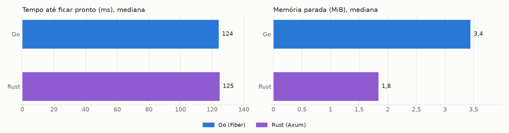
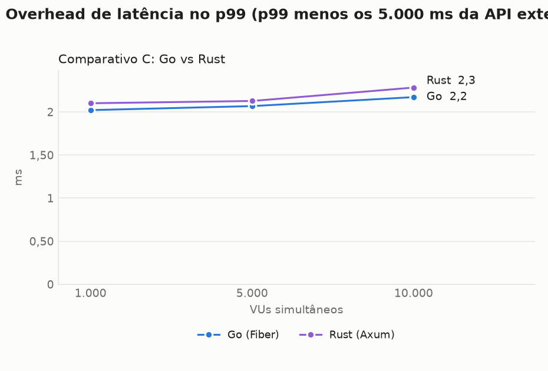
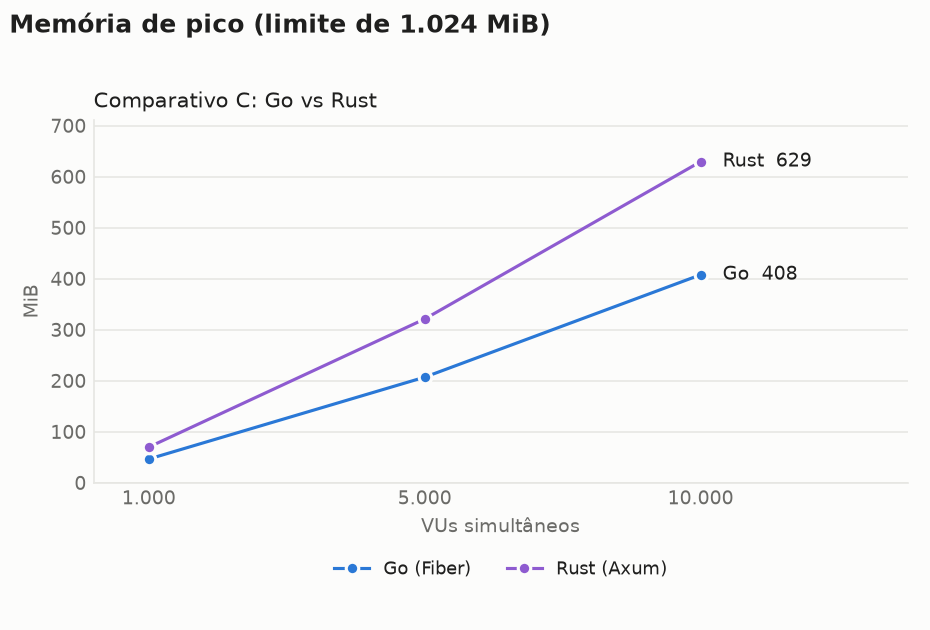
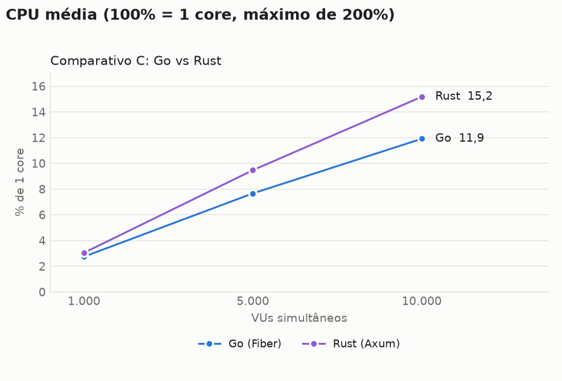
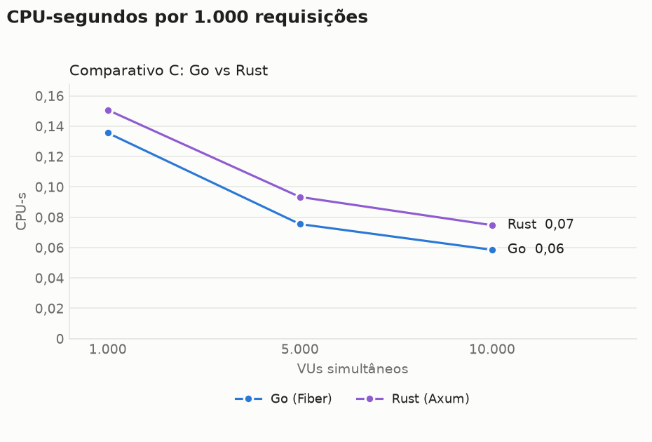
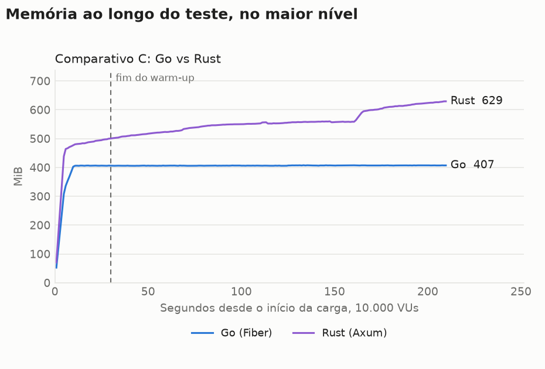
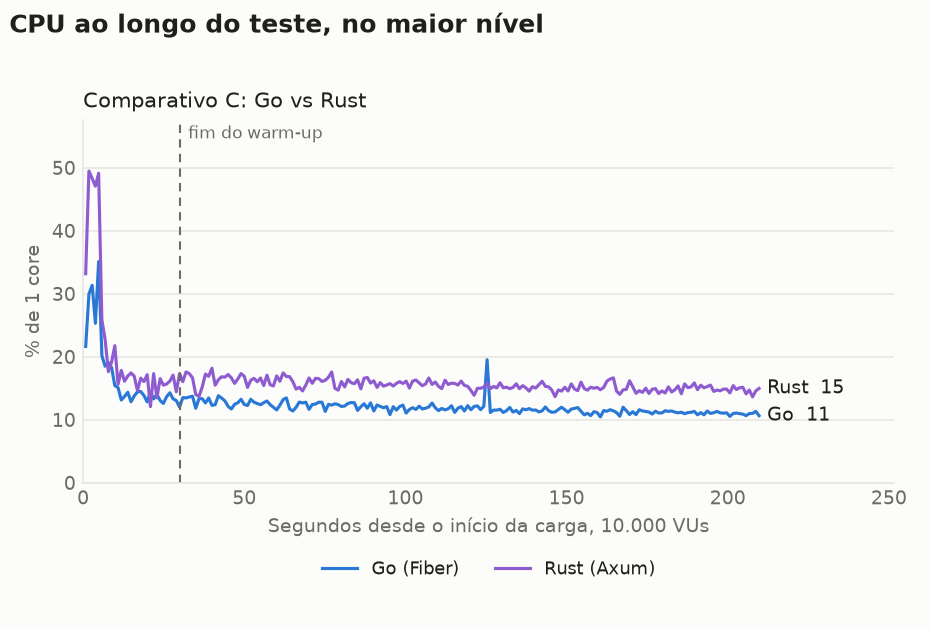

# Benchmark de I/O: Java com virtual threads, Go com Fiber e Rust com Axum

Cada requisição chama uma API externa com 5s de latência fixa e devolve a resposta, sem trabalho de CPU no handler. Os valores são a **mediana das repetições**, restritos à janela medida (sem warm-up). CPU em % de 1 core, com máximo de 200%. CPU-s por 1.000 requisições conta só respostas 200. O traço indica ausência de dado: nenhuma resposta 200 ou alvo já encerrado na janela. O Native Image usa JDK 25, e a variante JVM usa JDK 27, quando presentes nesta rodada.

## Ambiente

| Item | Valor |
|---|---|
| CPU | 16 vCPU, x86_64 |
| Memória | 30,8 GiB |
| Sistema operacional | Ubuntu 24.04.5 LTS, kernel 7.0.0-1014-aws |
| Docker | 29.9.2 |
| Níveis de VUs | 1000 5000 10000 |
| Repetições | 3 |
| Warm-up e janela medida | 30s e 180s |
| Execuções de startup | 10 |

## Análise

### Conclusões

- **Rust e Go atenderam aos três níveis dentro de 2 vCPU e 1 GB, com latência equivalente.** Com 10.000 VUs, o Rust fez 1.999,4 de 2.000 req/s e o Go 1.999,5, sem erros, com overhead p99 de 2,3 ms e 2,2 ms. Nos três níveis, a diferença de overhead p99 ficou em até 0,1 ms.
- **O Go gastou menos memória sob carga.** Pico com 1.000, 5.000 e 10.000 VUs: Go 46,5, 207,0 e 407,6 MiB; Rust 69,9, 321,0 e 629,4 MiB, cerca de 50% a mais.
- **O Go também gastou menos CPU.** CPU-s por 1.000 requisições com 1.000, 5.000 e 10.000 VUs: Go 0,136, 0,076 e 0,059; Rust 0,151, 0,093 e 0,075, de 11% a 27% a mais. Em valores absolutos a CPU é baixa: 15,2% de 1 core para o Rust com 10.000 VUs, contra 11,9% do Go.
- **O Rust usa menos memória parado, mas a imagem é maior.** Parado: 1,8 MiB, contra 3,4 MiB do Go. Imagem: 40,4 MB, contra 20,3 MB, porque usa `distroless/cc`, e o Go, `distroless/static`. O tempo até ficar pronto empatou: 125 ms e 124 ms.

### Limites destas conclusões

- **O resultado compara stacks, não linguagens.** O Go usa fasthttp nos dois lados, biblioteca voltada a reaproveitar buffers. O Rust usa Axum, hyper e reqwest, com o alocador padrão da glibc e sem ajuste de buffers, de alocador ou de LTO. A causa da diferença de memória e CPU não foi investigada. Outro cliente HTTP ou outro alocador pode mudar esses números.
- **O cenário é só de espera de I/O.** Não há trabalho de CPU no handler, nem TLS, serialização ou acesso a banco.
- **Os tempos autodeclarados do Go e do Rust (0 ms) não são comparáveis.** Use o tempo até ficar pronto.
- **O Java não foi executado nesta rodada.** A comparação com ele usa a rodada `20261102-005118`, na mesma máquina. O Go, repetido como controle, ficou próximo daquela rodada: 124 ms e 122 ms até ficar pronto, 407,6 MiB e 407,3 MiB de pico com 10.000 VUs, 2,2 ms e 2,1 ms de overhead p99.

### Rodadas e anomalias

- **Rodada completa:** 18 rodadas, nenhuma repetida ou descartada, sem erros e sem OOM. Mock-api e k6 ficaram abaixo de 320% de CPU: o maior pico foi de 206,5%, no k6. A memória disponível no host não ficou abaixo de 25,7 GiB.
- **Rodadas à parte:** a validação `20261102-172609` e o teste de limite `20261102-172853` não entram nas medianas. Um reinício do ambiente interrompeu a validação depois da carga, por isso ela não tem relatório.

## Startup

| Alvo | Pronto, mediana (ms) | Pronto, p90 (ms) | Autodeclarado (ms) | 1ª requisição (ms além dos 5s) | Memória parada (MiB) | Imagem (MB) | Execuções |
|---|---|---|---|---|---|---|---|
| Go (Fiber) | 124 | 132 | 0 | 6,2 | 3,4 | 20,3 | 10 |
| Rust (Axum) | 125 | 128 | 0 | 6,3 | 1,8 | 40,4 | 10 |

O tempo até ficar pronto é medido de fora, do start do container até o primeiro `/health` com 200, e inclui o custo do Docker. Os tempos autodeclarados do Go e do Rust partem do código do programa e não incluem o início do runtime, por isso não são comparáveis ao do Java.

## Comparativo C: Go vs Rust

### Latência e throughput

| VUs | Alvo | req/s real | req/s ideal | Erros | p50 (ms) | p90 (ms) | p99 (ms) | max (ms) | Overhead p99 (ms) |
|---|---|---|---|---|---|---|---|---|---|
| 1.000 | Go (Fiber) | 199,9 | 200 | 0 (0,00%) | 5.001,3 | 5.001,7 | 5.002,0 | 5.002,5 | 2,0 |
| 1.000 | Rust (Axum) | 199,9 | 200 | 0 (0,00%) | 5.001,3 | 5.001,8 | 5.002,1 | 5.002,6 | 2,1 |
| 5.000 | Go (Fiber) | 999,8 | 1.000 | 0 (0,00%) | 5.001,2 | 5.001,7 | 5.002,1 | 5.009,1 | 2,1 |
| 5.000 | Rust (Axum) | 999,7 | 1.000 | 0 (0,00%) | 5.001,2 | 5.001,8 | 5.002,1 | 5.008,9 | 2,1 |
| 10.000 | Go (Fiber) | 1.999,5 | 2.000 | 0 (0,00%) | 5.001,1 | 5.001,7 | 5.002,2 | 5.014,2 | 2,2 |
| 10.000 | Rust (Axum) | 1.999,4 | 2.000 | 0 (0,00%) | 5.001,2 | 5.001,8 | 5.002,3 | 5.014,3 | 2,3 |

### Memória e CPU

| VUs | Alvo | Memória parada (MiB) | Memória média (MiB) | Memória pico (MiB) | CPU média (%) | CPU pico (%) | CPU-s por 1.000 req | OOM kill | OOM de heap |
|---|---|---|---|---|---|---|---|---|---|
| 1.000 | Go (Fiber) | 3,4 | 45,7 | 46,5 | 2,7 | 3,5 | 0,136 | 0 | 0 |
| 1.000 | Rust (Axum) | 1,8 | 63,3 | 69,9 | 3,0 | 3,8 | 0,151 | 0 | 0 |
| 5.000 | Go (Fiber) | 3,4 | 206,1 | 207,0 | 7,7 | 11,1 | 0,076 | 0 | 0 |
| 5.000 | Rust (Axum) | 1,8 | 285,2 | 321,0 | 9,5 | 11,2 | 0,093 | 0 | 0 |
| 10.000 | Go (Fiber) | 3,4 | 406,5 | 407,6 | 11,9 | 19,6 | 0,059 | 0 | 0 |
| 10.000 | Rust (Axum) | 1,8 | 560,5 | 629,4 | 15,2 | 17,9 | 0,075 | 0 | 0 |

## Gráficos

## Sanidade do ambiente

Sem ocorrências: nenhuma saturação de mock-api ou k6, nenhum erro, nenhum OOM e throughput sempre acima de 95% do ideal.

### Consumo de mock-api e k6 por rodada

| VUs | Alvo | Rep | mock-api CPU média (%) | mock-api CPU pico (%) | k6 CPU média (%) | k6 CPU pico (%) | k6 memória pico (MiB) |
|---|---|---|---|---|---|---|---|
| 1.000 | Go | 1 | 4,1 | 5,4 | 5,9 | 25,1 | 302 |
| 1.000 | Go | 2 | 4,0 | 5,9 | 5,8 | 21,8 | 301 |
| 1.000 | Go | 3 | 3,9 | 5,5 | 5,6 | 22,2 | 302 |
| 1.000 | Rust | 1 | 4,0 | 5,5 | 5,8 | 21,4 | 302 |
| 1.000 | Rust | 2 | 4,0 | 5,6 | 5,8 | 22,1 | 302 |
| 1.000 | Rust | 3 | 3,9 | 5,3 | 5,8 | 22,9 | 301 |
| 5.000 | Go | 1 | 10,3 | 14,8 | 20,6 | 100,6 | 1.479 |
| 5.000 | Go | 2 | 10,1 | 15,6 | 20,3 | 100,4 | 1.474 |
| 5.000 | Go | 3 | 10,1 | 14,9 | 20,3 | 100,7 | 1.469 |
| 5.000 | Rust | 1 | 9,9 | 15,7 | 20,1 | 102,2 | 1.472 |
| 5.000 | Rust | 2 | 9,9 | 16,4 | 20,2 | 104,7 | 1.473 |
| 5.000 | Rust | 3 | 9,8 | 15,6 | 19,4 | 99,8 | 1.477 |
| 10.000 | Go | 1 | 15,0 | 25,2 | 34,0 | 201,2 | 2.926 |
| 10.000 | Go | 2 | 14,7 | 24,7 | 33,7 | 206,5 | 2.929 |
| 10.000 | Go | 3 | 14,6 | 25,6 | 33,2 | 201,8 | 2.907 |
| 10.000 | Rust | 1 | 14,2 | 24,1 | 32,7 | 199,9 | 2.903 |
| 10.000 | Rust | 2 | 14,7 | 24,8 | 33,5 | 200,8 | 2.917 |
| 10.000 | Rust | 3 | 14,5 | 23,7 | 33,0 | 200,7 | 2.918 |

## Todas as rodadas

| VUs | Alvo | Rep | Requisições | req/s | Erros | p50 (ms) | p99 (ms) | max (ms) | Mem. média (MiB) | Mem. pico (MiB) | CPU média (%) | CPU-s/1.000 | Blocked p99 (ms) | Blocked max (ms) | OOM |
|---|---|---|---|---|---|---|---|---|---|---|---|---|---|---|---|
| 1.000 | Go | 1 | 35.986 | 199,9 | 0 | 5.001,3 | 5.002,0 | 5.002,5 | 45,8 | 46,6 | 2,8 | 0,137 | 0,2 | 8,1 | não |
| 1.000 | Go | 2 | 35.986 | 199,9 | 0 | 5.001,3 | 5.002,1 | 5.002,5 | 45,7 | 46,5 | 2,7 | 0,136 | 0,2 | 14,0 | não |
| 1.000 | Go | 3 | 35.991 | 199,9 | 0 | 5.001,2 | 5.002,0 | 5.002,6 | 45,6 | 46,3 | 2,7 | 0,133 | 0,2 | 9,7 | não |
| 1.000 | Rust | 1 | 35.988 | 199,9 | 0 | 5.001,3 | 5.002,1 | 5.002,6 | 62,4 | 69,9 | 3,0 | 0,151 | 0,2 | 10,6 | não |
| 1.000 | Rust | 2 | 35.989 | 199,9 | 0 | 5.001,3 | 5.002,1 | 5.002,5 | 63,4 | 69,4 | 3,1 | 0,152 | 0,1 | 12,6 | não |
| 1.000 | Rust | 3 | 35.991 | 199,9 | 0 | 5.001,3 | 5.002,1 | 5.002,6 | 63,3 | 72,2 | 3,0 | 0,149 | 0,2 | 10,5 | não |
| 5.000 | Go | 1 | 179.956 | 999,8 | 0 | 5.001,2 | 5.002,1 | 5.009,1 | 206,2 | 207,2 | 7,7 | 0,076 | 0,1 | 27,8 | não |
| 5.000 | Go | 2 | 179.961 | 999,8 | 0 | 5.001,2 | 5.002,1 | 5.011,2 | 206,0 | 206,8 | 7,6 | 0,075 | 0,1 | 31,7 | não |
| 5.000 | Go | 3 | 179.949 | 999,7 | 0 | 5.001,2 | 5.002,1 | 5.007,4 | 206,1 | 207,0 | 7,7 | 0,076 | 0,1 | 27,0 | não |
| 5.000 | Rust | 1 | 179.949 | 999,7 | 0 | 5.001,3 | 5.002,2 | 5.005,7 | 284,4 | 321,1 | 9,5 | 0,094 | 0,1 | 29,6 | não |
| 5.000 | Rust | 2 | 179.935 | 999,6 | 0 | 5.001,2 | 5.002,1 | 5.010,5 | 286,4 | 321,0 | 9,5 | 0,093 | 0,1 | 29,5 | não |
| 5.000 | Rust | 3 | 179.952 | 999,7 | 0 | 5.001,2 | 5.002,1 | 5.008,9 | 285,2 | 319,9 | 9,3 | 0,092 | 0,1 | 33,1 | não |
| 10.000 | Go | 1 | 359.929 | 1.999,6 | 0 | 5.001,1 | 5.002,1 | 5.014,2 | 406,3 | 407,3 | 12,1 | 0,059 | 0,1 | 74,6 | não |
| 10.000 | Go | 2 | 359.917 | 1.999,5 | 0 | 5.001,1 | 5.002,2 | 5.014,2 | 406,7 | 407,8 | 11,9 | 0,059 | 0,1 | 69,6 | não |
| 10.000 | Go | 3 | 359.904 | 1.999,5 | 0 | 5.001,1 | 5.002,2 | 5.013,8 | 406,5 | 407,6 | 11,8 | 0,058 | 0,1 | 67,1 | não |
| 10.000 | Rust | 1 | 359.865 | 1.999,2 | 0 | 5.001,2 | 5.002,3 | 5.014,3 | 565,3 | 632,3 | 15,1 | 0,074 | 0,1 | 48,1 | não |
| 10.000 | Rust | 2 | 359.900 | 1.999,4 | 0 | 5.001,2 | 5.002,3 | 5.014,5 | 560,5 | 629,4 | 15,5 | 0,076 | 0,1 | 74,8 | não |
| 10.000 | Rust | 3 | 359.912 | 1.999,5 | 0 | 5.001,2 | 5.002,2 | 5.013,5 | 557,8 | 625,1 | 15,2 | 0,075 | 0,1 | 67,7 | não |
