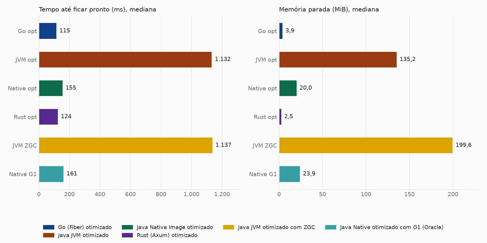
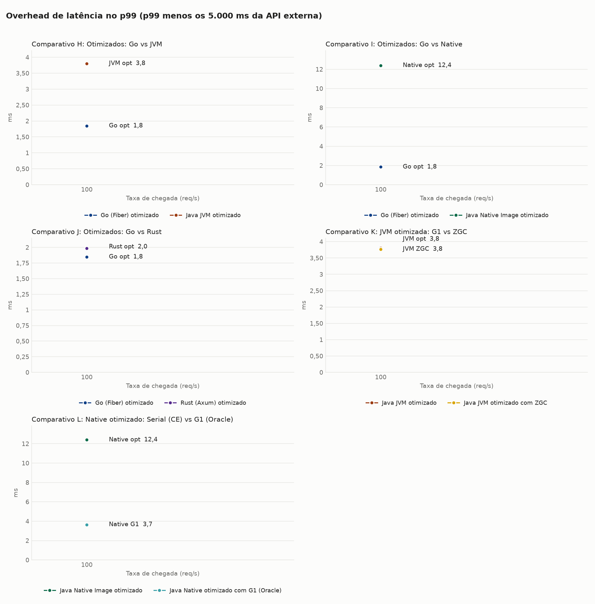
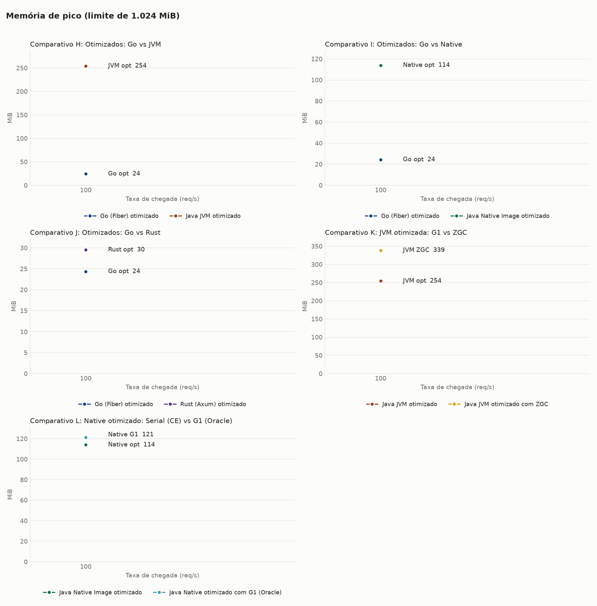
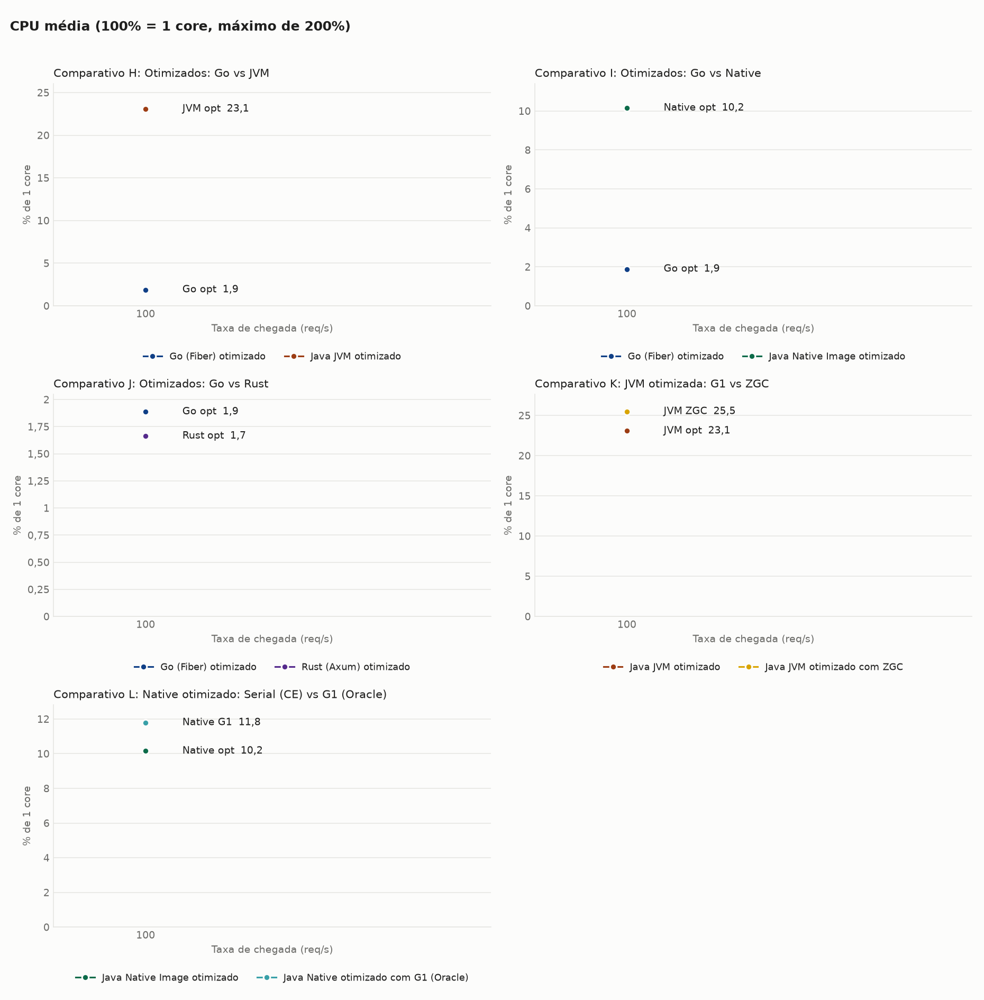
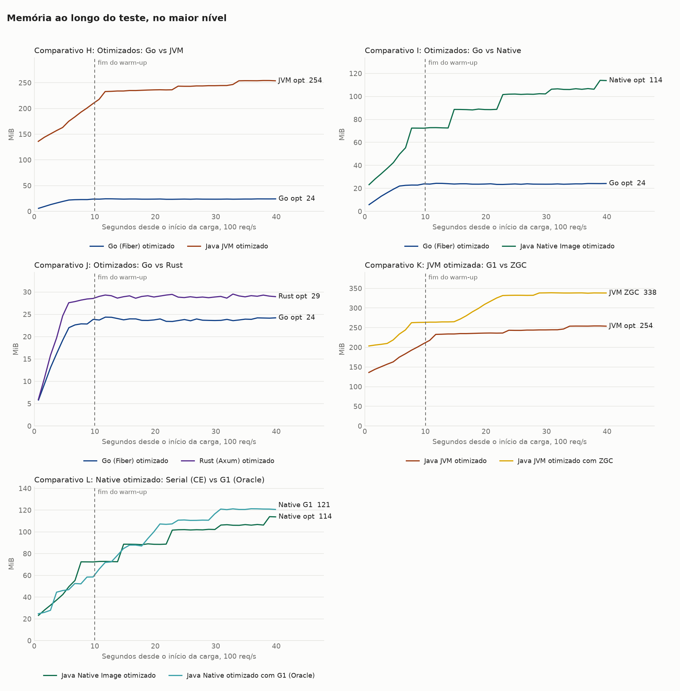
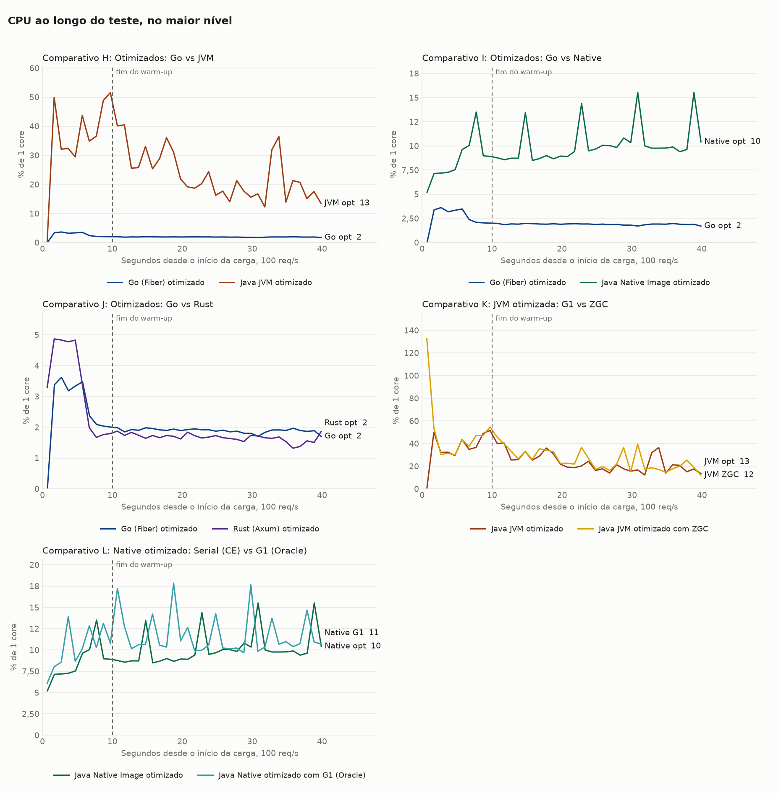

# Benchmark de I/O: Java com virtual threads, Go com Fiber e Rust com Axum

**Carga por taxa:** o nível é a taxa em req/s, constante mesmo se o alvo ficar lento (k6 `constant-arrival-rate`).

Cada requisição chama uma API externa com 5s de latência fixa e devolve a resposta, sem trabalho de CPU no handler. Os valores são a **mediana das repetições**, restritos à janela medida (sem warm-up). CPU em % de 1 core, com máximo de 200%. CPU-s por 1.000 requisições conta só respostas 200. O traço indica ausência de dado: nenhuma resposta 200 ou alvo já encerrado na janela. O Native Image usa JDK 25, e a variante JVM usa JDK 27, quando presentes nesta rodada.

## Ambiente

| Item | Valor |
|---|---|
| CPU | 16 vCPU, x86_64 |
| Memória | 30,8 GiB |
| Sistema operacional | Ubuntu 24.04.5 LTS, kernel 7.0.0-1014-aws |
| Docker | 29.9.2 |
| Níveis de VUs | 100 |
| Repetições | 1 |
| Warm-up e janela medida | 10s e 30s |
| Execuções de startup | 1 |

## Startup

| Alvo | Pronto, mediana (ms) | Pronto, p90 (ms) | Autodeclarado (ms) | 1ª requisição (ms além dos 5s) | Memória parada (MiB) | Imagem (MB) | Execuções |
|---|---|---|---|---|---|---|---|
| Go (Fiber) otimizado | 115 | 115 | 0 | 6,3 | 3,9 | 20,3 | 1 |
| Java JVM otimizado | 1.132 | 1.132 | 929 | 60,9 | 135,2 | 638,9 | 1 |
| Java Native Image otimizado | 155 | 155 | 38 | 8,5 | 20,0 | 126,8 | 1 |
| Rust (Axum) otimizado | 124 | 124 | 0 | 6,1 | 2,5 | 39,0 | 1 |
| Java JVM otimizado com ZGC | 1.137 | 1.137 | 942 | 86,0 | 199,6 | 639,7 | 1 |
| Java Native otimizado com G1 (Oracle) | 161 | 161 | 39 | 8,0 | 23,9 | 199,9 | 1 |

O tempo até ficar pronto é medido de fora, do start do container até o primeiro `/health` com 200, e inclui o custo do Docker. Os tempos autodeclarados do Go e do Rust partem do código do programa e não incluem o início do runtime, por isso não são comparáveis ao do Java.

## Comparativo H: Otimizados: Go vs JVM

### Latência e throughput

| Nível | Alvo | req/s real | req/s ideal | Erros | p50 (ms) | p90 (ms) | p99 (ms) | max (ms) | Overhead p99 (ms) |
|---|---|---|---|---|---|---|---|---|---|
| 100 | Go (Fiber) otimizado | 100,0 | 100 | 0 (0,00%) | 5.001,1 | 5.001,6 | 5.001,8 | 5.002,1 | 1,8 |
| 100 | Java JVM otimizado | 100,0 | 100 | 0 (0,00%) | 5.002,4 | 5.003,1 | 5.003,8 | 5.020,7 | 3,8 |

### Memória e CPU

| Nível | Alvo | Memória parada (MiB) | Memória média (MiB) | Memória pico (MiB) | CPU média (%) | CPU pico (%) | CPU-s por 1.000 req | OOM kill | OOM de heap |
|---|---|---|---|---|---|---|---|---|---|
| 100 | Go (Fiber) otimizado | 3,9 | 23,8 | 24,4 | 1,9 | 2,0 | 0,182 | 0 | 0 |
| 100 | Java JVM otimizado | 135,2 | 241,9 | 254,4 | 23,1 | 40,5 | 2,172 | 0 | 0 |

## Comparativo I: Otimizados: Go vs Native

### Latência e throughput

| Nível | Alvo | req/s real | req/s ideal | Erros | p50 (ms) | p90 (ms) | p99 (ms) | max (ms) | Overhead p99 (ms) |
|---|---|---|---|---|---|---|---|---|---|
| 100 | Go (Fiber) otimizado | 100,0 | 100 | 0 (0,00%) | 5.001,1 | 5.001,6 | 5.001,8 | 5.002,1 | 1,8 |
| 100 | Java Native Image otimizado | 100,0 | 100 | 0 (0,00%) | 5.002,2 | 5.002,9 | 5.012,4 | 5.059,1 | 12,4 |

### Memória e CPU

| Nível | Alvo | Memória parada (MiB) | Memória média (MiB) | Memória pico (MiB) | CPU média (%) | CPU pico (%) | CPU-s por 1.000 req | OOM kill | OOM de heap |
|---|---|---|---|---|---|---|---|---|---|
| 100 | Go (Fiber) otimizado | 3,9 | 23,8 | 24,4 | 1,9 | 2,0 | 0,182 | 0 | 0 |
| 100 | Java Native Image otimizado | 20,0 | 96,5 | 114,0 | 10,2 | 15,5 | 0,986 | 0 | 0 |

## Comparativo J: Otimizados: Go vs Rust

### Latência e throughput

| Nível | Alvo | req/s real | req/s ideal | Erros | p50 (ms) | p90 (ms) | p99 (ms) | max (ms) | Overhead p99 (ms) |
|---|---|---|---|---|---|---|---|---|---|
| 100 | Go (Fiber) otimizado | 100,0 | 100 | 0 (0,00%) | 5.001,1 | 5.001,6 | 5.001,8 | 5.002,1 | 1,8 |
| 100 | Rust (Axum) otimizado | 100,0 | 100 | 0 (0,00%) | 5.001,1 | 5.001,7 | 5.002,0 | 5.002,2 | 2,0 |

### Memória e CPU

| Nível | Alvo | Memória parada (MiB) | Memória média (MiB) | Memória pico (MiB) | CPU média (%) | CPU pico (%) | CPU-s por 1.000 req | OOM kill | OOM de heap |
|---|---|---|---|---|---|---|---|---|---|
| 100 | Go (Fiber) otimizado | 3,9 | 23,8 | 24,4 | 1,9 | 2,0 | 0,182 | 0 | 0 |
| 100 | Rust (Axum) otimizado | 2,5 | 29,0 | 29,5 | 1,7 | 1,9 | 0,160 | 0 | 0 |

## Comparativo K: JVM otimizada: G1 vs ZGC

### Latência e throughput

| Nível | Alvo | req/s real | req/s ideal | Erros | p50 (ms) | p90 (ms) | p99 (ms) | max (ms) | Overhead p99 (ms) |
|---|---|---|---|---|---|---|---|---|---|
| 100 | Java JVM otimizado | 100,0 | 100 | 0 (0,00%) | 5.002,4 | 5.003,1 | 5.003,8 | 5.020,7 | 3,8 |
| 100 | Java JVM otimizado com ZGC | 100,0 | 100 | 0 (0,00%) | 5.002,6 | 5.003,2 | 5.003,8 | 5.004,9 | 3,8 |

### Memória e CPU

| Nível | Alvo | Memória parada (MiB) | Memória média (MiB) | Memória pico (MiB) | CPU média (%) | CPU pico (%) | CPU-s por 1.000 req | OOM kill | OOM de heap |
|---|---|---|---|---|---|---|---|---|---|
| 100 | Java JVM otimizado | 135,2 | 241,9 | 254,4 | 23,1 | 40,5 | 2,172 | 0 | 0 |
| 100 | Java JVM otimizado com ZGC | 199,6 | 315,6 | 338,8 | 25,5 | 45,7 | 2,392 | 0 | 0 |

## Comparativo L: Native otimizado: Serial (CE) vs G1 (Oracle)

### Latência e throughput

| Nível | Alvo | req/s real | req/s ideal | Erros | p50 (ms) | p90 (ms) | p99 (ms) | max (ms) | Overhead p99 (ms) |
|---|---|---|---|---|---|---|---|---|---|
| 100 | Java Native Image otimizado | 100,0 | 100 | 0 (0,00%) | 5.002,2 | 5.002,9 | 5.012,4 | 5.059,1 | 12,4 |
| 100 | Java Native otimizado com G1 (Oracle) | 100,0 | 100 | 0 (0,00%) | 5.002,4 | 5.003,0 | 5.003,7 | 5.023,5 | 3,7 |

### Memória e CPU

| Nível | Alvo | Memória parada (MiB) | Memória média (MiB) | Memória pico (MiB) | CPU média (%) | CPU pico (%) | CPU-s por 1.000 req | OOM kill | OOM de heap |
|---|---|---|---|---|---|---|---|---|---|
| 100 | Java Native Image otimizado | 20,0 | 96,5 | 114,0 | 10,2 | 15,5 | 0,986 | 0 | 0 |
| 100 | Java Native otimizado com G1 (Oracle) | 23,9 | 104,7 | 121,3 | 11,8 | 17,9 | 1,121 | 0 | 0 |

## Gráficos

## Sanidade do ambiente

Sem ocorrências: nenhuma saturação de mock-api ou k6, nenhum erro, nenhum OOM e throughput sempre acima de 95% do ideal.

### Consumo de mock-api e k6 por rodada

| Nível | Alvo | Rep | mock-api CPU média (%) | mock-api CPU pico (%) | k6 CPU média (%) | k6 CPU pico (%) | k6 memória pico (MiB) |
|---|---|---|---|---|---|---|---|
| 100 | Go opt | 1 | 2,3 | 2,9 | 4,9 | 13,3 | 146 |
| 100 | JVM opt | 1 | 2,5 | 3,0 | 5,0 | 12,6 | 144 |
| 100 | JVM ZGC | 1 | 2,6 | 3,2 | 5,2 | 13,4 | 147 |
| 100 | Native G1 | 1 | 2,8 | 3,3 | 5,7 | 14,2 | 151 |
| 100 | Native opt | 1 | 2,7 | 3,5 | 5,5 | 15,3 | 151 |
| 100 | Rust opt | 1 | 2,6 | 3,1 | 5,2 | 13,1 | 143 |

## Todas as rodadas

| Nível | Alvo | Rep | Requisições | req/s | Erros | p50 (ms) | p99 (ms) | max (ms) | Mem. média (MiB) | Mem. pico (MiB) | CPU média (%) | CPU-s/1.000 | Blocked p99 (ms) | Blocked max (ms) | OOM |
|---|---|---|---|---|---|---|---|---|---|---|---|---|---|---|---|
| 100 | Go opt | 1 | 3.000 | 100,0 | 0 | 5.001,1 | 5.001,8 | 5.002,1 | 23,8 | 24,4 | 1,9 | 0,182 | 0,4 | 6,0 | não |
| 100 | JVM opt | 1 | 3.000 | 100,0 | 0 | 5.002,4 | 5.003,8 | 5.020,7 | 241,9 | 254,4 | 23,1 | 2,172 | 0,4 | 11,6 | não |
| 100 | JVM ZGC | 1 | 3.000 | 100,0 | 0 | 5.002,6 | 5.003,8 | 5.004,9 | 315,6 | 338,8 | 25,5 | 2,392 | 0,4 | 10,1 | não |
| 100 | Native G1 | 1 | 3.000 | 100,0 | 0 | 5.002,4 | 5.003,7 | 5.023,5 | 104,7 | 121,3 | 11,8 | 1,121 | 0,4 | 9,2 | não |
| 100 | Native opt | 1 | 3.000 | 100,0 | 0 | 5.002,2 | 5.012,4 | 5.059,1 | 96,5 | 114,0 | 10,2 | 0,986 | 0,4 | 11,3 | não |
| 100 | Rust opt | 1 | 3.000 | 100,0 | 0 | 5.001,1 | 5.002,0 | 5.002,2 | 29,0 | 29,5 | 1,7 | 0,160 | 0,4 | 7,6 | não |
