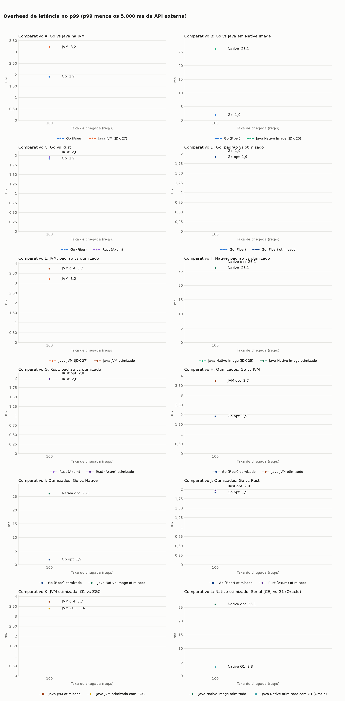
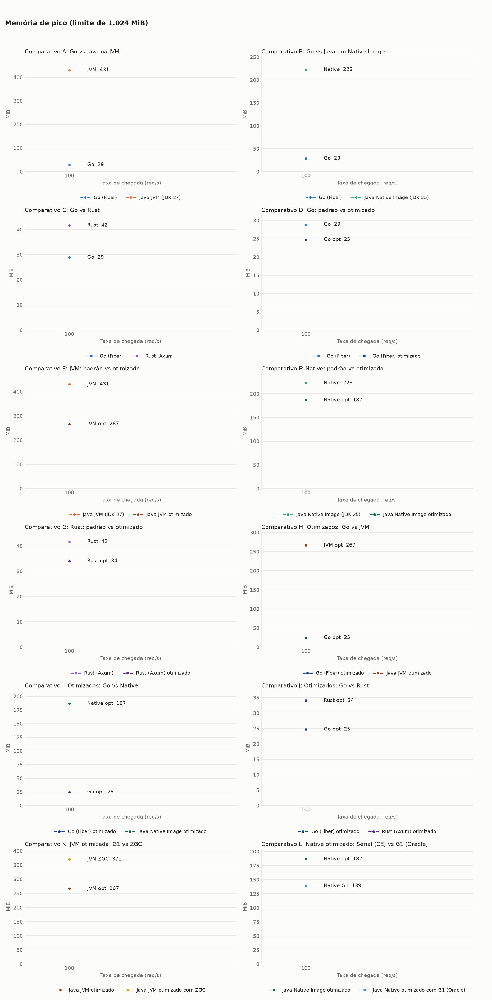
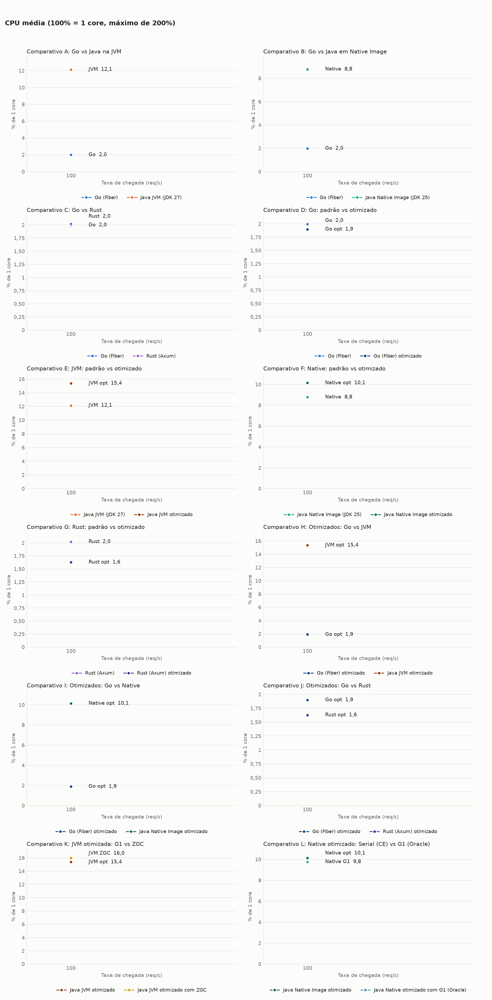
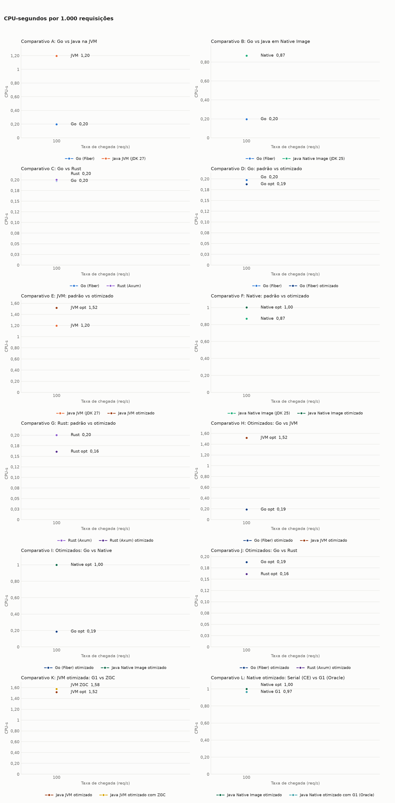
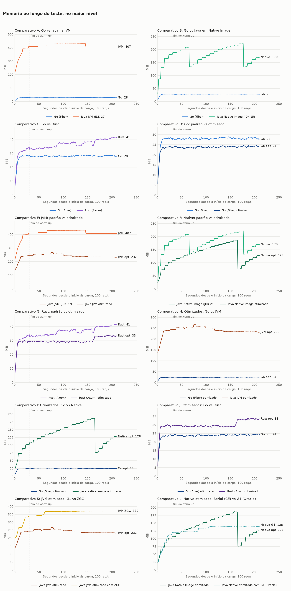
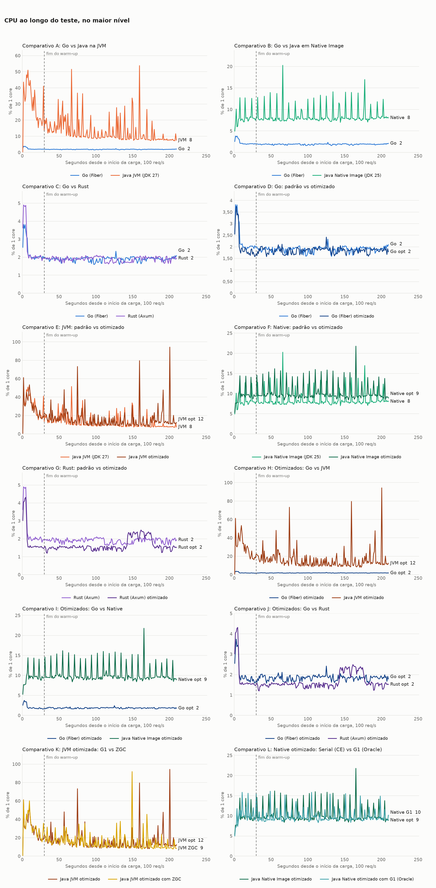

# Benchmark de I/O: Java com virtual threads, Go com Fiber e Rust com Axum

**Carga por taxa:** o nível é a taxa em req/s, constante mesmo se o alvo ficar lento (k6 `constant-arrival-rate`).

Cada requisição chama uma API externa com 5s de latência fixa e devolve a resposta, sem trabalho de CPU no handler. Os valores são a **mediana das repetições**, restritos à janela medida (sem warm-up). CPU em % de 1 core, com máximo de 200%. CPU-s por 1.000 requisições conta só respostas 200. O traço indica ausência de dado: nenhuma resposta 200 ou alvo já encerrado na janela. O Native Image usa JDK 25, e a variante JVM usa JDK 27, quando presentes nesta rodada.

## Ambiente

| Item | Valor |
|---|---|
| CPU | 16 vCPU, x86_64 |
| Memória | 30,8 GiB |
| Sistema operacional | Ubuntu 24.04.5 LTS, kernel 7.0.0-1014-aws |
| Docker | 29.9.2 |
| Níveis de VUs | 100 |
| Repetições | 3 |
| Warm-up e janela medida | 30s e 180s |
| Execuções de startup | 0 |

## Análise

### Conclusões

- **Os 10 alvos sustentaram 100 req/s, sem erros e sem iterações descartadas.** Com cerca de 500 chamadas simultâneas, a carga é menor que a do nível de 1.000 VUs, e a diferença está em memória, CPU e latência de cauda.
- **Go e Rust melhoraram sem custo aparente.** Memória de pico do Go: 28,9 para 24,8 MiB. Rust: 41,7 para 34,0 MiB, com CPU por 1.000 requisições de 0,200 para 0,161.
- **O coletor define a cauda do Native.** O overhead p99 foi de 26,1 ms com Serial, com ou sem `-Xmn400m`, e de 3,3 ms com G1.
- **O ZGC tem a menor latência máxima da JVM.** Foram 5.004,4 ms, contra 5.019,3 ms com G1, com 39% mais memória de pico. No p99, a diferença é mínima: 3,4 ms contra 3,7 ms.

### Limites destas conclusões

- **Com carga leve, o Java otimizado gastou mais CPU.** A JVM foi de 1,198 para 1,518 CPU-s por 1.000 requisições, e o Native com Serial, de 0,869 para 1,001. A causa não foi investigada. Os valores absolutos são baixos: até cerca de 16% de 1 core.
- **Esta rodada não mede capacidade.** Todos os alvos ficaram folgados. O modo por taxa só mostraria perda de capacidade com taxas maiores.
- **Não houve medição de startup,** porque ela não depende do modo de carga.

### Rodadas e anomalias

- **Rodada completa:** 30 rodadas, nenhuma repetida ou descartada. Mock-api e k6 ficaram muito abaixo de 320% de CPU: o maior pico foi de 16,1%, no k6. A memória disponível no host não ficou abaixo de 28,9 GiB.

## Comparativo A: Go vs Java na JVM

### Latência e throughput

| Nível | Alvo | req/s real | req/s ideal | Erros | p50 (ms) | p90 (ms) | p99 (ms) | max (ms) | Overhead p99 (ms) |
|---|---|---|---|---|---|---|---|---|---|
| 100 | Go (Fiber) | 100,0 | 100 | 0 (0,00%) | 5.001,1 | 5.001,7 | 5.001,9 | 5.002,3 | 1,9 |
| 100 | Java JVM (JDK 27) | 100,0 | 100 | 0 (0,00%) | 5.002,0 | 5.002,7 | 5.003,2 | 5.024,5 | 3,2 |

### Memória e CPU

| Nível | Alvo | Memória parada (MiB) | Memória média (MiB) | Memória pico (MiB) | CPU média (%) | CPU pico (%) | CPU-s por 1.000 req | OOM kill | OOM de heap |
|---|---|---|---|---|---|---|---|---|---|
| 100 | Go (Fiber) | - | 28,1 | 28,9 | 2,0 | 2,6 | 0,198 | 0 | 0 |
| 100 | Java JVM (JDK 27) | - | 417,6 | 430,9 | 12,1 | 63,5 | 1,198 | 0 | 0 |

## Comparativo B: Go vs Java em Native Image

### Latência e throughput

| Nível | Alvo | req/s real | req/s ideal | Erros | p50 (ms) | p90 (ms) | p99 (ms) | max (ms) | Overhead p99 (ms) |
|---|---|---|---|---|---|---|---|---|---|
| 100 | Go (Fiber) | 100,0 | 100 | 0 (0,00%) | 5.001,1 | 5.001,7 | 5.001,9 | 5.002,3 | 1,9 |
| 100 | Java Native Image (JDK 25) | 100,0 | 100 | 0 (0,00%) | 5.002,1 | 5.002,8 | 5.026,1 | 5.143,0 | 26,1 |

### Memória e CPU

| Nível | Alvo | Memória parada (MiB) | Memória média (MiB) | Memória pico (MiB) | CPU média (%) | CPU pico (%) | CPU-s por 1.000 req | OOM kill | OOM de heap |
|---|---|---|---|---|---|---|---|---|---|
| 100 | Go (Fiber) | - | 28,1 | 28,9 | 2,0 | 2,6 | 0,198 | 0 | 0 |
| 100 | Java Native Image (JDK 25) | - | 182,8 | 222,5 | 8,8 | 21,4 | 0,869 | 0 | 0 |

## Comparativo C: Go vs Rust

### Latência e throughput

| Nível | Alvo | req/s real | req/s ideal | Erros | p50 (ms) | p90 (ms) | p99 (ms) | max (ms) | Overhead p99 (ms) |
|---|---|---|---|---|---|---|---|---|---|
| 100 | Go (Fiber) | 100,0 | 100 | 0 (0,00%) | 5.001,1 | 5.001,7 | 5.001,9 | 5.002,3 | 1,9 |
| 100 | Rust (Axum) | 100,0 | 100 | 0 (0,00%) | 5.001,1 | 5.001,7 | 5.002,0 | 5.002,3 | 2,0 |

### Memória e CPU

| Nível | Alvo | Memória parada (MiB) | Memória média (MiB) | Memória pico (MiB) | CPU média (%) | CPU pico (%) | CPU-s por 1.000 req | OOM kill | OOM de heap |
|---|---|---|---|---|---|---|---|---|---|
| 100 | Go (Fiber) | - | 28,1 | 28,9 | 2,0 | 2,6 | 0,198 | 0 | 0 |
| 100 | Rust (Axum) | - | 36,4 | 41,7 | 2,0 | 2,5 | 0,200 | 0 | 0 |

## Comparativo D: Go: padrão vs otimizado

### Latência e throughput

| Nível | Alvo | req/s real | req/s ideal | Erros | p50 (ms) | p90 (ms) | p99 (ms) | max (ms) | Overhead p99 (ms) |
|---|---|---|---|---|---|---|---|---|---|
| 100 | Go (Fiber) | 100,0 | 100 | 0 (0,00%) | 5.001,1 | 5.001,7 | 5.001,9 | 5.002,3 | 1,9 |
| 100 | Go (Fiber) otimizado | 100,0 | 100 | 0 (0,00%) | 5.001,1 | 5.001,6 | 5.001,9 | 5.002,2 | 1,9 |

### Memória e CPU

| Nível | Alvo | Memória parada (MiB) | Memória média (MiB) | Memória pico (MiB) | CPU média (%) | CPU pico (%) | CPU-s por 1.000 req | OOM kill | OOM de heap |
|---|---|---|---|---|---|---|---|---|---|
| 100 | Go (Fiber) | - | 28,1 | 28,9 | 2,0 | 2,6 | 0,198 | 0 | 0 |
| 100 | Go (Fiber) otimizado | - | 23,9 | 24,8 | 1,9 | 2,3 | 0,188 | 0 | 0 |

## Comparativo E: JVM: padrão vs otimizado

### Latência e throughput

| Nível | Alvo | req/s real | req/s ideal | Erros | p50 (ms) | p90 (ms) | p99 (ms) | max (ms) | Overhead p99 (ms) |
|---|---|---|---|---|---|---|---|---|---|
| 100 | Java JVM (JDK 27) | 100,0 | 100 | 0 (0,00%) | 5.002,0 | 5.002,7 | 5.003,2 | 5.024,5 | 3,2 |
| 100 | Java JVM otimizado | 100,0 | 100 | 0 (0,00%) | 5.002,2 | 5.002,9 | 5.003,7 | 5.019,3 | 3,7 |

### Memória e CPU

| Nível | Alvo | Memória parada (MiB) | Memória média (MiB) | Memória pico (MiB) | CPU média (%) | CPU pico (%) | CPU-s por 1.000 req | OOM kill | OOM de heap |
|---|---|---|---|---|---|---|---|---|---|
| 100 | Java JVM (JDK 27) | - | 417,6 | 430,9 | 12,1 | 63,5 | 1,198 | 0 | 0 |
| 100 | Java JVM otimizado | - | 243,6 | 266,6 | 15,4 | 61,2 | 1,518 | 0 | 0 |

## Comparativo F: Native: padrão vs otimizado

### Latência e throughput

| Nível | Alvo | req/s real | req/s ideal | Erros | p50 (ms) | p90 (ms) | p99 (ms) | max (ms) | Overhead p99 (ms) |
|---|---|---|---|---|---|---|---|---|---|
| 100 | Java Native Image (JDK 25) | 100,0 | 100 | 0 (0,00%) | 5.002,1 | 5.002,8 | 5.026,1 | 5.143,0 | 26,1 |
| 100 | Java Native Image otimizado | 100,0 | 100 | 0 (0,00%) | 5.002,2 | 5.002,9 | 5.026,1 | 5.139,1 | 26,1 |

### Memória e CPU

| Nível | Alvo | Memória parada (MiB) | Memória média (MiB) | Memória pico (MiB) | CPU média (%) | CPU pico (%) | CPU-s por 1.000 req | OOM kill | OOM de heap |
|---|---|---|---|---|---|---|---|---|---|
| 100 | Java Native Image (JDK 25) | - | 182,8 | 222,5 | 8,8 | 21,4 | 0,869 | 0 | 0 |
| 100 | Java Native Image otimizado | - | 138,7 | 186,7 | 10,1 | 21,8 | 1,001 | 0 | 0 |

## Comparativo G: Rust: padrão vs otimizado

### Latência e throughput

| Nível | Alvo | req/s real | req/s ideal | Erros | p50 (ms) | p90 (ms) | p99 (ms) | max (ms) | Overhead p99 (ms) |
|---|---|---|---|---|---|---|---|---|---|
| 100 | Rust (Axum) | 100,0 | 100 | 0 (0,00%) | 5.001,1 | 5.001,7 | 5.002,0 | 5.002,3 | 2,0 |
| 100 | Rust (Axum) otimizado | 100,0 | 100 | 0 (0,00%) | 5.001,1 | 5.001,7 | 5.002,0 | 5.002,3 | 2,0 |

### Memória e CPU

| Nível | Alvo | Memória parada (MiB) | Memória média (MiB) | Memória pico (MiB) | CPU média (%) | CPU pico (%) | CPU-s por 1.000 req | OOM kill | OOM de heap |
|---|---|---|---|---|---|---|---|---|---|
| 100 | Rust (Axum) | - | 36,4 | 41,7 | 2,0 | 2,5 | 0,200 | 0 | 0 |
| 100 | Rust (Axum) otimizado | - | 30,3 | 34,0 | 1,6 | 2,0 | 0,161 | 0 | 0 |

## Comparativo H: Otimizados: Go vs JVM

### Latência e throughput

| Nível | Alvo | req/s real | req/s ideal | Erros | p50 (ms) | p90 (ms) | p99 (ms) | max (ms) | Overhead p99 (ms) |
|---|---|---|---|---|---|---|---|---|---|
| 100 | Go (Fiber) otimizado | 100,0 | 100 | 0 (0,00%) | 5.001,1 | 5.001,6 | 5.001,9 | 5.002,2 | 1,9 |
| 100 | Java JVM otimizado | 100,0 | 100 | 0 (0,00%) | 5.002,2 | 5.002,9 | 5.003,7 | 5.019,3 | 3,7 |

### Memória e CPU

| Nível | Alvo | Memória parada (MiB) | Memória média (MiB) | Memória pico (MiB) | CPU média (%) | CPU pico (%) | CPU-s por 1.000 req | OOM kill | OOM de heap |
|---|---|---|---|---|---|---|---|---|---|
| 100 | Go (Fiber) otimizado | - | 23,9 | 24,8 | 1,9 | 2,3 | 0,188 | 0 | 0 |
| 100 | Java JVM otimizado | - | 243,6 | 266,6 | 15,4 | 61,2 | 1,518 | 0 | 0 |

## Comparativo I: Otimizados: Go vs Native

### Latência e throughput

| Nível | Alvo | req/s real | req/s ideal | Erros | p50 (ms) | p90 (ms) | p99 (ms) | max (ms) | Overhead p99 (ms) |
|---|---|---|---|---|---|---|---|---|---|
| 100 | Go (Fiber) otimizado | 100,0 | 100 | 0 (0,00%) | 5.001,1 | 5.001,6 | 5.001,9 | 5.002,2 | 1,9 |
| 100 | Java Native Image otimizado | 100,0 | 100 | 0 (0,00%) | 5.002,2 | 5.002,9 | 5.026,1 | 5.139,1 | 26,1 |

### Memória e CPU

| Nível | Alvo | Memória parada (MiB) | Memória média (MiB) | Memória pico (MiB) | CPU média (%) | CPU pico (%) | CPU-s por 1.000 req | OOM kill | OOM de heap |
|---|---|---|---|---|---|---|---|---|---|
| 100 | Go (Fiber) otimizado | - | 23,9 | 24,8 | 1,9 | 2,3 | 0,188 | 0 | 0 |
| 100 | Java Native Image otimizado | - | 138,7 | 186,7 | 10,1 | 21,8 | 1,001 | 0 | 0 |

## Comparativo J: Otimizados: Go vs Rust

### Latência e throughput

| Nível | Alvo | req/s real | req/s ideal | Erros | p50 (ms) | p90 (ms) | p99 (ms) | max (ms) | Overhead p99 (ms) |
|---|---|---|---|---|---|---|---|---|---|
| 100 | Go (Fiber) otimizado | 100,0 | 100 | 0 (0,00%) | 5.001,1 | 5.001,6 | 5.001,9 | 5.002,2 | 1,9 |
| 100 | Rust (Axum) otimizado | 100,0 | 100 | 0 (0,00%) | 5.001,1 | 5.001,7 | 5.002,0 | 5.002,3 | 2,0 |

### Memória e CPU

| Nível | Alvo | Memória parada (MiB) | Memória média (MiB) | Memória pico (MiB) | CPU média (%) | CPU pico (%) | CPU-s por 1.000 req | OOM kill | OOM de heap |
|---|---|---|---|---|---|---|---|---|---|
| 100 | Go (Fiber) otimizado | - | 23,9 | 24,8 | 1,9 | 2,3 | 0,188 | 0 | 0 |
| 100 | Rust (Axum) otimizado | - | 30,3 | 34,0 | 1,6 | 2,0 | 0,161 | 0 | 0 |

## Comparativo K: JVM otimizada: G1 vs ZGC

### Latência e throughput

| Nível | Alvo | req/s real | req/s ideal | Erros | p50 (ms) | p90 (ms) | p99 (ms) | max (ms) | Overhead p99 (ms) |
|---|---|---|---|---|---|---|---|---|---|
| 100 | Java JVM otimizado | 100,0 | 100 | 0 (0,00%) | 5.002,2 | 5.002,9 | 5.003,7 | 5.019,3 | 3,7 |
| 100 | Java JVM otimizado com ZGC | 100,0 | 100 | 0 (0,00%) | 5.002,2 | 5.002,9 | 5.003,4 | 5.004,4 | 3,4 |

### Memória e CPU

| Nível | Alvo | Memória parada (MiB) | Memória média (MiB) | Memória pico (MiB) | CPU média (%) | CPU pico (%) | CPU-s por 1.000 req | OOM kill | OOM de heap |
|---|---|---|---|---|---|---|---|---|---|
| 100 | Java JVM otimizado | - | 243,6 | 266,6 | 15,4 | 61,2 | 1,518 | 0 | 0 |
| 100 | Java JVM otimizado com ZGC | - | 364,6 | 370,9 | 16,0 | 91,8 | 1,576 | 0 | 0 |

## Comparativo L: Native otimizado: Serial (CE) vs G1 (Oracle)

### Latência e throughput

| Nível | Alvo | req/s real | req/s ideal | Erros | p50 (ms) | p90 (ms) | p99 (ms) | max (ms) | Overhead p99 (ms) |
|---|---|---|---|---|---|---|---|---|---|
| 100 | Java Native Image otimizado | 100,0 | 100 | 0 (0,00%) | 5.002,2 | 5.002,9 | 5.026,1 | 5.139,1 | 26,1 |
| 100 | Java Native otimizado com G1 (Oracle) | 100,0 | 100 | 0 (0,00%) | 5.002,2 | 5.002,8 | 5.003,3 | 5.018,9 | 3,3 |

### Memória e CPU

| Nível | Alvo | Memória parada (MiB) | Memória média (MiB) | Memória pico (MiB) | CPU média (%) | CPU pico (%) | CPU-s por 1.000 req | OOM kill | OOM de heap |
|---|---|---|---|---|---|---|---|---|---|
| 100 | Java Native Image otimizado | - | 138,7 | 186,7 | 10,1 | 21,8 | 1,001 | 0 | 0 |
| 100 | Java Native otimizado com G1 (Oracle) | - | 134,1 | 138,9 | 9,8 | 16,1 | 0,966 | 0 | 0 |

## Gráficos

## Sanidade do ambiente

Sem ocorrências: nenhuma saturação de mock-api ou k6, nenhum erro, nenhum OOM e throughput sempre acima de 95% do ideal.

### Consumo de mock-api e k6 por rodada

| Nível | Alvo | Rep | mock-api CPU média (%) | mock-api CPU pico (%) | k6 CPU média (%) | k6 CPU pico (%) | k6 memória pico (MiB) |
|---|---|---|---|---|---|---|---|
| 100 | Go | 1 | 2,4 | 3,0 | 4,8 | 14,3 | 181 |
| 100 | Go | 2 | 2,5 | 3,4 | 5,2 | 13,7 | 181 |
| 100 | Go | 3 | 2,5 | 3,2 | 5,2 | 14,6 | 180 |
| 100 | Go opt | 1 | 2,4 | 3,1 | 4,9 | 14,4 | 181 |
| 100 | Go opt | 2 | 2,3 | 3,0 | 4,8 | 15,0 | 181 |
| 100 | Go opt | 3 | 2,5 | 3,1 | 5,3 | 14,6 | 181 |
| 100 | JVM | 1 | 2,5 | 3,2 | 4,9 | 14,5 | 181 |
| 100 | JVM | 2 | 2,4 | 3,1 | 4,8 | 13,8 | 181 |
| 100 | JVM | 3 | 2,6 | 3,3 | 5,1 | 13,3 | 164 |
| 100 | JVM opt | 1 | 2,7 | 3,8 | 5,3 | 16,1 | 181 |
| 100 | JVM opt | 2 | 2,5 | 3,2 | 4,9 | 14,5 | 181 |
| 100 | JVM opt | 3 | 2,7 | 3,3 | 5,3 | 14,8 | 181 |
| 100 | JVM ZGC | 1 | 2,4 | 3,2 | 4,8 | 14,1 | 181 |
| 100 | JVM ZGC | 2 | 2,6 | 3,4 | 5,1 | 13,8 | 181 |
| 100 | JVM ZGC | 3 | 2,7 | 3,4 | 5,3 | 14,7 | 181 |
| 100 | Native | 1 | 2,5 | 3,2 | 4,9 | 14,2 | 181 |
| 100 | Native | 2 | 2,4 | 3,1 | 4,8 | 13,9 | 180 |
| 100 | Native | 3 | 2,7 | 3,4 | 5,1 | 14,4 | 170 |
| 100 | Native G1 | 1 | 2,3 | 3,0 | 4,7 | 14,0 | 163 |
| 100 | Native G1 | 2 | 2,5 | 3,3 | 5,1 | 14,6 | 181 |
| 100 | Native G1 | 3 | 2,6 | 3,3 | 5,2 | 14,7 | 180 |
| 100 | Native opt | 1 | 2,5 | 3,2 | 4,7 | 13,3 | 181 |
| 100 | Native opt | 2 | 2,6 | 3,3 | 5,1 | 14,3 | 181 |
| 100 | Native opt | 3 | 2,6 | 3,4 | 5,1 | 14,3 | 180 |
| 100 | Rust | 1 | 2,4 | 3,1 | 4,9 | 13,8 | 181 |
| 100 | Rust | 2 | 2,3 | 2,9 | 4,7 | 13,7 | 181 |
| 100 | Rust | 3 | 2,5 | 3,2 | 5,1 | 14,3 | 180 |
| 100 | Rust opt | 1 | 2,5 | 3,6 | 5,2 | 15,1 | 180 |
| 100 | Rust opt | 2 | 2,5 | 3,2 | 5,2 | 14,2 | 181 |
| 100 | Rust opt | 3 | 2,5 | 3,1 | 5,1 | 13,6 | 181 |

## Todas as rodadas

| Nível | Alvo | Rep | Requisições | req/s | Erros | p50 (ms) | p99 (ms) | max (ms) | Mem. média (MiB) | Mem. pico (MiB) | CPU média (%) | CPU-s/1.000 | Blocked p99 (ms) | Blocked max (ms) | OOM |
|---|---|---|---|---|---|---|---|---|---|---|---|---|---|---|---|
| 100 | Go | 1 | 18.000 | 100,0 | 0 | 5.001,1 | 5.001,9 | 5.002,2 | 28,1 | 28,9 | 1,9 | 0,187 | 0,4 | 4,5 | não |
| 100 | Go | 2 | 18.000 | 100,0 | 0 | 5.001,1 | 5.001,9 | 5.002,3 | 28,1 | 29,0 | 2,0 | 0,198 | 0,4 | 4,5 | não |
| 100 | Go | 3 | 18.000 | 100,0 | 0 | 5.001,1 | 5.002,0 | 5.002,3 | 28,0 | 28,7 | 2,0 | 0,200 | 0,4 | 4,8 | não |
| 100 | Go opt | 1 | 18.000 | 100,0 | 0 | 5.001,1 | 5.001,9 | 5.002,2 | 24,2 | 24,9 | 1,9 | 0,188 | 0,4 | 4,6 | não |
| 100 | Go opt | 2 | 18.000 | 100,0 | 0 | 5.001,0 | 5.001,9 | 5.002,2 | 23,9 | 24,8 | 1,8 | 0,182 | 0,4 | 4,1 | não |
| 100 | Go opt | 3 | 18.000 | 100,0 | 0 | 5.001,1 | 5.001,9 | 5.002,3 | 23,9 | 24,5 | 2,0 | 0,201 | 0,4 | 4,7 | não |
| 100 | JVM | 1 | 18.000 | 100,0 | 0 | 5.002,0 | 5.003,2 | 5.023,6 | 431,4 | 445,0 | 12,1 | 1,198 | 0,4 | 7,2 | não |
| 100 | JVM | 2 | 18.000 | 100,0 | 0 | 5.002,0 | 5.003,1 | 5.028,9 | 412,3 | 429,9 | 12,1 | 1,195 | 0,3 | 4,5 | não |
| 100 | JVM | 3 | 18.000 | 100,0 | 0 | 5.002,1 | 5.003,3 | 5.024,5 | 417,6 | 430,9 | 12,7 | 1,254 | 0,4 | 7,2 | não |
| 100 | JVM opt | 1 | 18.000 | 100,0 | 0 | 5.002,2 | 5.003,7 | 5.017,2 | 243,6 | 266,6 | 15,8 | 1,558 | 0,4 | 7,8 | não |
| 100 | JVM opt | 2 | 18.000 | 100,0 | 0 | 5.002,1 | 5.004,0 | 5.019,3 | 244,4 | 256,8 | 14,4 | 1,415 | 0,3 | 9,1 | não |
| 100 | JVM opt | 3 | 18.000 | 100,0 | 0 | 5.002,2 | 5.003,7 | 5.019,7 | 243,6 | 268,0 | 15,4 | 1,518 | 0,3 | 7,2 | não |
| 100 | JVM ZGC | 1 | 18.000 | 100,0 | 0 | 5.002,1 | 5.003,2 | 5.004,0 | 364,6 | 370,9 | 14,8 | 1,453 | 0,4 | 9,5 | não |
| 100 | JVM ZGC | 2 | 18.000 | 100,0 | 0 | 5.002,2 | 5.003,4 | 5.004,8 | 373,9 | 384,0 | 16,0 | 1,576 | 0,4 | 12,8 | não |
| 100 | JVM ZGC | 3 | 18.000 | 100,0 | 0 | 5.002,2 | 5.003,4 | 5.004,4 | 361,6 | 368,6 | 16,2 | 1,586 | 0,4 | 9,1 | não |
| 100 | Native | 1 | 18.000 | 100,0 | 0 | 5.002,1 | 5.027,1 | 5.143,0 | 235,7 | 277,9 | 8,8 | 0,869 | 0,4 | 8,5 | não |
| 100 | Native | 2 | 18.000 | 100,0 | 0 | 5.002,1 | 5.024,5 | 5.136,9 | 182,8 | 222,5 | 8,5 | 0,838 | 0,3 | 4,5 | não |
| 100 | Native | 3 | 18.000 | 100,0 | 0 | 5.002,2 | 5.026,1 | 5.147,7 | 182,7 | 221,6 | 9,3 | 0,916 | 0,4 | 4,7 | não |
| 100 | Native G1 | 1 | 18.000 | 100,0 | 0 | 5.002,0 | 5.003,1 | 5.018,9 | 134,1 | 137,5 | 9,0 | 0,885 | 0,4 | 4,9 | não |
| 100 | Native G1 | 2 | 18.000 | 100,0 | 0 | 5.002,2 | 5.003,3 | 5.018,1 | 133,1 | 138,9 | 9,8 | 0,966 | 0,4 | 7,3 | não |
| 100 | Native G1 | 3 | 18.000 | 100,0 | 0 | 5.002,2 | 5.003,4 | 5.023,5 | 137,6 | 142,4 | 10,1 | 0,997 | 0,4 | 4,5 | não |
| 100 | Native opt | 1 | 18.000 | 100,0 | 0 | 5.002,1 | 5.026,1 | 5.139,1 | 139,0 | 186,5 | 9,5 | 0,933 | 0,4 | 8,2 | não |
| 100 | Native opt | 2 | 18.000 | 100,0 | 0 | 5.002,2 | 5.026,4 | 5.135,9 | 138,6 | 186,9 | 10,1 | 1,001 | 0,4 | 10,3 | não |
| 100 | Native opt | 3 | 18.000 | 100,0 | 0 | 5.002,2 | 5.025,8 | 5.140,3 | 138,7 | 186,7 | 10,2 | 1,003 | 0,4 | 8,6 | não |
| 100 | Rust | 1 | 18.000 | 100,0 | 0 | 5.001,1 | 5.002,0 | 5.002,3 | 36,4 | 41,9 | 2,0 | 0,200 | 0,4 | 8,0 | não |
| 100 | Rust | 2 | 18.000 | 100,0 | 0 | 5.001,1 | 5.001,9 | 5.002,4 | 36,9 | 41,7 | 1,9 | 0,187 | 0,3 | 8,0 | não |
| 100 | Rust | 3 | 18.000 | 100,0 | 0 | 5.001,1 | 5.002,0 | 5.002,3 | 35,4 | 40,4 | 2,2 | 0,214 | 0,4 | 6,1 | não |
| 100 | Rust opt | 1 | 18.000 | 100,0 | 0 | 5.001,1 | 5.002,0 | 5.002,3 | 30,3 | 34,0 | 1,6 | 0,162 | 0,3 | 4,3 | não |
| 100 | Rust opt | 2 | 18.000 | 100,0 | 0 | 5.001,1 | 5.002,0 | 5.002,4 | 30,3 | 34,0 | 1,6 | 0,161 | 0,4 | 9,2 | não |
| 100 | Rust opt | 3 | 18.000 | 100,0 | 0 | 5.001,1 | 5.002,0 | 5.002,3 | 30,3 | 33,9 | 1,6 | 0,161 | 0,4 | 6,9 | não |
