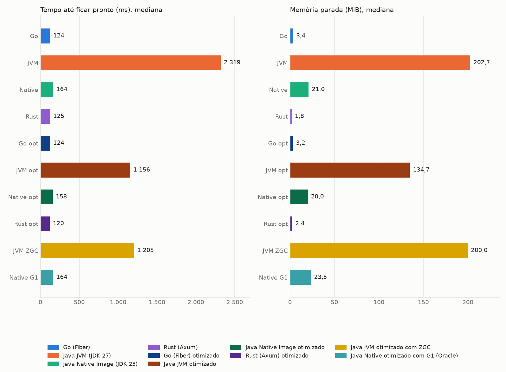
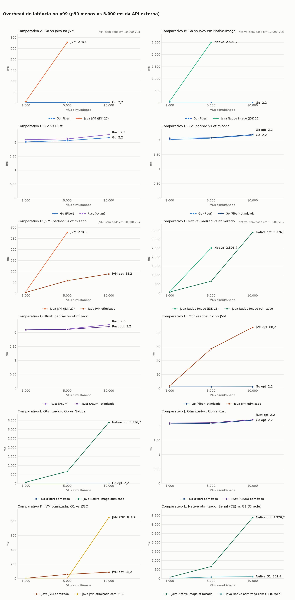
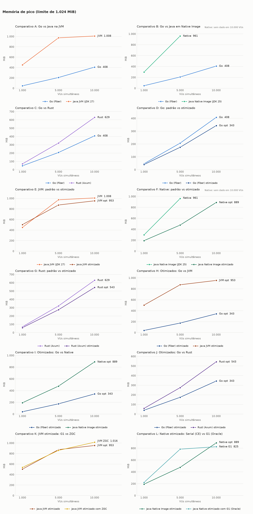
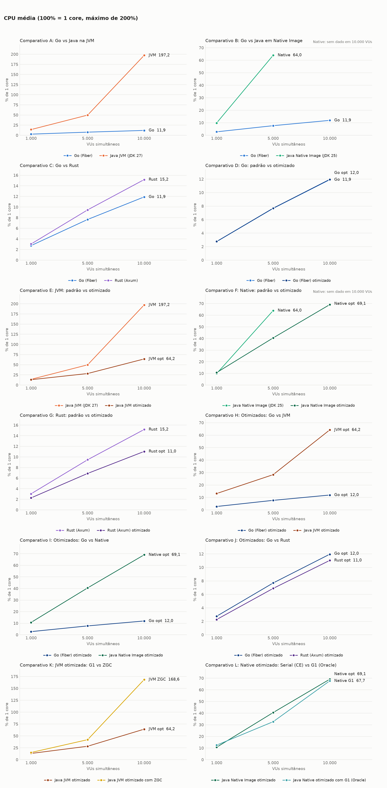
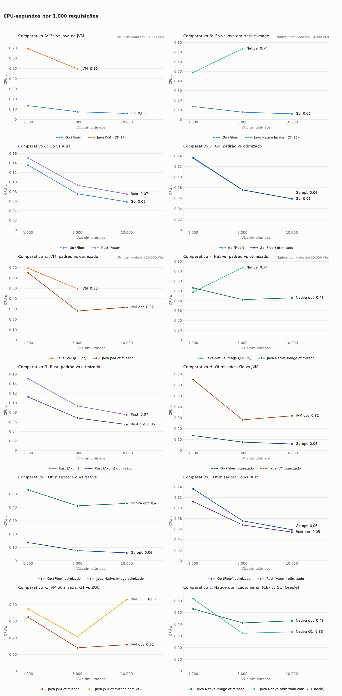
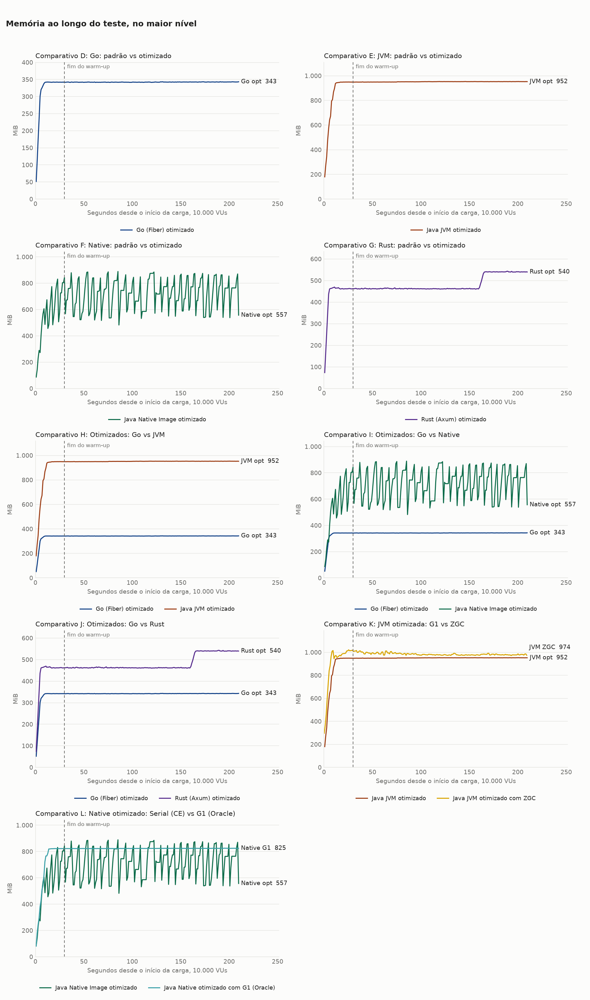
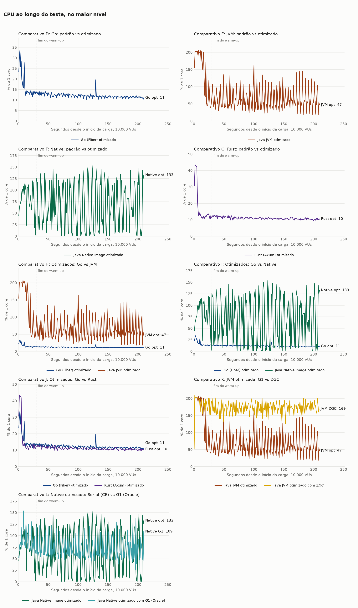

# Benchmark de I/O: Java com virtual threads, Go com Fiber e Rust com Axum

**Carga por VUs:** o nível é o número de usuários virtuais simultâneos.

Cada requisição chama uma API externa com 5s de latência fixa e devolve a resposta, sem trabalho de CPU no handler. Os valores são a **mediana das repetições**, restritos à janela medida (sem warm-up). CPU em % de 1 core, com máximo de 200%. CPU-s por 1.000 requisições conta só respostas 200. O traço indica ausência de dado: nenhuma resposta 200 ou alvo já encerrado na janela. O Native Image usa JDK 25, e a variante JVM usa JDK 27, quando presentes nesta rodada.

## Ambiente

| Item | Valor |
|---|---|
| CPU | 16 vCPU, x86_64 |
| Memória | 30,8 GiB |
| Sistema operacional | Ubuntu 24.04.5 LTS, kernel 7.0.0-1014-aws |
| Docker | 29.9.2 |
| Níveis de VUs | 1000 5000 10000 |
| Repetições | 3 |
| Warm-up e janela medida | 30s e 180s |
| Execuções de startup | 10 |

## Análise

### Conclusões

- **Todos os alvos otimizados atenderam a 10.000 VUs em 1 GB, sem erros.** No padrão, as duas variantes Java tinham 100% de erros nesse nível. Agora a JVM com G1 faz 1.992,5 de 2.000 req/s, com overhead p99 de 88,2 ms, e o Native com G1 faz 1.996,0, com 101,4 ms.
- **Nem todos ficaram acima de 95% do ideal.** O Native com Serial fez 1.650,3 req/s (82,5%), com overhead p99 de 3.376,7 ms, nas 3 repetições. O ZGC fez 1.949,9 req/s na mediana, mas caiu a 1.749,3 req/s em uma repetição.
- **O maior ganho do Java veio da troca do servidor e de ajustes por conexão, não do coletor.** Com Tomcat, o heap vivo com 10.000 VUs era de 1,39 GB. Com Jetty, sem o cache de cabeçalhos por conexão e com o limite de concorrência removido, o processo coube em 953 MiB, com G1.
- **No Native, o coletor decide o resultado.** Com 5.000 VUs, o overhead p99 foi de 665,5 ms com Serial e de 81,0 ms com G1. Com 10.000 VUs, o throughput foi de 1.650,3 req/s com Serial e de 1.996,0 req/s com G1.
- **O ZGC só compensa até certa carga.** Com 5.000 VUs, teve overhead p99 de 5,0 ms, contra 57,2 ms do G1, com 49% mais CPU por requisição. Com 10.000 VUs, ficou pior em tudo: 848,9 ms contra 88,2 ms, 2,7 vezes a CPU e 1.016 MiB de pico, a 8 MiB do limite.
- **Rust e Go otimizados têm latência igual e custos invertidos.** Com 10.000 VUs, o Go usa menos memória (343 MiB contra 543 MiB), e o Rust, menos CPU (0,054 contra 0,059 CPU-s por 1.000 requisições). O Rust ganhou 28% de CPU e 14% de memória, e o Go ganhou 16% de memória, sem mudança de CPU.
- **Mesmo otimizado, o Java continua mais caro.** Com 10.000 VUs, a JVM com G1 usa 2,8 vezes a memória e 5,4 vezes a CPU do Go otimizado. O AOT Cache reduziu o tempo até ficar pronto de 2.319 ms para 1.156 ms, ainda longe dos 124 ms do Go, e aumentou a imagem de 512,6 MB para 638,9 MB.

### Limites destas conclusões

- **Os alvos padrão vêm de outras rodadas.** Go e Rust são da `20261102-173102`, e o Java, da `20261102-005118`, na mesma máquina. Diferenças pequenas não devem ser tratadas como efeito dos ajustes.
- **Os ajustes foram feitos para este cenário.** As respostas têm 35 bytes, os cabeçalhos ficam limitados a 2 KiB, e o cache de cabeçalhos está desligado. Requisições reais com cookies ou tokens grandes podem ser rejeitadas, e respostas maiores podem custar mais.
- **O Java otimizado não é só a mesma aplicação com outras flags.** O servidor HTTP mudou. O Native com G1 também muda de distribuição, para Oracle GraalVM, com licença própria.
- **Nem toda otimização melhorou tudo.** Com 1.000 VUs, a memória de pico da JVM subiu de 449,9 MiB para 502,9 MiB. Na rodada de 100 req/s, a CPU por requisição do Java otimizado foi maior que a do padrão, e a causa não foi investigada.
- **O ZGC divergiu dos diagnósticos.** Em rodadas de 60 s sem AOT Cache, ele foi encerrado pelo kernel com 10.000 VUs. Nesta rodada, com AOT Cache, não foi. A causa não foi investigada, e o pico de 1.016 MiB indica que a margem é muito pequena.
- **A memória da JVM não é o mínimo necessário.** O coletor ocupa o heap disponível, e o mesmo vale para o Native com G1.

### Rodadas e anomalias

- **Rodada completa:** 54 rodadas, sem erros e sem OOM. Mock-api e k6 ficaram abaixo de 320% de CPU: o maior pico foi de 245,2%, no k6. A memória disponível no host não ficou abaixo de 25,3 GiB.
- **Execução em duas partes:** a máquina desligou por volta das 00:00 UTC, e a rodada foi retomada às 01:00 UTC com `scripts/resume.sh`. Nenhuma rodada foi descartada. A rodada ZGC com 10.000 VUs, rep 2, foi cortada antes de gravar seus arquivos finais e repetida. A versão cortada, com 1.639,2 req/s, está em `interrompidas/` e não entra nas medianas. O log do k6 dela foi sobrescrito pela repetição.
- **Efeito da retomada:** não há mudança sistemática entre as repetições feitas antes e depois. A exceção é a memória de JVM e ZGC com 1.000 VUs na rep 3, cerca de 11% maior, sem efeito em latência ou CPU.
- **Abaixo de 95% do ideal:** Native com Serial com 10.000 VUs, nas 3 repetições, e ZGC com 10.000 VUs, rep 3. Os logs de GC não foram gravados nesta rodada, então a causa não foi medida aqui. Os diagnósticos em `results/diagnostico-opt/` mostram pausas de 150 a 200 ms no Serial.

## Startup

| Alvo | Pronto, mediana (ms) | Pronto, p90 (ms) | Autodeclarado (ms) | 1ª requisição (ms além dos 5s) | Memória parada (MiB) | Imagem (MB) | Execuções |
|---|---|---|---|---|---|---|---|
| Go (Fiber) | 124 | 132 | 0 | 6,2 | 3,4 | 20,3 | 10 |
| Java JVM (JDK 27) | 2.319 | 2.374 | 2.137 | 105,0 | 202,7 | 512,6 | 10 |
| Java Native Image (JDK 25) | 164 | 167 | 43 | 8,2 | 21,0 | 131,2 | 10 |
| Rust (Axum) | 125 | 128 | 0 | 6,3 | 1,8 | 40,4 | 10 |
| Go (Fiber) otimizado | 124 | 126 | 0 | 6,1 | 3,2 | 20,3 | 10 |
| Java JVM otimizado | 1.156 | 1.194 | 962 | 79,4 | 134,7 | 638,9 | 10 |
| Java Native Image otimizado | 158 | 166 | 40 | 8,3 | 20,0 | 126,8 | 10 |
| Rust (Axum) otimizado | 120 | 125 | 0 | 6,3 | 2,4 | 39,0 | 10 |
| Java JVM otimizado com ZGC | 1.205 | 1.216 | 1.010 | 66,5 | 200,0 | 639,7 | 10 |
| Java Native otimizado com G1 (Oracle) | 164 | 169 | 41 | 8,4 | 23,5 | 199,9 | 10 |

O tempo até ficar pronto é medido de fora, do start do container até o primeiro `/health` com 200, e inclui o custo do Docker. Os tempos autodeclarados do Go e do Rust partem do código do programa e não incluem o início do runtime, por isso não são comparáveis ao do Java.

## Comparativo A: Go vs Java na JVM

### Latência e throughput

| Nível | Alvo | req/s real | req/s ideal | Erros | p50 (ms) | p90 (ms) | p99 (ms) | max (ms) | Overhead p99 (ms) |
|---|---|---|---|---|---|---|---|---|---|
| 1.000 | Go (Fiber) | 199,9 | 200 | 0 (0,00%) | 5.001,3 | 5.001,7 | 5.002,0 | 5.002,5 | 2,0 |
| 1.000 | Java JVM (JDK 27) | 199,9 | 200 | 0 (0,00%) | 5.002,1 | 5.002,7 | 5.008,2 | 5.031,8 | 8,2 |
| 5.000 | Go (Fiber) | 999,8 | 1.000 | 0 (0,00%) | 5.001,2 | 5.001,7 | 5.002,1 | 5.009,1 | 2,1 |
| 5.000 | Java JVM (JDK 27) | 994,1 | 1.000 | 0 (0,00%) | 5.004,3 | 5.061,5 | 5.278,5 | 5.323,8 | 278,5 |
| 10.000 | Go (Fiber) | 1.999,5 | 2.000 | 0 (0,00%) | 5.001,1 | 5.001,7 | 5.002,2 | 5.014,2 | 2,2 |
| 10.000 | Java JVM (JDK 27) | 0,0 | 2.000 | 60.000 (100,00%) | - | - | - | - | - |

### Memória e CPU

| Nível | Alvo | Memória parada (MiB) | Memória média (MiB) | Memória pico (MiB) | CPU média (%) | CPU pico (%) | CPU-s por 1.000 req | OOM kill | OOM de heap |
|---|---|---|---|---|---|---|---|---|---|
| 1.000 | Go (Fiber) | 3,4 | 45,7 | 46,5 | 2,7 | 3,5 | 0,136 | 0 | 0 |
| 1.000 | Java JVM (JDK 27) | 202,7 | 405,9 | 449,9 | 14,1 | 62,0 | 0,694 | 0 | 0 |
| 5.000 | Go (Fiber) | 3,4 | 206,1 | 207,0 | 7,7 | 11,1 | 0,076 | 0 | 0 |
| 5.000 | Java JVM (JDK 27) | 202,7 | 968,0 | 972,8 | 49,8 | 110,8 | 0,495 | 0 | 0 |
| 10.000 | Go (Fiber) | 3,4 | 406,5 | 407,6 | 11,9 | 19,6 | 0,059 | 0 | 0 |
| 10.000 | Java JVM (JDK 27) | 202,7 | 1.007,1 | 1.007,9 | 197,2 | 201,0 | - | 0 | 3 |

## Comparativo B: Go vs Java em Native Image

### Latência e throughput

| Nível | Alvo | req/s real | req/s ideal | Erros | p50 (ms) | p90 (ms) | p99 (ms) | max (ms) | Overhead p99 (ms) |
|---|---|---|---|---|---|---|---|---|---|
| 1.000 | Go (Fiber) | 199,9 | 200 | 0 (0,00%) | 5.001,3 | 5.001,7 | 5.002,0 | 5.002,5 | 2,0 |
| 1.000 | Java Native Image (JDK 25) | 199,9 | 200 | 0 (0,00%) | 5.002,4 | 5.005,0 | 5.076,0 | 5.188,9 | 76,0 |
| 5.000 | Go (Fiber) | 999,8 | 1.000 | 0 (0,00%) | 5.001,2 | 5.001,7 | 5.002,1 | 5.009,1 | 2,1 |
| 5.000 | Java Native Image (JDK 25) | 866,6 | 1.000 | 0 (0,00%) | 5.671,3 | 6.348,3 | 7.506,7 | 8.211,8 | 2.506,7 |
| 10.000 | Go (Fiber) | 1.999,5 | 2.000 | 0 (0,00%) | 5.001,1 | 5.001,7 | 5.002,2 | 5.014,2 | 2,2 |
| 10.000 | Java Native Image (JDK 25) | 0,0 | 2.000 | 61.582 (100,00%) | - | - | - | - | - |

### Memória e CPU

| Nível | Alvo | Memória parada (MiB) | Memória média (MiB) | Memória pico (MiB) | CPU média (%) | CPU pico (%) | CPU-s por 1.000 req | OOM kill | OOM de heap |
|---|---|---|---|---|---|---|---|---|---|
| 1.000 | Go (Fiber) | 3,4 | 45,7 | 46,5 | 2,7 | 3,5 | 0,136 | 0 | 0 |
| 1.000 | Java Native Image (JDK 25) | 21,0 | 261,9 | 297,0 | 9,9 | 27,8 | 0,489 | 0 | 0 |
| 5.000 | Go (Fiber) | 3,4 | 206,1 | 207,0 | 7,7 | 11,1 | 0,076 | 0 | 0 |
| 5.000 | Java Native Image (JDK 25) | 21,0 | 891,8 | 960,8 | 64,0 | 123,4 | 0,736 | 0 | 0 |
| 10.000 | Go (Fiber) | 3,4 | 406,5 | 407,6 | 11,9 | 19,6 | 0,059 | 0 | 0 |
| 10.000 | Java Native Image (JDK 25) | 21,0 | - | - | - | - | - | 3 | 0 |

## Comparativo C: Go vs Rust

### Latência e throughput

| Nível | Alvo | req/s real | req/s ideal | Erros | p50 (ms) | p90 (ms) | p99 (ms) | max (ms) | Overhead p99 (ms) |
|---|---|---|---|---|---|---|---|---|---|
| 1.000 | Go (Fiber) | 199,9 | 200 | 0 (0,00%) | 5.001,3 | 5.001,7 | 5.002,0 | 5.002,5 | 2,0 |
| 1.000 | Rust (Axum) | 199,9 | 200 | 0 (0,00%) | 5.001,3 | 5.001,8 | 5.002,1 | 5.002,6 | 2,1 |
| 5.000 | Go (Fiber) | 999,8 | 1.000 | 0 (0,00%) | 5.001,2 | 5.001,7 | 5.002,1 | 5.009,1 | 2,1 |
| 5.000 | Rust (Axum) | 999,7 | 1.000 | 0 (0,00%) | 5.001,2 | 5.001,8 | 5.002,1 | 5.008,9 | 2,1 |
| 10.000 | Go (Fiber) | 1.999,5 | 2.000 | 0 (0,00%) | 5.001,1 | 5.001,7 | 5.002,2 | 5.014,2 | 2,2 |
| 10.000 | Rust (Axum) | 1.999,4 | 2.000 | 0 (0,00%) | 5.001,2 | 5.001,8 | 5.002,3 | 5.014,3 | 2,3 |

### Memória e CPU

| Nível | Alvo | Memória parada (MiB) | Memória média (MiB) | Memória pico (MiB) | CPU média (%) | CPU pico (%) | CPU-s por 1.000 req | OOM kill | OOM de heap |
|---|---|---|---|---|---|---|---|---|---|
| 1.000 | Go (Fiber) | 3,4 | 45,7 | 46,5 | 2,7 | 3,5 | 0,136 | 0 | 0 |
| 1.000 | Rust (Axum) | 1,8 | 63,3 | 69,9 | 3,0 | 3,8 | 0,151 | 0 | 0 |
| 5.000 | Go (Fiber) | 3,4 | 206,1 | 207,0 | 7,7 | 11,1 | 0,076 | 0 | 0 |
| 5.000 | Rust (Axum) | 1,8 | 285,2 | 321,0 | 9,5 | 11,2 | 0,093 | 0 | 0 |
| 10.000 | Go (Fiber) | 3,4 | 406,5 | 407,6 | 11,9 | 19,6 | 0,059 | 0 | 0 |
| 10.000 | Rust (Axum) | 1,8 | 560,5 | 629,4 | 15,2 | 17,9 | 0,075 | 0 | 0 |

## Comparativo D: Go: padrão vs otimizado

### Latência e throughput

| Nível | Alvo | req/s real | req/s ideal | Erros | p50 (ms) | p90 (ms) | p99 (ms) | max (ms) | Overhead p99 (ms) |
|---|---|---|---|---|---|---|---|---|---|
| 1.000 | Go (Fiber) | 199,9 | 200 | 0 (0,00%) | 5.001,3 | 5.001,7 | 5.002,0 | 5.002,5 | 2,0 |
| 1.000 | Go (Fiber) otimizado | 199,9 | 200 | 0 (0,00%) | 5.001,3 | 5.001,8 | 5.002,1 | 5.002,7 | 2,1 |
| 5.000 | Go (Fiber) | 999,8 | 1.000 | 0 (0,00%) | 5.001,2 | 5.001,7 | 5.002,1 | 5.009,1 | 2,1 |
| 5.000 | Go (Fiber) otimizado | 999,7 | 1.000 | 0 (0,00%) | 5.001,2 | 5.001,7 | 5.002,1 | 5.009,4 | 2,1 |
| 10.000 | Go (Fiber) | 1.999,5 | 2.000 | 0 (0,00%) | 5.001,1 | 5.001,7 | 5.002,2 | 5.014,2 | 2,2 |
| 10.000 | Go (Fiber) otimizado | 1.999,5 | 2.000 | 0 (0,00%) | 5.001,2 | 5.001,7 | 5.002,2 | 5.013,2 | 2,2 |

### Memória e CPU

| Nível | Alvo | Memória parada (MiB) | Memória média (MiB) | Memória pico (MiB) | CPU média (%) | CPU pico (%) | CPU-s por 1.000 req | OOM kill | OOM de heap |
|---|---|---|---|---|---|---|---|---|---|
| 1.000 | Go (Fiber) | 3,4 | 45,7 | 46,5 | 2,7 | 3,5 | 0,136 | 0 | 0 |
| 1.000 | Go (Fiber) otimizado | 3,2 | 39,1 | 39,9 | 2,8 | 3,4 | 0,137 | 0 | 0 |
| 5.000 | Go (Fiber) | 3,4 | 206,1 | 207,0 | 7,7 | 11,1 | 0,076 | 0 | 0 |
| 5.000 | Go (Fiber) otimizado | 3,2 | 173,7 | 174,6 | 7,7 | 11,3 | 0,076 | 0 | 0 |
| 10.000 | Go (Fiber) | 3,4 | 406,5 | 407,6 | 11,9 | 19,6 | 0,059 | 0 | 0 |
| 10.000 | Go (Fiber) otimizado | 3,2 | 342,5 | 343,4 | 12,0 | 19,6 | 0,059 | 0 | 0 |

## Comparativo E: JVM: padrão vs otimizado

### Latência e throughput

| Nível | Alvo | req/s real | req/s ideal | Erros | p50 (ms) | p90 (ms) | p99 (ms) | max (ms) | Overhead p99 (ms) |
|---|---|---|---|---|---|---|---|---|---|
| 1.000 | Java JVM (JDK 27) | 199,9 | 200 | 0 (0,00%) | 5.002,1 | 5.002,7 | 5.008,2 | 5.031,8 | 8,2 |
| 1.000 | Java JVM otimizado | 199,9 | 200 | 0 (0,00%) | 5.002,3 | 5.003,0 | 5.003,6 | 5.033,1 | 3,6 |
| 5.000 | Java JVM (JDK 27) | 994,1 | 1.000 | 0 (0,00%) | 5.004,3 | 5.061,5 | 5.278,5 | 5.323,8 | 278,5 |
| 5.000 | Java JVM otimizado | 999,3 | 1.000 | 0 (0,00%) | 5.002,5 | 5.004,1 | 5.057,2 | 5.094,9 | 57,2 |
| 10.000 | Java JVM (JDK 27) | 0,0 | 2.000 | 60.000 (100,00%) | - | - | - | - | - |
| 10.000 | Java JVM otimizado | 1.992,5 | 2.000 | 0 (0,00%) | 5.003,0 | 5.037,3 | 5.088,2 | 5.649,8 | 88,2 |

### Memória e CPU

| Nível | Alvo | Memória parada (MiB) | Memória média (MiB) | Memória pico (MiB) | CPU média (%) | CPU pico (%) | CPU-s por 1.000 req | OOM kill | OOM de heap |
|---|---|---|---|---|---|---|---|---|---|
| 1.000 | Java JVM (JDK 27) | 202,7 | 405,9 | 449,9 | 14,1 | 62,0 | 0,694 | 0 | 0 |
| 1.000 | Java JVM otimizado | 134,7 | 478,3 | 502,9 | 13,2 | 62,6 | 0,650 | 0 | 0 |
| 5.000 | Java JVM (JDK 27) | 202,7 | 968,0 | 972,8 | 49,8 | 110,8 | 0,495 | 0 | 0 |
| 5.000 | Java JVM otimizado | 134,7 | 843,0 | 874,1 | 28,3 | 85,0 | 0,280 | 0 | 0 |
| 10.000 | Java JVM (JDK 27) | 202,7 | 1.007,1 | 1.007,9 | 197,2 | 201,0 | - | 0 | 3 |
| 10.000 | Java JVM otimizado | 134,7 | 950,8 | 953,4 | 64,2 | 161,8 | 0,317 | 0 | 0 |

## Comparativo F: Native: padrão vs otimizado

### Latência e throughput

| Nível | Alvo | req/s real | req/s ideal | Erros | p50 (ms) | p90 (ms) | p99 (ms) | max (ms) | Overhead p99 (ms) |
|---|---|---|---|---|---|---|---|---|---|
| 1.000 | Java Native Image (JDK 25) | 199,9 | 200 | 0 (0,00%) | 5.002,4 | 5.005,0 | 5.076,0 | 5.188,9 | 76,0 |
| 1.000 | Java Native Image otimizado | 199,8 | 200 | 0 (0,00%) | 5.002,6 | 5.003,6 | 5.065,4 | 5.178,3 | 65,4 |
| 5.000 | Java Native Image (JDK 25) | 866,6 | 1.000 | 0 (0,00%) | 5.671,3 | 6.348,3 | 7.506,7 | 8.211,8 | 2.506,7 |
| 5.000 | Java Native Image otimizado | 976,0 | 1.000 | 0 (0,00%) | 5.039,7 | 5.354,1 | 5.665,5 | 5.977,5 | 665,5 |
| 10.000 | Java Native Image (JDK 25) | 0,0 | 2.000 | 61.582 (100,00%) | - | - | - | - | - |
| 10.000 | Java Native Image otimizado | 1.650,3 | 2.000 | 0 (0,00%) | 6.059,9 | 7.256,3 | 8.376,7 | 9.628,1 | 3.376,7 |

### Memória e CPU

| Nível | Alvo | Memória parada (MiB) | Memória média (MiB) | Memória pico (MiB) | CPU média (%) | CPU pico (%) | CPU-s por 1.000 req | OOM kill | OOM de heap |
|---|---|---|---|---|---|---|---|---|---|
| 1.000 | Java Native Image (JDK 25) | 21,0 | 261,9 | 297,0 | 9,9 | 27,8 | 0,489 | 0 | 0 |
| 1.000 | Java Native Image otimizado | 20,0 | 155,5 | 192,5 | 10,7 | 26,5 | 0,531 | 0 | 0 |
| 5.000 | Java Native Image (JDK 25) | 21,0 | 891,8 | 960,8 | 64,0 | 123,4 | 0,736 | 0 | 0 |
| 5.000 | Java Native Image otimizado | 20,0 | 417,6 | 476,5 | 40,5 | 108,3 | 0,411 | 0 | 0 |
| 10.000 | Java Native Image (JDK 25) | 21,0 | - | - | - | - | - | 3 | 0 |
| 10.000 | Java Native Image otimizado | 20,0 | 718,5 | 889,4 | 69,1 | 156,9 | 0,429 | 0 | 0 |

## Comparativo G: Rust: padrão vs otimizado

### Latência e throughput

| Nível | Alvo | req/s real | req/s ideal | Erros | p50 (ms) | p90 (ms) | p99 (ms) | max (ms) | Overhead p99 (ms) |
|---|---|---|---|---|---|---|---|---|---|
| 1.000 | Rust (Axum) | 199,9 | 200 | 0 (0,00%) | 5.001,3 | 5.001,8 | 5.002,1 | 5.002,6 | 2,1 |
| 1.000 | Rust (Axum) otimizado | 199,9 | 200 | 0 (0,00%) | 5.001,3 | 5.001,8 | 5.002,1 | 5.002,6 | 2,1 |
| 5.000 | Rust (Axum) | 999,7 | 1.000 | 0 (0,00%) | 5.001,2 | 5.001,8 | 5.002,1 | 5.008,9 | 2,1 |
| 5.000 | Rust (Axum) otimizado | 999,8 | 1.000 | 0 (0,00%) | 5.001,2 | 5.001,7 | 5.002,1 | 5.009,6 | 2,1 |
| 10.000 | Rust (Axum) | 1.999,4 | 2.000 | 0 (0,00%) | 5.001,2 | 5.001,8 | 5.002,3 | 5.014,3 | 2,3 |
| 10.000 | Rust (Axum) otimizado | 1.999,4 | 2.000 | 0 (0,00%) | 5.001,2 | 5.001,7 | 5.002,2 | 5.012,7 | 2,2 |

### Memória e CPU

| Nível | Alvo | Memória parada (MiB) | Memória média (MiB) | Memória pico (MiB) | CPU média (%) | CPU pico (%) | CPU-s por 1.000 req | OOM kill | OOM de heap |
|---|---|---|---|---|---|---|---|---|---|
| 1.000 | Rust (Axum) | 1,8 | 63,3 | 69,9 | 3,0 | 3,8 | 0,151 | 0 | 0 |
| 1.000 | Rust (Axum) otimizado | 2,4 | 52,4 | 59,3 | 2,3 | 2,9 | 0,112 | 0 | 0 |
| 5.000 | Rust (Axum) | 1,8 | 285,2 | 321,0 | 9,5 | 11,2 | 0,093 | 0 | 0 |
| 5.000 | Rust (Axum) otimizado | 2,4 | 243,9 | 274,9 | 6,9 | 8,5 | 0,068 | 0 | 0 |
| 10.000 | Rust (Axum) | 1,8 | 560,5 | 629,4 | 15,2 | 17,9 | 0,075 | 0 | 0 |
| 10.000 | Rust (Axum) otimizado | 2,4 | 482,9 | 543,1 | 11,0 | 13,0 | 0,054 | 0 | 0 |

## Comparativo H: Otimizados: Go vs JVM

### Latência e throughput

| Nível | Alvo | req/s real | req/s ideal | Erros | p50 (ms) | p90 (ms) | p99 (ms) | max (ms) | Overhead p99 (ms) |
|---|---|---|---|---|---|---|---|---|---|
| 1.000 | Go (Fiber) otimizado | 199,9 | 200 | 0 (0,00%) | 5.001,3 | 5.001,8 | 5.002,1 | 5.002,7 | 2,1 |
| 1.000 | Java JVM otimizado | 199,9 | 200 | 0 (0,00%) | 5.002,3 | 5.003,0 | 5.003,6 | 5.033,1 | 3,6 |
| 5.000 | Go (Fiber) otimizado | 999,7 | 1.000 | 0 (0,00%) | 5.001,2 | 5.001,7 | 5.002,1 | 5.009,4 | 2,1 |
| 5.000 | Java JVM otimizado | 999,3 | 1.000 | 0 (0,00%) | 5.002,5 | 5.004,1 | 5.057,2 | 5.094,9 | 57,2 |
| 10.000 | Go (Fiber) otimizado | 1.999,5 | 2.000 | 0 (0,00%) | 5.001,2 | 5.001,7 | 5.002,2 | 5.013,2 | 2,2 |
| 10.000 | Java JVM otimizado | 1.992,5 | 2.000 | 0 (0,00%) | 5.003,0 | 5.037,3 | 5.088,2 | 5.649,8 | 88,2 |

### Memória e CPU

| Nível | Alvo | Memória parada (MiB) | Memória média (MiB) | Memória pico (MiB) | CPU média (%) | CPU pico (%) | CPU-s por 1.000 req | OOM kill | OOM de heap |
|---|---|---|---|---|---|---|---|---|---|
| 1.000 | Go (Fiber) otimizado | 3,2 | 39,1 | 39,9 | 2,8 | 3,4 | 0,137 | 0 | 0 |
| 1.000 | Java JVM otimizado | 134,7 | 478,3 | 502,9 | 13,2 | 62,6 | 0,650 | 0 | 0 |
| 5.000 | Go (Fiber) otimizado | 3,2 | 173,7 | 174,6 | 7,7 | 11,3 | 0,076 | 0 | 0 |
| 5.000 | Java JVM otimizado | 134,7 | 843,0 | 874,1 | 28,3 | 85,0 | 0,280 | 0 | 0 |
| 10.000 | Go (Fiber) otimizado | 3,2 | 342,5 | 343,4 | 12,0 | 19,6 | 0,059 | 0 | 0 |
| 10.000 | Java JVM otimizado | 134,7 | 950,8 | 953,4 | 64,2 | 161,8 | 0,317 | 0 | 0 |

## Comparativo I: Otimizados: Go vs Native

### Latência e throughput

| Nível | Alvo | req/s real | req/s ideal | Erros | p50 (ms) | p90 (ms) | p99 (ms) | max (ms) | Overhead p99 (ms) |
|---|---|---|---|---|---|---|---|---|---|
| 1.000 | Go (Fiber) otimizado | 199,9 | 200 | 0 (0,00%) | 5.001,3 | 5.001,8 | 5.002,1 | 5.002,7 | 2,1 |
| 1.000 | Java Native Image otimizado | 199,8 | 200 | 0 (0,00%) | 5.002,6 | 5.003,6 | 5.065,4 | 5.178,3 | 65,4 |
| 5.000 | Go (Fiber) otimizado | 999,7 | 1.000 | 0 (0,00%) | 5.001,2 | 5.001,7 | 5.002,1 | 5.009,4 | 2,1 |
| 5.000 | Java Native Image otimizado | 976,0 | 1.000 | 0 (0,00%) | 5.039,7 | 5.354,1 | 5.665,5 | 5.977,5 | 665,5 |
| 10.000 | Go (Fiber) otimizado | 1.999,5 | 2.000 | 0 (0,00%) | 5.001,2 | 5.001,7 | 5.002,2 | 5.013,2 | 2,2 |
| 10.000 | Java Native Image otimizado | 1.650,3 | 2.000 | 0 (0,00%) | 6.059,9 | 7.256,3 | 8.376,7 | 9.628,1 | 3.376,7 |

### Memória e CPU

| Nível | Alvo | Memória parada (MiB) | Memória média (MiB) | Memória pico (MiB) | CPU média (%) | CPU pico (%) | CPU-s por 1.000 req | OOM kill | OOM de heap |
|---|---|---|---|---|---|---|---|---|---|
| 1.000 | Go (Fiber) otimizado | 3,2 | 39,1 | 39,9 | 2,8 | 3,4 | 0,137 | 0 | 0 |
| 1.000 | Java Native Image otimizado | 20,0 | 155,5 | 192,5 | 10,7 | 26,5 | 0,531 | 0 | 0 |
| 5.000 | Go (Fiber) otimizado | 3,2 | 173,7 | 174,6 | 7,7 | 11,3 | 0,076 | 0 | 0 |
| 5.000 | Java Native Image otimizado | 20,0 | 417,6 | 476,5 | 40,5 | 108,3 | 0,411 | 0 | 0 |
| 10.000 | Go (Fiber) otimizado | 3,2 | 342,5 | 343,4 | 12,0 | 19,6 | 0,059 | 0 | 0 |
| 10.000 | Java Native Image otimizado | 20,0 | 718,5 | 889,4 | 69,1 | 156,9 | 0,429 | 0 | 0 |

## Comparativo J: Otimizados: Go vs Rust

### Latência e throughput

| Nível | Alvo | req/s real | req/s ideal | Erros | p50 (ms) | p90 (ms) | p99 (ms) | max (ms) | Overhead p99 (ms) |
|---|---|---|---|---|---|---|---|---|---|
| 1.000 | Go (Fiber) otimizado | 199,9 | 200 | 0 (0,00%) | 5.001,3 | 5.001,8 | 5.002,1 | 5.002,7 | 2,1 |
| 1.000 | Rust (Axum) otimizado | 199,9 | 200 | 0 (0,00%) | 5.001,3 | 5.001,8 | 5.002,1 | 5.002,6 | 2,1 |
| 5.000 | Go (Fiber) otimizado | 999,7 | 1.000 | 0 (0,00%) | 5.001,2 | 5.001,7 | 5.002,1 | 5.009,4 | 2,1 |
| 5.000 | Rust (Axum) otimizado | 999,8 | 1.000 | 0 (0,00%) | 5.001,2 | 5.001,7 | 5.002,1 | 5.009,6 | 2,1 |
| 10.000 | Go (Fiber) otimizado | 1.999,5 | 2.000 | 0 (0,00%) | 5.001,2 | 5.001,7 | 5.002,2 | 5.013,2 | 2,2 |
| 10.000 | Rust (Axum) otimizado | 1.999,4 | 2.000 | 0 (0,00%) | 5.001,2 | 5.001,7 | 5.002,2 | 5.012,7 | 2,2 |

### Memória e CPU

| Nível | Alvo | Memória parada (MiB) | Memória média (MiB) | Memória pico (MiB) | CPU média (%) | CPU pico (%) | CPU-s por 1.000 req | OOM kill | OOM de heap |
|---|---|---|---|---|---|---|---|---|---|
| 1.000 | Go (Fiber) otimizado | 3,2 | 39,1 | 39,9 | 2,8 | 3,4 | 0,137 | 0 | 0 |
| 1.000 | Rust (Axum) otimizado | 2,4 | 52,4 | 59,3 | 2,3 | 2,9 | 0,112 | 0 | 0 |
| 5.000 | Go (Fiber) otimizado | 3,2 | 173,7 | 174,6 | 7,7 | 11,3 | 0,076 | 0 | 0 |
| 5.000 | Rust (Axum) otimizado | 2,4 | 243,9 | 274,9 | 6,9 | 8,5 | 0,068 | 0 | 0 |
| 10.000 | Go (Fiber) otimizado | 3,2 | 342,5 | 343,4 | 12,0 | 19,6 | 0,059 | 0 | 0 |
| 10.000 | Rust (Axum) otimizado | 2,4 | 482,9 | 543,1 | 11,0 | 13,0 | 0,054 | 0 | 0 |

## Comparativo K: JVM otimizada: G1 vs ZGC

### Latência e throughput

| Nível | Alvo | req/s real | req/s ideal | Erros | p50 (ms) | p90 (ms) | p99 (ms) | max (ms) | Overhead p99 (ms) |
|---|---|---|---|---|---|---|---|---|---|
| 1.000 | Java JVM otimizado | 199,9 | 200 | 0 (0,00%) | 5.002,3 | 5.003,0 | 5.003,6 | 5.033,1 | 3,6 |
| 1.000 | Java JVM otimizado com ZGC | 199,9 | 200 | 0 (0,00%) | 5.002,3 | 5.003,0 | 5.003,6 | 5.006,6 | 3,6 |
| 5.000 | Java JVM otimizado | 999,3 | 1.000 | 0 (0,00%) | 5.002,5 | 5.004,1 | 5.057,2 | 5.094,9 | 57,2 |
| 5.000 | Java JVM otimizado com ZGC | 999,4 | 1.000 | 0 (0,00%) | 5.002,3 | 5.003,5 | 5.005,0 | 5.010,6 | 5,0 |
| 10.000 | Java JVM otimizado | 1.992,5 | 2.000 | 0 (0,00%) | 5.003,0 | 5.037,3 | 5.088,2 | 5.649,8 | 88,2 |
| 10.000 | Java JVM otimizado com ZGC | 1.949,9 | 2.000 | 0 (0,00%) | 5.037,8 | 5.350,6 | 5.848,9 | 6.343,0 | 848,9 |

### Memória e CPU

| Nível | Alvo | Memória parada (MiB) | Memória média (MiB) | Memória pico (MiB) | CPU média (%) | CPU pico (%) | CPU-s por 1.000 req | OOM kill | OOM de heap |
|---|---|---|---|---|---|---|---|---|---|
| 1.000 | Java JVM otimizado | 134,7 | 478,3 | 502,9 | 13,2 | 62,6 | 0,650 | 0 | 0 |
| 1.000 | Java JVM otimizado com ZGC | 200,0 | 528,6 | 535,5 | 15,2 | 86,4 | 0,748 | 0 | 0 |
| 5.000 | Java JVM otimizado | 134,7 | 843,0 | 874,1 | 28,3 | 85,0 | 0,280 | 0 | 0 |
| 5.000 | Java JVM otimizado com ZGC | 200,0 | 845,5 | 860,1 | 42,1 | 100,0 | 0,416 | 0 | 0 |
| 10.000 | Java JVM otimizado | 134,7 | 950,8 | 953,4 | 64,2 | 161,8 | 0,317 | 0 | 0 |
| 10.000 | Java JVM otimizado com ZGC | 200,0 | 983,1 | 1.015,7 | 168,6 | 202,1 | 0,863 | 0 | 0 |

## Comparativo L: Native otimizado: Serial (CE) vs G1 (Oracle)

### Latência e throughput

| Nível | Alvo | req/s real | req/s ideal | Erros | p50 (ms) | p90 (ms) | p99 (ms) | max (ms) | Overhead p99 (ms) |
|---|---|---|---|---|---|---|---|---|---|
| 1.000 | Java Native Image otimizado | 199,8 | 200 | 0 (0,00%) | 5.002,6 | 5.003,6 | 5.065,4 | 5.178,3 | 65,4 |
| 1.000 | Java Native otimizado com G1 (Oracle) | 199,9 | 200 | 0 (0,00%) | 5.002,3 | 5.002,9 | 5.003,6 | 5.031,0 | 3,6 |
| 5.000 | Java Native Image otimizado | 976,0 | 1.000 | 0 (0,00%) | 5.039,7 | 5.354,1 | 5.665,5 | 5.977,5 | 665,5 |
| 5.000 | Java Native otimizado com G1 (Oracle) | 998,9 | 1.000 | 0 (0,00%) | 5.002,8 | 5.007,4 | 5.081,0 | 5.113,4 | 81,0 |
| 10.000 | Java Native Image otimizado | 1.650,3 | 2.000 | 0 (0,00%) | 6.059,9 | 7.256,3 | 8.376,7 | 9.628,1 | 3.376,7 |
| 10.000 | Java Native otimizado com G1 (Oracle) | 1.996,0 | 2.000 | 0 (0,00%) | 5.005,8 | 5.052,1 | 5.101,4 | 5.166,9 | 101,4 |

### Memória e CPU

| Nível | Alvo | Memória parada (MiB) | Memória média (MiB) | Memória pico (MiB) | CPU média (%) | CPU pico (%) | CPU-s por 1.000 req | OOM kill | OOM de heap |
|---|---|---|---|---|---|---|---|---|---|
| 1.000 | Java Native Image otimizado | 20,0 | 155,5 | 192,5 | 10,7 | 26,5 | 0,531 | 0 | 0 |
| 1.000 | Java Native otimizado com G1 (Oracle) | 23,5 | 212,1 | 222,4 | 12,5 | 23,6 | 0,618 | 0 | 0 |
| 5.000 | Java Native Image otimizado | 20,0 | 417,6 | 476,5 | 40,5 | 108,3 | 0,411 | 0 | 0 |
| 5.000 | Java Native otimizado com G1 (Oracle) | 23,5 | 780,5 | 783,9 | 32,7 | 75,0 | 0,322 | 0 | 0 |
| 10.000 | Java Native Image otimizado | 20,0 | 718,5 | 889,4 | 69,1 | 156,9 | 0,429 | 0 | 0 |
| 10.000 | Java Native otimizado com G1 (Oracle) | 23,5 | 823,7 | 825,4 | 67,7 | 138,5 | 0,335 | 0 | 0 |

## Gráficos

Os alvos ausentes nesta rodada vêm das rodadas de referência: `20261102-173102`, `20261102-005118`. As seções abaixo cobrem só a rodada atual.

## Sanidade do ambiente

4 ocorrências:

| Rodada | Ocorrência |
|---|---|
| JVM ZGC 10.000 VUs, rep 3 | throughput de 1.749,3 req/s, abaixo de 95% do ideal (2.000) |
| Native opt 10.000 VUs, rep 1 | throughput de 1.650,3 req/s, abaixo de 95% do ideal (2.000) |
| Native opt 10.000 VUs, rep 2 | throughput de 1.582,6 req/s, abaixo de 95% do ideal (2.000) |
| Native opt 10.000 VUs, rep 3 | throughput de 1.677,7 req/s, abaixo de 95% do ideal (2.000) |

### Consumo de mock-api e k6 por rodada

| Nível | Alvo | Rep | mock-api CPU média (%) | mock-api CPU pico (%) | k6 CPU média (%) | k6 CPU pico (%) | k6 memória pico (MiB) |
|---|---|---|---|---|---|---|---|
| 1.000 | Go opt | 1 | 4,0 | 5,1 | 5,8 | 20,7 | 303 |
| 1.000 | Go opt | 2 | 4,1 | 5,7 | 5,9 | 21,3 | 303 |
| 1.000 | Go opt | 3 | 4,1 | 5,4 | 6,2 | 21,8 | 303 |
| 1.000 | JVM opt | 1 | 3,4 | 5,2 | 5,6 | 22,6 | 303 |
| 1.000 | JVM opt | 2 | 3,6 | 5,4 | 5,7 | 21,4 | 303 |
| 1.000 | JVM opt | 3 | 3,4 | 5,3 | 5,6 | 22,9 | 305 |
| 1.000 | JVM ZGC | 1 | 3,5 | 5,2 | 5,6 | 22,2 | 304 |
| 1.000 | JVM ZGC | 2 | 3,5 | 5,2 | 5,5 | 21,4 | 303 |
| 1.000 | JVM ZGC | 3 | 3,5 | 5,0 | 5,7 | 22,7 | 304 |
| 1.000 | Native G1 | 1 | 3,5 | 5,1 | 5,6 | 22,1 | 307 |
| 1.000 | Native G1 | 2 | 3,5 | 4,8 | 5,7 | 22,7 | 303 |
| 1.000 | Native G1 | 3 | 3,4 | 5,1 | 5,6 | 20,4 | 303 |
| 1.000 | Native opt | 1 | 2,7 | 5,0 | 4,7 | 20,1 | 303 |
| 1.000 | Native opt | 2 | 2,7 | 4,9 | 4,7 | 19,6 | 303 |
| 1.000 | Native opt | 3 | 2,8 | 4,5 | 4,8 | 21,9 | 305 |
| 1.000 | Rust opt | 1 | 3,9 | 5,6 | 5,8 | 22,6 | 303 |
| 1.000 | Rust opt | 2 | 3,9 | 5,4 | 5,9 | 20,8 | 303 |
| 1.000 | Rust opt | 3 | 4,1 | 5,6 | 6,1 | 22,5 | 304 |
| 5.000 | Go opt | 1 | 10,2 | 15,4 | 20,6 | 102,3 | 1.473 |
| 5.000 | Go opt | 2 | 10,1 | 16,1 | 20,5 | 101,1 | 1.480 |
| 5.000 | Go opt | 3 | 10,2 | 16,1 | 20,7 | 103,7 | 1.482 |
| 5.000 | JVM opt | 1 | 6,9 | 13,3 | 16,9 | 99,0 | 1.476 |
| 5.000 | JVM opt | 2 | 7,0 | 12,9 | 16,7 | 104,3 | 1.495 |
| 5.000 | JVM opt | 3 | 7,0 | 14,0 | 17,0 | 100,6 | 1.486 |
| 5.000 | JVM ZGC | 1 | 8,1 | 14,1 | 18,8 | 103,7 | 1.477 |
| 5.000 | JVM ZGC | 2 | 7,9 | 13,9 | 18,7 | 100,9 | 1.480 |
| 5.000 | JVM ZGC | 3 | 7,8 | 14,6 | 18,3 | 103,1 | 1.493 |
| 5.000 | Native G1 | 1 | 7,0 | 13,6 | 16,6 | 101,8 | 1.480 |
| 5.000 | Native G1 | 2 | 7,0 | 13,7 | 16,4 | 98,7 | 1.453 |
| 5.000 | Native G1 | 3 | 7,0 | 13,7 | 16,7 | 104,4 | 1.474 |
| 5.000 | Native opt | 1 | 5,0 | 15,3 | 13,8 | 109,1 | 1.458 |
| 5.000 | Native opt | 2 | 5,0 | 11,7 | 13,9 | 102,0 | 1.445 |
| 5.000 | Native opt | 3 | 5,2 | 14,8 | 14,2 | 111,0 | 1.445 |
| 5.000 | Rust opt | 1 | 10,1 | 15,9 | 20,3 | 102,9 | 1.478 |
| 5.000 | Rust opt | 2 | 9,8 | 15,5 | 20,0 | 100,9 | 1.477 |
| 5.000 | Rust opt | 3 | 10,0 | 15,6 | 20,4 | 107,5 | 1.488 |
| 10.000 | Go opt | 1 | 14,5 | 24,6 | 33,4 | 202,1 | 2.933 |
| 10.000 | Go opt | 2 | 15,1 | 25,4 | 34,6 | 209,9 | 2.946 |
| 10.000 | Go opt | 3 | 14,8 | 24,1 | 34,2 | 206,2 | 2.940 |
| 10.000 | JVM opt | 1 | 11,3 | 25,3 | 30,5 | 189,8 | 2.922 |
| 10.000 | JVM opt | 2 | 11,2 | 26,3 | 31,2 | 210,6 | 2.903 |
| 10.000 | JVM opt | 3 | 11,4 | 26,9 | 31,5 | 196,2 | 2.911 |
| 10.000 | JVM ZGC | 1 | 11,0 | 23,7 | 31,8 | 198,3 | 2.925 |
| 10.000 | JVM ZGC | 2 | 11,8 | 26,2 | 33,9 | 214,4 | 2.962 |
| 10.000 | JVM ZGC | 3 | 10,0 | 29,0 | 30,4 | 245,2 | 2.725 |
| 10.000 | Native G1 | 1 | 10,7 | 21,1 | 28,0 | 203,5 | 2.928 |
| 10.000 | Native G1 | 2 | 11,1 | 24,0 | 29,4 | 200,7 | 2.908 |
| 10.000 | Native G1 | 3 | 11,2 | 24,1 | 29,8 | 208,5 | 2.916 |
| 10.000 | Native opt | 1 | 7,8 | 24,4 | 23,6 | 212,8 | 2.823 |
| 10.000 | Native opt | 2 | 7,7 | 32,0 | 22,9 | 154,0 | 2.715 |
| 10.000 | Native opt | 3 | 8,3 | 32,7 | 25,0 | 209,9 | 2.727 |
| 10.000 | Rust opt | 1 | 14,5 | 25,5 | 33,1 | 196,9 | 2.921 |
| 10.000 | Rust opt | 2 | 14,7 | 25,4 | 33,0 | 214,9 | 2.950 |
| 10.000 | Rust opt | 3 | 14,6 | 26,1 | 33,6 | 208,6 | 2.924 |

## Todas as rodadas

| Nível | Alvo | Rep | Requisições | req/s | Erros | p50 (ms) | p99 (ms) | max (ms) | Mem. média (MiB) | Mem. pico (MiB) | CPU média (%) | CPU-s/1.000 | Blocked p99 (ms) | Blocked max (ms) | OOM |
|---|---|---|---|---|---|---|---|---|---|---|---|---|---|---|---|
| 1.000 | Go opt | 1 | 35.996 | 200,0 | 0 | 5.001,3 | 5.002,1 | 5.002,5 | 39,2 | 39,9 | 2,7 | 0,134 | 0,2 | 11,1 | não |
| 1.000 | Go opt | 2 | 35.987 | 199,9 | 0 | 5.001,3 | 5.002,1 | 5.002,7 | 39,1 | 39,9 | 2,8 | 0,138 | 0,2 | 6,8 | não |
| 1.000 | Go opt | 3 | 35.991 | 199,9 | 0 | 5.001,3 | 5.002,1 | 5.002,9 | 39,1 | 40,0 | 2,8 | 0,137 | 0,2 | 9,1 | não |
| 1.000 | JVM opt | 1 | 35.985 | 199,9 | 0 | 5.002,3 | 5.003,5 | 5.033,1 | 471,0 | 497,8 | 13,2 | 0,650 | 0,2 | 9,0 | não |
| 1.000 | JVM opt | 2 | 35.987 | 199,9 | 0 | 5.002,3 | 5.003,6 | 5.032,9 | 478,3 | 502,9 | 13,6 | 0,671 | 0,2 | 11,2 | não |
| 1.000 | JVM opt | 3 | 35.974 | 199,9 | 0 | 5.002,4 | 5.003,7 | 5.033,6 | 533,9 | 559,3 | 13,0 | 0,639 | 0,2 | 14,0 | não |
| 1.000 | JVM ZGC | 1 | 35.990 | 199,9 | 0 | 5.002,3 | 5.003,6 | 5.006,6 | 521,2 | 527,3 | 15,2 | 0,748 | 0,2 | 13,3 | não |
| 1.000 | JVM ZGC | 2 | 35.985 | 199,9 | 0 | 5.002,3 | 5.003,5 | 5.005,6 | 528,6 | 535,5 | 15,2 | 0,748 | 0,1 | 9,6 | não |
| 1.000 | JVM ZGC | 3 | 35.981 | 199,9 | 0 | 5.002,3 | 5.003,8 | 5.007,2 | 588,2 | 593,3 | 15,6 | 0,769 | 0,2 | 12,9 | não |
| 1.000 | Native G1 | 1 | 35.983 | 199,9 | 0 | 5.002,3 | 5.003,7 | 5.041,2 | 218,0 | 224,7 | 12,4 | 0,613 | 0,2 | 5,3 | não |
| 1.000 | Native G1 | 2 | 35.981 | 199,9 | 0 | 5.002,3 | 5.003,6 | 5.027,8 | 208,4 | 217,4 | 12,6 | 0,625 | 0,2 | 10,7 | não |
| 1.000 | Native G1 | 3 | 35.975 | 199,9 | 0 | 5.002,3 | 5.003,6 | 5.031,0 | 212,1 | 222,4 | 12,5 | 0,618 | 0,2 | 8,3 | não |
| 1.000 | Native opt | 1 | 35.961 | 199,8 | 0 | 5.002,6 | 5.065,4 | 5.177,7 | 155,2 | 190,9 | 10,7 | 0,531 | 0,2 | 6,4 | não |
| 1.000 | Native opt | 2 | 35.962 | 199,8 | 0 | 5.002,5 | 5.062,7 | 5.178,3 | 156,8 | 192,5 | 10,6 | 0,526 | 0,2 | 11,9 | não |
| 1.000 | Native opt | 3 | 35.975 | 199,9 | 0 | 5.002,6 | 5.066,0 | 5.188,7 | 155,5 | 194,5 | 10,8 | 0,536 | 0,2 | 7,1 | não |
| 1.000 | Rust opt | 1 | 35.983 | 199,9 | 0 | 5.001,3 | 5.002,1 | 5.002,6 | 52,3 | 58,7 | 2,3 | 0,112 | 0,2 | 8,5 | não |
| 1.000 | Rust opt | 2 | 35.993 | 200,0 | 0 | 5.001,3 | 5.002,1 | 5.002,6 | 52,6 | 59,4 | 2,2 | 0,111 | 0,2 | 11,2 | não |
| 1.000 | Rust opt | 3 | 35.983 | 199,9 | 0 | 5.001,3 | 5.002,1 | 5.002,7 | 52,4 | 59,3 | 2,4 | 0,118 | 0,2 | 8,3 | não |
| 5.000 | Go opt | 1 | 179.973 | 999,9 | 0 | 5.001,2 | 5.002,1 | 5.010,0 | 173,9 | 174,6 | 7,7 | 0,076 | 0,1 | 33,7 | não |
| 5.000 | Go opt | 2 | 179.944 | 999,7 | 0 | 5.001,2 | 5.002,1 | 5.009,4 | 173,7 | 174,5 | 7,6 | 0,075 | 0,1 | 28,1 | não |
| 5.000 | Go opt | 3 | 179.947 | 999,7 | 0 | 5.001,2 | 5.002,1 | 5.009,2 | 173,7 | 174,6 | 7,7 | 0,076 | 0,1 | 31,5 | não |
| 5.000 | JVM opt | 1 | 179.878 | 999,3 | 0 | 5.002,5 | 5.057,2 | 5.125,4 | 874,0 | 895,6 | 28,3 | 0,280 | 0,1 | 1.063,5 | não |
| 5.000 | JVM opt | 2 | 179.881 | 999,3 | 0 | 5.002,5 | 5.055,9 | 5.094,9 | 839,1 | 852,6 | 28,5 | 0,282 | 0,1 | 29,8 | não |
| 5.000 | JVM opt | 3 | 179.846 | 999,1 | 0 | 5.002,5 | 5.058,7 | 5.090,0 | 843,0 | 874,1 | 28,2 | 0,279 | 0,1 | 28,2 | não |
| 5.000 | JVM ZGC | 1 | 179.896 | 999,4 | 0 | 5.002,3 | 5.004,9 | 5.010,6 | 845,3 | 860,1 | 43,2 | 0,425 | 0,1 | 1.055,0 | não |
| 5.000 | JVM ZGC | 2 | 179.932 | 999,6 | 0 | 5.002,3 | 5.005,0 | 5.009,6 | 845,5 | 857,1 | 42,1 | 0,416 | 0,1 | 1.059,7 | não |
| 5.000 | JVM ZGC | 3 | 179.876 | 999,3 | 0 | 5.002,4 | 5.005,3 | 5.013,0 | 845,6 | 866,7 | 42,0 | 0,416 | 0,1 | 1.058,0 | não |
| 5.000 | Native G1 | 1 | 179.821 | 999,0 | 0 | 5.002,7 | 5.081,0 | 5.113,4 | 779,8 | 784,2 | 32,7 | 0,323 | 0,1 | 22,1 | não |
| 5.000 | Native G1 | 2 | 179.623 | 997,9 | 0 | 5.002,8 | 5.085,9 | 5.106,0 | 780,5 | 783,3 | 32,3 | 0,319 | 0,1 | 30,0 | não |
| 5.000 | Native G1 | 3 | 179.795 | 998,9 | 0 | 5.002,8 | 5.072,8 | 5.118,9 | 780,6 | 783,9 | 32,7 | 0,322 | 0,1 | 31,6 | não |
| 5.000 | Native opt | 1 | 175.091 | 972,7 | 0 | 5.066,6 | 5.743,0 | 5.977,5 | 418,0 | 473,1 | 40,5 | 0,411 | 0,1 | 1.064,5 | não |
| 5.000 | Native opt | 2 | 175.684 | 976,0 | 0 | 5.039,1 | 5.626,5 | 5.848,9 | 417,6 | 476,5 | 39,5 | 0,401 | 0,1 | 2.088,0 | não |
| 5.000 | Native opt | 3 | 176.122 | 978,5 | 0 | 5.039,7 | 5.665,5 | 5.988,5 | 417,0 | 479,4 | 41,8 | 0,422 | 0,1 | 2.088,4 | não |
| 5.000 | Rust opt | 1 | 179.960 | 999,8 | 0 | 5.001,2 | 5.002,1 | 5.009,6 | 243,9 | 274,9 | 6,9 | 0,068 | 0,1 | 25,2 | não |
| 5.000 | Rust opt | 2 | 179.958 | 999,8 | 0 | 5.001,2 | 5.002,1 | 5.009,2 | 244,1 | 277,2 | 6,8 | 0,067 | 0,1 | 30,0 | não |
| 5.000 | Rust opt | 3 | 179.967 | 999,8 | 0 | 5.001,2 | 5.002,1 | 5.010,1 | 243,8 | 273,7 | 6,9 | 0,068 | 0,1 | 33,7 | não |
| 10.000 | Go opt | 1 | 359.911 | 1.999,5 | 0 | 5.001,2 | 5.002,2 | 5.012,3 | 342,5 | 343,3 | 11,8 | 0,058 | 0,1 | 67,0 | não |
| 10.000 | Go opt | 2 | 359.914 | 1.999,5 | 0 | 5.001,2 | 5.002,1 | 5.013,3 | 351,2 | 352,2 | 12,1 | 0,060 | 0,1 | 74,6 | não |
| 10.000 | Go opt | 3 | 359.908 | 1.999,5 | 0 | 5.001,2 | 5.002,2 | 5.013,2 | 342,3 | 343,4 | 12,0 | 0,059 | 0,1 | 41,5 | não |
| 10.000 | JVM opt | 1 | 357.746 | 1.987,5 | 0 | 5.002,9 | 5.088,2 | 5.633,6 | 951,4 | 953,4 | 63,1 | 0,312 | 0,1 | 5.158,5 | não |
| 10.000 | JVM opt | 2 | 358.659 | 1.992,5 | 0 | 5.003,0 | 5.068,1 | 5.649,8 | 950,8 | 952,5 | 64,6 | 0,320 | 0,1 | 3.085,9 | não |
| 10.000 | JVM opt | 3 | 359.896 | 1.999,4 | 0 | 5.003,2 | 5.117,0 | 5.717,4 | 950,4 | 957,2 | 64,2 | 0,317 | 0,1 | 3.101,3 | não |
| 10.000 | JVM ZGC | 1 | 350.985 | 1.949,9 | 0 | 5.037,8 | 5.848,9 | 6.192,2 | 963,1 | 987,6 | 168,6 | 0,853 | 0,2 | 4.135,9 | não |
| 10.000 | JVM ZGC | 2 | 354.409 | 1.968,9 | 0 | 5.014,3 | 5.614,9 | 6.343,0 | 984,4 | 1.015,7 | 172,5 | 0,863 | 0,2 | 4.133,0 | não |
| 10.000 | JVM ZGC | 3 | 314.874 | 1.749,3 | 0 | 5.612,6 | 6.958,6 | 7.439,4 | 983,1 | 1.016,2 | 166,6 | 0,940 | 0,2 | 5.152,3 | não |
| 10.000 | Native G1 | 1 | 359.437 | 1.996,9 | 0 | 5.005,8 | 5.094,8 | 5.146,9 | 823,3 | 825,3 | 65,3 | 0,322 | 0,1 | 1.032,5 | não |
| 10.000 | Native G1 | 2 | 359.274 | 1.996,0 | 0 | 5.005,2 | 5.101,4 | 5.197,7 | 901,5 | 903,7 | 67,7 | 0,335 | 0,1 | 1.053,1 | não |
| 10.000 | Native G1 | 3 | 358.986 | 1.994,4 | 0 | 5.005,9 | 5.108,5 | 5.166,9 | 823,7 | 825,4 | 70,6 | 0,348 | 0,1 | 1.027,5 | não |
| 10.000 | Native opt | 1 | 297.063 | 1.650,3 | 0 | 6.059,9 | 8.575,4 | 9.628,1 | 718,5 | 889,4 | 67,2 | 0,401 | 0,2 | 3.111,9 | não |
| 10.000 | Native opt | 2 | 284.875 | 1.582,6 | 0 | 6.211,9 | 8.376,7 | 9.738,1 | 786,2 | 957,4 | 69,1 | 0,429 | 0,2 | 3.112,7 | não |
| 10.000 | Native opt | 3 | 301.986 | 1.677,7 | 0 | 5.860,0 | 8.291,9 | 8.947,7 | 716,0 | 887,6 | 73,1 | 0,430 | 0,2 | 4.125,1 | não |
| 10.000 | Rust opt | 1 | 359.913 | 1.999,5 | 0 | 5.001,2 | 5.002,1 | 5.012,7 | 482,9 | 543,1 | 10,9 | 0,054 | 0,1 | 60,9 | não |
| 10.000 | Rust opt | 2 | 359.896 | 1.999,4 | 0 | 5.001,2 | 5.002,2 | 5.014,3 | 483,3 | 543,3 | 11,0 | 0,054 | 0,1 | 69,7 | não |
| 10.000 | Rust opt | 3 | 359.890 | 1.999,4 | 0 | 5.001,2 | 5.002,2 | 5.012,2 | 481,9 | 541,8 | 11,0 | 0,054 | 0,1 | 67,3 | não |
