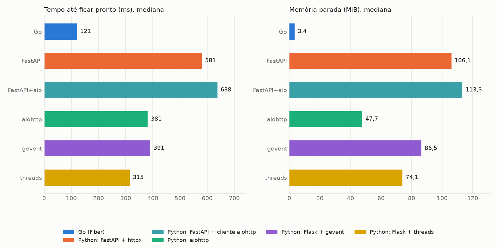
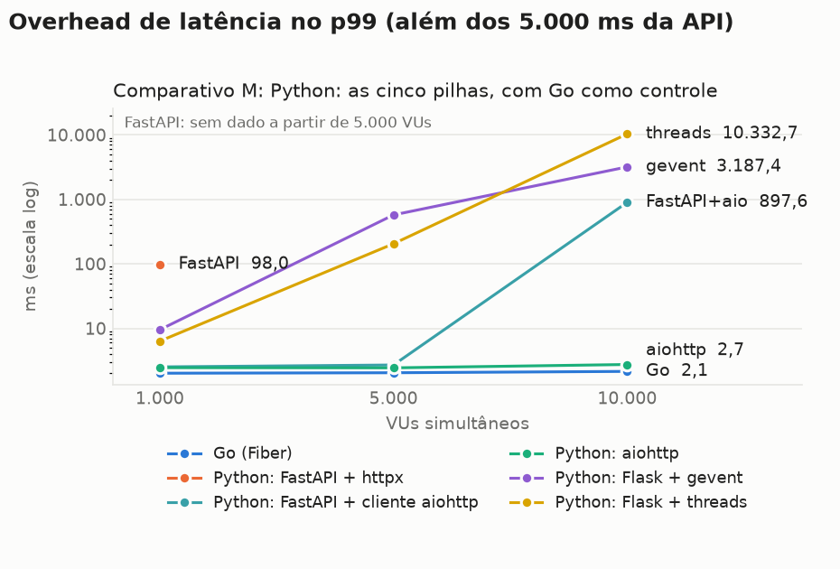
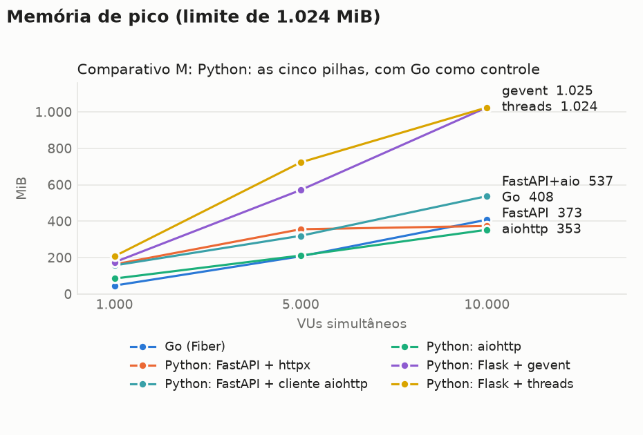
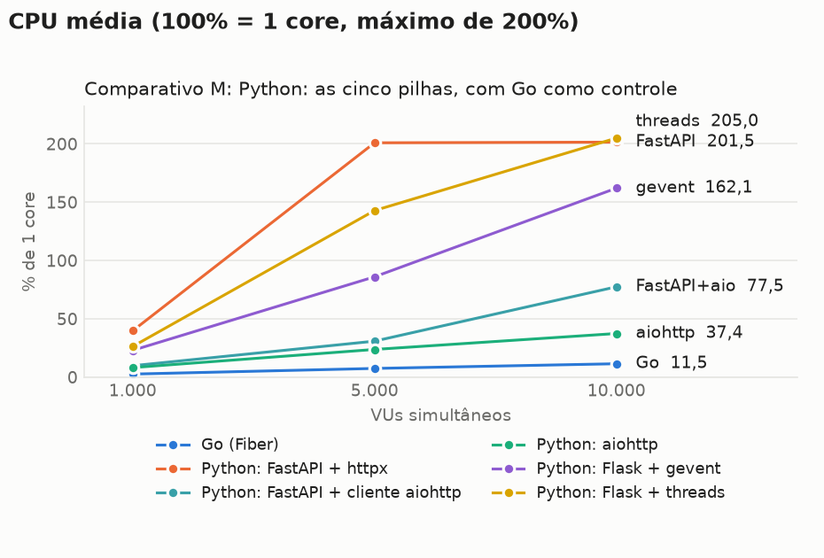
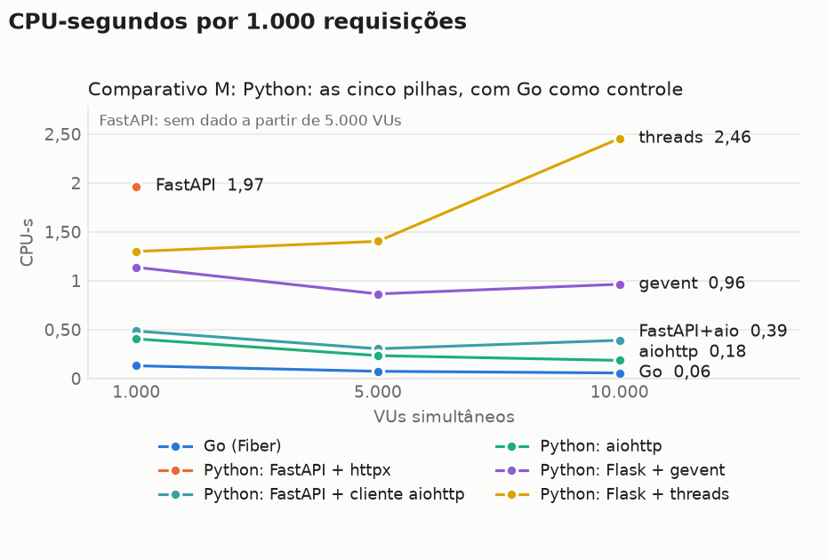
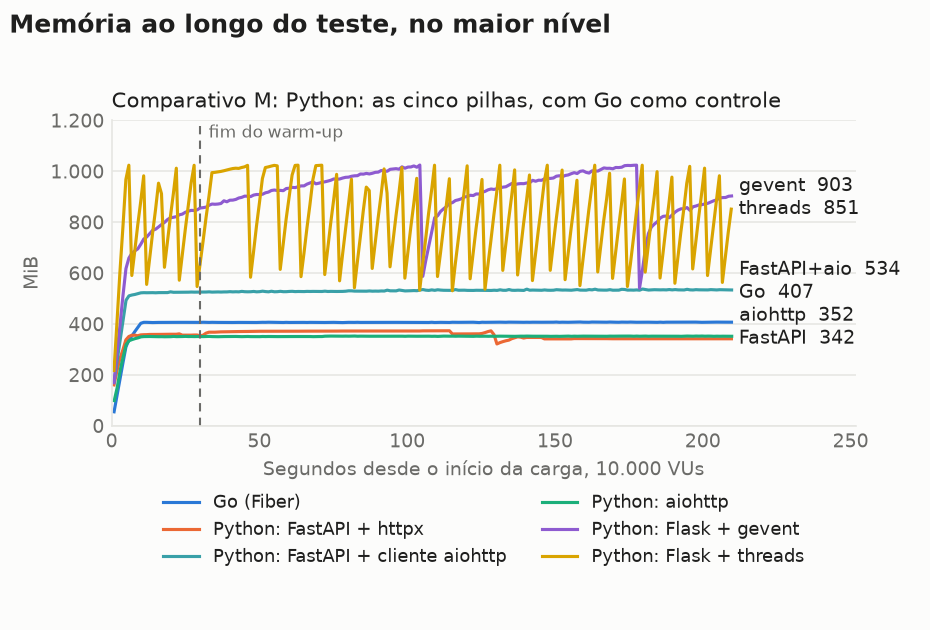
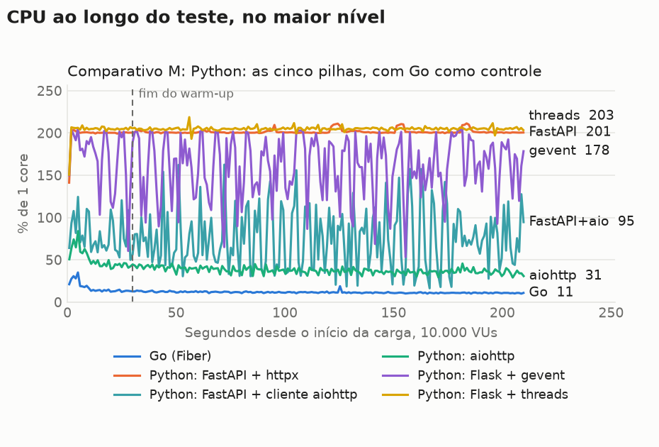

# Benchmark de I/O: pilhas Python, com Go como controle

**Carga por VUs:** o nível é o número de usuários virtuais simultâneos.

Cada requisição chama uma API externa com 5s de latência fixa e devolve a resposta, sem trabalho de CPU no handler. Os valores são a **mediana das repetições**, restritos à janela medida (sem warm-up). CPU em % de 1 core, com máximo de 200%. CPU-s por 1.000 requisições conta só respostas 200. O traço indica ausência de dado: nenhuma resposta 200 ou alvo já encerrado na janela. O Native Image usa JDK 25, e a variante JVM usa JDK 27, quando presentes nesta rodada.

## Ambiente

| Item | Valor |
|---|---|
| CPU | 16 vCPU, x86_64 |
| Memória | 30,8 GiB |
| Sistema operacional | Ubuntu 24.04.5 LTS, kernel 7.0.0-1014-aws |
| Docker | 29.9.2 |
| Níveis de VUs | 1000 5000 10000 |
| Repetições | 3 |
| Warm-up e janela medida | 30s e 180s |
| Execuções de startup | 10 |

## Análise

### Conclusões

- **Python atende 10.000 VUs em 2 vCPU e 1 GB, mas a escolha da pilha decide o resultado.** O aiohttp fez 1.999,4 de 2.000 req/s, sem erros e com overhead p99 de 2,7 ms. Com a mesma carga, FastAPI + httpx não entregou nenhuma resposta 200.
- **O aiohttp empatou com o Go em throughput e latência, e paga em CPU.** Com 10.000 VUs, o Go fez 1.999,5 req/s com overhead de 2,1 ms. O aiohttp gastou 3,2 vezes a CPU por requisição (0,185 contra 0,057 CPU-s por 1.000) e 13% menos memória de pico (353 contra 408 MiB). Com 1.000 VUs, a relação de memória se inverte: 85 MiB contra 46 MiB.
- **O colapso do FastAPI + httpx vem do cliente, não do FastAPI.** Com 5.000 e 10.000 VUs, ele teve 100% de erros nas 6 rodadas, com CPU em 200% e sem OOM. No diagnóstico de 60 s com 10.000 VUs, FastAPI com o cliente do aiohttp fez 1.980,5 req/s sem erros, e aiohttp como servidor com httpx fez 17,7 req/s. O perfil do cliente isolado concentra o tempo em `httpcore`, no `is_idle` chamado por `_assign_requests_to_connections`: cerca de 95 milhões de chamadas em 20 s, com 500 chamadas simultâneas. O código refaz uma lista de todas as conexões para cada conexão ociosa, um custo quadrático.
- **O httpx já custa caro antes de colapsar.** Com 1.000 VUs, FastAPI + httpx ainda atende, mas gasta 1,966 CPU-s por 1.000 requisições, 4,1 vezes o FastAPI com cliente aiohttp (0,485), e tem overhead p99 de 98,0 ms contra 2,5 ms. O ponto exato do colapso, entre 1.000 e 5.000 VUs, não foi medido.
- **FastAPI com cliente aiohttp é viável até 5.000 VUs sem custo de latência.** Com 5.000 VUs, teve overhead p99 de 2,7 ms. Com 10.000 VUs, ficou em 1.950,5 req/s (97,5% do ideal), com overhead de 897,6 ms e 537 MiB, contra 2,7 ms e 353 MiB do aiohttp puro.
- **gevent mantém o código síncrono, mas não aguenta 10.000 VUs em 1 GB.** Com 5.000 VUs, fez 980,9 req/s, com overhead de 573,3 ms. Com 10.000 VUs, fez 1.649,2 req/s (82,5%), com overhead de 3.187,4 ms, e o kernel encerrou de 2 a 4 workers em cada rodada.
- **Threads do sistema ainda funcionam até 5.000 VUs, com o maior consumo.** Com 5.000 VUs, fizeram 994,5 req/s, com overhead de 204,7 ms, 723 MiB e 1,403 CPU-s por 1.000. Com 10.000 VUs, ficaram em 808,4 req/s (40,4%), 3,98% de erros e de 35 a 39 workers encerrados pelo kernel por rodada.
- **Startup e memória parada ficam atrás do Go, sem chegar ao custo da JVM padrão.** O tempo até ficar pronto foi de 315 a 638 ms, contra 121 ms do Go. A memória parada foi de 47,7 a 113,3 MiB, contra 3,4 MiB, e as imagens têm de 239 a 268 MB, contra 20,3 MB.

### Limites destas conclusões

- **Cada alvo usa 2 workers.** Esse número acompanha os 2 vCPU. Outras contagens não foram testadas.
- **Os alvos só receberam ajustes de limites artificiais.** Pools, backlog, timeouts e keep-alive foram configurados para não criar gargalo. Nenhuma pilha Python foi otimizada como na trilha `opt/`, e não testamos stack menor nas threads, outros alocadores ou outras versões do httpx.
- **O perfil do httpx foi feito só no cliente, com `cProfile`, que deixa o programa mais lento.** Ele serve para atribuir onde o tempo vai, não para medir a velocidade. Os números de carga vêm dos alvos sem perfilador. O py-spy 0.4.3 não reconheceu o Python 3.15.
- **O teste usa uma resposta de 35 bytes, sem trabalho de CPU, sem banco e sem validação.** Em Python, o trabalho de CPU real disputa o mesmo event loop, e este teste não mede isso.
- **A comparação com Java e Rust é indireta.** Só o Go foi medido nesta rodada, e seus números repetem os da rodada `20261102-173102`: com 10.000 VUs, 1.999,5 req/s nas duas, overhead p99 de 2,1 e 2,2 ms e pico de 408 e 408 MiB.
- **Duas quedas não têm causa identificada.** No FastAPI com cliente aiohttp com 10.000 VUs e no gevent com 5.000 VUs, o overhead cresce sem CPU média saturada e sem desbalanceamento: as amostras por processo mostram os workers com CPU e descritores parecidos. Essas amostras cobrem só 10 s, então não descartam picos curtos.
- **Os números do gevent com 5.000 VUs variam.** O overhead p99 foi de 429,6 a 878,6 ms entre repetições de 180 s, e de cerca de 195 ms no diagnóstico de 30 s medidos.
- **Os OOM são contados no cgroup e incluem warm-up e fim da rodada.** O contador `oom_kill` soma 109 no Flask com threads e 8 no gevent. O `docker events` registrou 109 e 6, e o `State.OOMKilled` não os mostra, porque o container continua de pé. O contador é mais confiável que os eventos.
- **O autodeclarado não é comparável entre alvos.** No aiohttp, ele sai em cerca de 1 ms porque o gunicorn já importou a biblioteca antes do início da contagem. Use o tempo até ficar pronto.

### Rodadas e anomalias

- **Rodada completa:** 54 rodadas, todas concluídas, sem entradas em `failures.log`. A memória disponível no host não ficou abaixo de 25,2 GiB.
- **Pico de CPU do k6:** nas 3 rodadas de FastAPI + httpx com 10.000 VUs, o k6 teve picos de 355,4% a 403,3%, com média de 17,5% a 18,5%. Pela média, o k6 não ficou saturado, e o mesmo alvo já falha com 5.000 VUs, sem esse pico. Por isso, as rodadas foram mantidas. A mock-api não passou de 36,7%.
- **FastAPI + httpx na memória:** os 373 MiB com 10.000 VUs não indicam eficiência, porque ele não entregou respostas. As requisições esgotam os 30 s de timeout do k6.
- **Teste de limite interrompido:** a rodada `20261103-162014` foi cortada por um limite de tempo da minha sessão, no Flask com threads. Ela não tem relatório, foi mantida e não entra nas medianas.
- **Diagnósticos:** estão em `results/diagnostico-python/`, com scripts e variantes. Não entram nas medianas. O primeiro perfil com `cProfile`, no alvo sob carga, não gerou arquivo, e a causa não foi investigada: ele foi substituído pelo perfil do cliente isolado.

## Startup

| Alvo | Pronto, mediana (ms) | Pronto, p90 (ms) | Autodeclarado (ms) | 1ª requisição (ms além dos 5s) | Memória parada (MiB) | Imagem (MB) | Execuções |
|---|---|---|---|---|---|---|---|
| Go (Fiber) | 121 | 124 | 0 | 6,0 | 3,4 | 20,3 | 10 |
| Python: FastAPI + httpx | 581 | 585 | 214 | 18,5 | 106,1 | 253,4 | 10 |
| Python: FastAPI + cliente aiohttp | 638 | 647 | 266 | 8,9 | 113,3 | 267,6 | 10 |
| Python: aiohttp | 381 | 396 | 1 | 9,3 | 47,7 | 243,1 | 10 |
| Python: Flask + gevent | 391 | 421 | 115 | 13,2 | 86,5 | 239,3 | 10 |
| Python: Flask + threads | 315 | 335 | 117 | 17,1 | 74,1 | 239,3 | 10 |

O tempo até ficar pronto é medido de fora, do start do container até o primeiro `/health` com 200, e inclui o custo do Docker. Os tempos autodeclarados do Go e do Rust partem do código do programa e não incluem o início do runtime, por isso não são comparáveis ao do Java.

## Comparativo M: Python: as cinco pilhas, com Go como controle

### Latência e throughput

| Nível | Alvo | req/s real | req/s ideal | Erros | p50 (ms) | p90 (ms) | p99 (ms) | max (ms) | Overhead p99 (ms) |
|---|---|---|---|---|---|---|---|---|---|
| 1.000 | Go (Fiber) | 199,9 | 200 | 0 (0,00%) | 5.001,2 | 5.001,7 | 5.002,0 | 5.002,6 | 2,0 |
| 1.000 | Python: FastAPI + httpx | 199,8 | 200 | 0 (0,00%) | 5.003,4 | 5.005,2 | 5.098,0 | 6.450,1 | 98,0 |
| 1.000 | Python: FastAPI + cliente aiohttp | 199,9 | 200 | 0 (0,00%) | 5.001,7 | 5.002,2 | 5.002,5 | 5.003,0 | 2,5 |
| 1.000 | Python: aiohttp | 199,9 | 200 | 0 (0,00%) | 5.001,6 | 5.002,1 | 5.002,5 | 5.002,9 | 2,5 |
| 1.000 | Python: Flask + gevent | 199,9 | 200 | 0 (0,00%) | 5.002,9 | 5.004,7 | 5.009,5 | 5.041,9 | 9,5 |
| 1.000 | Python: Flask + threads | 199,9 | 200 | 0 (0,00%) | 5.002,3 | 5.003,0 | 5.006,3 | 5.047,2 | 6,3 |
| 5.000 | Go (Fiber) | 999,8 | 1.000 | 0 (0,00%) | 5.001,2 | 5.001,7 | 5.002,0 | 5.009,6 | 2,0 |
| 5.000 | Python: FastAPI + httpx | 0,0 | 1.000 | 30.000 (100,00%) | - | - | - | - | - |
| 5.000 | Python: FastAPI + cliente aiohttp | 999,6 | 1.000 | 0 (0,00%) | 5.001,5 | 5.002,1 | 5.002,7 | 5.009,0 | 2,7 |
| 5.000 | Python: aiohttp | 999,7 | 1.000 | 0 (0,00%) | 5.001,4 | 5.002,0 | 5.002,4 | 5.010,3 | 2,4 |
| 5.000 | Python: Flask + gevent | 980,9 | 1.000 | 0 (0,00%) | 5.052,6 | 5.291,4 | 5.573,3 | 5.866,7 | 573,3 |
| 5.000 | Python: Flask + threads | 994,5 | 1.000 | 0 (0,00%) | 5.010,6 | 5.075,0 | 5.204,7 | 5.467,8 | 204,7 |
| 10.000 | Go (Fiber) | 1.999,5 | 2.000 | 0 (0,00%) | 5.001,1 | 5.001,7 | 5.002,1 | 5.014,2 | 2,1 |
| 10.000 | Python: FastAPI + httpx | 0,0 | 2.000 | 60.000 (100,00%) | - | - | - | - | - |
| 10.000 | Python: FastAPI + cliente aiohttp | 1.950,5 | 2.000 | 0 (0,00%) | 5.034,3 | 5.465,8 | 5.897,6 | 6.164,6 | 897,6 |
| 10.000 | Python: aiohttp | 1.999,4 | 2.000 | 0 (0,00%) | 5.001,4 | 5.002,1 | 5.002,7 | 5.015,2 | 2,7 |
| 10.000 | Python: Flask + gevent | 1.649,2 | 2.000 | 2 (0,00%) | 5.798,0 | 6.711,3 | 8.187,4 | 10.279,0 | 3.187,4 |
| 10.000 | Python: Flask + threads | 808,4 | 2.000 | 5.723 (3,98%) | 9.057,8 | 11.985,1 | 15.332,7 | 17.138,3 | 10.332,7 |

### Memória e CPU

| Nível | Alvo | Memória parada (MiB) | Memória média (MiB) | Memória pico (MiB) | CPU média (%) | CPU pico (%) | CPU-s por 1.000 req | OOM kill | OOM de heap |
|---|---|---|---|---|---|---|---|---|---|
| 1.000 | Go (Fiber) | 3,4 | 45,6 | 46,3 | 2,6 | 3,4 | 0,130 | 0 | 0 |
| 1.000 | Python: FastAPI + httpx | 106,1 | 161,6 | 162,5 | 39,7 | 54,6 | 1,966 | 0 | 0 |
| 1.000 | Python: FastAPI + cliente aiohttp | 113,3 | 156,2 | 157,0 | 9,8 | 12,4 | 0,485 | 0 | 0 |
| 1.000 | Python: aiohttp | 47,7 | 84,1 | 84,8 | 8,2 | 11,2 | 0,405 | 0 | 0 |
| 1.000 | Python: Flask + gevent | 86,5 | 171,1 | 174,3 | 23,0 | 30,4 | 1,137 | 0 | 0 |
| 1.000 | Python: Flask + threads | 74,1 | 204,9 | 207,2 | 26,3 | 33,0 | 1,299 | 0 | 0 |
| 5.000 | Go (Fiber) | 3,4 | 206,2 | 207,0 | 7,5 | 11,2 | 0,074 | 0 | 0 |
| 5.000 | Python: FastAPI + httpx | 106,1 | 343,2 | 355,6 | 200,9 | 205,4 | - | 0 | 0 |
| 5.000 | Python: FastAPI + cliente aiohttp | 113,3 | 318,2 | 319,5 | 30,9 | 40,5 | 0,304 | 0 | 0 |
| 5.000 | Python: aiohttp | 47,7 | 210,6 | 211,2 | 23,7 | 32,7 | 0,234 | 0 | 0 |
| 5.000 | Python: Flask + gevent | 86,5 | 534,6 | 570,9 | 86,0 | 158,3 | 0,865 | 0 | 0 |
| 5.000 | Python: Flask + threads | 74,1 | 715,4 | 722,6 | 142,8 | 188,4 | 1,403 | 0 | 0 |
| 10.000 | Go (Fiber) | 3,4 | 406,7 | 407,9 | 11,5 | 19,2 | 0,057 | 0 | 0 |
| 10.000 | Python: FastAPI + httpx | 106,1 | 357,5 | 373,4 | 201,5 | 210,7 | - | 0 | 0 |
| 10.000 | Python: FastAPI + cliente aiohttp | 113,3 | 531,4 | 537,4 | 77,5 | 178,5 | 0,391 | 0 | 0 |
| 10.000 | Python: aiohttp | 47,7 | 351,7 | 352,7 | 37,4 | 45,0 | 0,185 | 0 | 0 |
| 10.000 | Python: Flask + gevent | 86,5 | 917,4 | 1.024,7 | 162,1 | 203,9 | 0,964 | 3 | 0 |
| 10.000 | Python: Flask + threads | 74,1 | 814,2 | 1.024,0 | 205,0 | 218,9 | 2,455 | 3 | 0 |

## Gráficos

## Sanidade do ambiente

39 ocorrências:

| Rodada | Ocorrência |
|---|---|
| FastAPI 10.000 VUs, rep 1 | k6 com pico de CPU de 355,4% (média de 17,6%) |
| FastAPI 10.000 VUs, rep 1 | 60.000 erros (100,00%), 60.000 de transporte |
| FastAPI 10.000 VUs, rep 1 | throughput de 0,0 req/s, abaixo de 95% do ideal (2.000) |
| FastAPI 10.000 VUs, rep 2 | k6 com pico de CPU de 370,3% (média de 17,5%) |
| FastAPI 10.000 VUs, rep 2 | 60.000 erros (100,00%), 60.000 de transporte |
| FastAPI 10.000 VUs, rep 2 | throughput de 0,0 req/s, abaixo de 95% do ideal (2.000) |
| FastAPI 10.000 VUs, rep 3 | k6 com pico de CPU de 403,3% (média de 18,5%) |
| FastAPI 10.000 VUs, rep 3 | 60.000 erros (100,00%), 60.000 de transporte |
| FastAPI 10.000 VUs, rep 3 | throughput de 0,0 req/s, abaixo de 95% do ideal (2.000) |
| FastAPI 5.000 VUs, rep 1 | 30.000 erros (100,00%), 30.000 de transporte |
| FastAPI 5.000 VUs, rep 1 | throughput de 0,0 req/s, abaixo de 95% do ideal (1.000) |
| FastAPI 5.000 VUs, rep 2 | 30.000 erros (100,00%), 30.000 de transporte |
| FastAPI 5.000 VUs, rep 2 | throughput de 0,0 req/s, abaixo de 95% do ideal (1.000) |
| FastAPI 5.000 VUs, rep 3 | 30.000 erros (100,00%), 30.000 de transporte |
| FastAPI 5.000 VUs, rep 3 | throughput de 0,0 req/s, abaixo de 95% do ideal (1.000) |
| gevent 10.000 VUs, rep 1 | 2 erros (0,00%), 2 de transporte |
| gevent 10.000 VUs, rep 1 | throughput de 1.649,2 req/s, abaixo de 95% do ideal (2.000) |
| gevent 10.000 VUs, rep 1 | 2 processos encerrados pelo kernel por falta de memória (oom_kill do cgroup) |
| gevent 10.000 VUs, rep 1 | 2 avisos de worker encerrado no log do alvo |
| gevent 10.000 VUs, rep 2 | 2 erros (0,00%), 2 de transporte |
| gevent 10.000 VUs, rep 2 | throughput de 1.658,1 req/s, abaixo de 95% do ideal (2.000) |
| gevent 10.000 VUs, rep 2 | 2 processos encerrados pelo kernel por falta de memória (oom_kill do cgroup) |
| gevent 10.000 VUs, rep 2 | 2 avisos de worker encerrado no log do alvo |
| gevent 10.000 VUs, rep 3 | 3 erros (0,00%), 3 de transporte |
| gevent 10.000 VUs, rep 3 | throughput de 1.633,1 req/s, abaixo de 95% do ideal (2.000) |
| gevent 10.000 VUs, rep 3 | 4 processos encerrados pelo kernel por falta de memória (oom_kill do cgroup) |
| gevent 10.000 VUs, rep 3 | 4 avisos de worker encerrado no log do alvo |
| threads 10.000 VUs, rep 1 | 3.556 erros (2,35%), 3.556 de transporte |
| threads 10.000 VUs, rep 1 | throughput de 822,2 req/s, abaixo de 95% do ideal (2.000) |
| threads 10.000 VUs, rep 1 | 35 processos encerrados pelo kernel por falta de memória (oom_kill do cgroup) |
| threads 10.000 VUs, rep 1 | 35 avisos de worker encerrado no log do alvo |
| threads 10.000 VUs, rep 2 | 8.975 erros (5,81%), 8.975 de transporte |
| threads 10.000 VUs, rep 2 | throughput de 808,4 req/s, abaixo de 95% do ideal (2.000) |
| threads 10.000 VUs, rep 2 | 35 processos encerrados pelo kernel por falta de memória (oom_kill do cgroup) |
| threads 10.000 VUs, rep 2 | 35 avisos de worker encerrado no log do alvo |
| threads 10.000 VUs, rep 3 | 5.723 erros (3,98%), 5.723 de transporte |
| threads 10.000 VUs, rep 3 | throughput de 767,9 req/s, abaixo de 95% do ideal (2.000) |
| threads 10.000 VUs, rep 3 | 39 processos encerrados pelo kernel por falta de memória (oom_kill do cgroup) |
| threads 10.000 VUs, rep 3 | 39 avisos de worker encerrado no log do alvo |

### Consumo de mock-api e k6 por rodada

| Nível | Alvo | Rep | mock-api CPU média (%) | mock-api CPU pico (%) | k6 CPU média (%) | k6 CPU pico (%) | k6 memória pico (MiB) |
|---|---|---|---|---|---|---|---|
| 1.000 | Go | 1 | 3,9 | 5,4 | 5,6 | 21,3 | 303 |
| 1.000 | Go | 2 | 3,9 | 5,2 | 5,6 | 23,1 | 303 |
| 1.000 | Go | 3 | 3,8 | 5,1 | 5,5 | 21,8 | 303 |
| 1.000 | aiohttp | 1 | 4,0 | 5,9 | 5,7 | 20,9 | 303 |
| 1.000 | aiohttp | 2 | 3,8 | 5,5 | 5,6 | 19,2 | 303 |
| 1.000 | aiohttp | 3 | 4,0 | 5,7 | 5,8 | 21,2 | 303 |
| 1.000 | FastAPI | 1 | 4,5 | 6,1 | 6,0 | 22,4 | 303 |
| 1.000 | FastAPI | 2 | 4,5 | 6,0 | 6,0 | 22,0 | 303 |
| 1.000 | FastAPI | 3 | 4,6 | 5,7 | 6,0 | 21,1 | 303 |
| 1.000 | FastAPI+aio | 1 | 3,9 | 5,9 | 5,7 | 23,4 | 304 |
| 1.000 | FastAPI+aio | 2 | 3,8 | 5,4 | 5,7 | 21,4 | 304 |
| 1.000 | FastAPI+aio | 3 | 3,9 | 5,3 | 5,7 | 21,6 | 303 |
| 1.000 | gevent | 1 | 3,8 | 5,4 | 6,0 | 22,3 | 303 |
| 1.000 | gevent | 2 | 3,7 | 5,3 | 5,9 | 24,7 | 304 |
| 1.000 | gevent | 3 | 3,7 | 5,0 | 5,8 | 21,8 | 303 |
| 1.000 | threads | 1 | 4,5 | 5,7 | 6,1 | 22,3 | 303 |
| 1.000 | threads | 2 | 4,5 | 5,8 | 6,0 | 22,3 | 303 |
| 1.000 | threads | 3 | 4,4 | 5,8 | 6,0 | 22,0 | 303 |
| 5.000 | Go | 1 | 9,8 | 15,3 | 19,7 | 99,7 | 1.483 |
| 5.000 | Go | 2 | 9,9 | 15,0 | 20,0 | 97,1 | 1.480 |
| 5.000 | Go | 3 | 9,6 | 14,5 | 19,6 | 99,5 | 1.498 |
| 5.000 | aiohttp | 1 | 10,3 | 17,7 | 20,3 | 106,4 | 1.477 |
| 5.000 | aiohttp | 2 | 10,3 | 16,1 | 20,0 | 99,5 | 1.481 |
| 5.000 | aiohttp | 3 | 10,3 | 16,4 | 20,2 | 104,5 | 1.481 |
| 5.000 | FastAPI | 1 | 0,7 | 12,0 | 7,2 | 82,4 | 1.275 |
| 5.000 | FastAPI | 2 | 0,6 | 11,6 | 7,2 | 108,6 | 1.297 |
| 5.000 | FastAPI | 3 | 0,7 | 12,3 | 7,5 | 106,4 | 1.301 |
| 5.000 | FastAPI+aio | 1 | 11,1 | 17,5 | 21,3 | 104,0 | 1.483 |
| 5.000 | FastAPI+aio | 2 | 11,0 | 16,8 | 21,4 | 100,0 | 1.480 |
| 5.000 | FastAPI+aio | 3 | 10,6 | 16,2 | 20,7 | 101,2 | 1.471 |
| 5.000 | gevent | 1 | 9,1 | 15,4 | 22,7 | 113,5 | 1.478 |
| 5.000 | gevent | 2 | 8,8 | 18,4 | 22,5 | 110,8 | 1.472 |
| 5.000 | gevent | 3 | 9,3 | 18,3 | 23,0 | 108,9 | 1.475 |
| 5.000 | threads | 1 | 14,9 | 21,4 | 27,4 | 110,4 | 1.491 |
| 5.000 | threads | 2 | 14,9 | 22,6 | 27,7 | 118,7 | 1.483 |
| 5.000 | threads | 3 | 14,7 | 21,4 | 27,6 | 119,0 | 1.479 |
| 10.000 | Go | 1 | 14,1 | 24,6 | 32,2 | 214,4 | 2.943 |
| 10.000 | Go | 2 | 14,1 | 26,4 | 32,1 | 193,7 | 2.922 |
| 10.000 | Go | 3 | 14,5 | 24,3 | 33,0 | 193,0 | 2.911 |
| 10.000 | aiohttp | 1 | 16,2 | 27,3 | 35,1 | 201,5 | 2.947 |
| 10.000 | aiohttp | 2 | 16,0 | 27,2 | 35,1 | 205,2 | 2.994 |
| 10.000 | aiohttp | 3 | 15,8 | 25,7 | 34,7 | 198,9 | 2.940 |
| 10.000 | FastAPI | 1 | 0,6 | 9,7 | 17,6 | 355,4 | 2.532 |
| 10.000 | FastAPI | 2 | 0,7 | 11,2 | 17,5 | 370,3 | 2.530 |
| 10.000 | FastAPI | 3 | 0,7 | 9,8 | 18,5 | 403,3 | 2.537 |
| 10.000 | FastAPI+aio | 1 | 16,0 | 33,4 | 33,6 | 203,0 | 2.917 |
| 10.000 | FastAPI+aio | 2 | 16,1 | 29,9 | 33,9 | 206,6 | 2.923 |
| 10.000 | FastAPI+aio | 3 | 15,9 | 31,9 | 33,7 | 220,2 | 2.934 |
| 10.000 | gevent | 1 | 13,7 | 31,6 | 36,0 | 192,7 | 2.895 |
| 10.000 | gevent | 2 | 13,9 | 31,5 | 36,7 | 215,4 | 2.969 |
| 10.000 | gevent | 3 | 13,9 | 32,8 | 36,6 | 205,6 | 2.895 |
| 10.000 | threads | 1 | 24,1 | 33,2 | 33,4 | 256,1 | 2.784 |
| 10.000 | threads | 2 | 24,0 | 34,0 | 33,5 | 247,1 | 2.759 |
| 10.000 | threads | 3 | 24,9 | 36,7 | 32,7 | 238,4 | 2.778 |

## Todas as rodadas

| Nível | Alvo | Rep | Requisições | req/s | Erros | p50 (ms) | p99 (ms) | max (ms) | Mem. média (MiB) | Mem. pico (MiB) | CPU média (%) | CPU-s/1.000 | Blocked p99 (ms) | Blocked max (ms) | OOM |
|---|---|---|---|---|---|---|---|---|---|---|---|---|---|---|---|
| 1.000 | Go | 1 | 35.985 | 199,9 | 0 | 5.001,2 | 5.002,0 | 5.002,6 | 45,6 | 46,3 | 2,7 | 0,131 | 0,2 | 9,8 | não |
| 1.000 | Go | 2 | 35.992 | 200,0 | 0 | 5.001,2 | 5.002,0 | 5.002,6 | 45,6 | 46,4 | 2,6 | 0,130 | 0,1 | 12,1 | não |
| 1.000 | Go | 3 | 35.984 | 199,9 | 0 | 5.001,2 | 5.002,0 | 5.002,6 | 45,6 | 46,2 | 2,6 | 0,128 | 0,1 | 7,8 | não |
| 1.000 | aiohttp | 1 | 35.985 | 199,9 | 0 | 5.001,6 | 5.002,4 | 5.002,9 | 84,1 | 84,8 | 8,2 | 0,405 | 0,2 | 7,7 | não |
| 1.000 | aiohttp | 2 | 35.989 | 199,9 | 0 | 5.001,6 | 5.002,5 | 5.002,9 | 83,1 | 83,8 | 8,0 | 0,397 | 0,2 | 8,3 | não |
| 1.000 | aiohttp | 3 | 35.989 | 199,9 | 0 | 5.001,6 | 5.002,5 | 5.002,9 | 84,4 | 85,1 | 8,4 | 0,413 | 0,2 | 9,9 | não |
| 1.000 | FastAPI | 1 | 35.966 | 199,8 | 0 | 5.003,4 | 5.063,0 | 6.490,7 | 161,0 | 161,6 | 39,7 | 1,966 | 0,1 | 13,6 | não |
| 1.000 | FastAPI | 2 | 35.977 | 199,9 | 0 | 5.003,4 | 5.166,3 | 6.017,6 | 162,4 | 163,4 | 40,0 | 1,983 | 0,1 | 8,2 | não |
| 1.000 | FastAPI | 3 | 35.967 | 199,8 | 0 | 5.003,3 | 5.098,0 | 6.450,1 | 161,6 | 162,5 | 39,7 | 1,966 | 0,1 | 13,7 | não |
| 1.000 | FastAPI+aio | 1 | 35.988 | 199,9 | 0 | 5.001,7 | 5.002,5 | 5.003,4 | 156,2 | 157,0 | 10,0 | 0,494 | 0,2 | 7,8 | não |
| 1.000 | FastAPI+aio | 2 | 35.994 | 200,0 | 0 | 5.001,7 | 5.002,5 | 5.003,0 | 154,7 | 155,4 | 9,8 | 0,485 | 0,1 | 8,9 | não |
| 1.000 | FastAPI+aio | 3 | 35.990 | 199,9 | 0 | 5.001,7 | 5.002,5 | 5.003,0 | 156,3 | 157,2 | 9,7 | 0,482 | 0,1 | 11,5 | não |
| 1.000 | gevent | 1 | 35.986 | 199,9 | 0 | 5.002,9 | 5.009,5 | 5.041,9 | 171,3 | 174,3 | 23,5 | 1,162 | 0,2 | 14,2 | não |
| 1.000 | gevent | 2 | 35.967 | 199,8 | 0 | 5.002,9 | 5.009,6 | 5.040,6 | 171,1 | 174,4 | 22,9 | 1,134 | 0,1 | 8,7 | não |
| 1.000 | gevent | 3 | 35.980 | 199,9 | 0 | 5.002,8 | 5.008,2 | 5.043,6 | 169,1 | 172,4 | 23,0 | 1,137 | 0,1 | 11,5 | não |
| 1.000 | threads | 1 | 35.979 | 199,9 | 0 | 5.002,3 | 5.006,8 | 5.047,2 | 205,1 | 207,7 | 26,3 | 1,301 | 0,1 | 10,8 | não |
| 1.000 | threads | 2 | 35.979 | 199,9 | 0 | 5.002,3 | 5.006,0 | 5.048,7 | 204,4 | 206,8 | 26,3 | 1,299 | 0,1 | 8,4 | não |
| 1.000 | threads | 3 | 35.976 | 199,9 | 0 | 5.002,3 | 5.006,3 | 5.040,2 | 204,9 | 207,2 | 26,1 | 1,291 | 0,1 | 9,2 | não |
| 5.000 | Go | 1 | 179.954 | 999,7 | 0 | 5.001,2 | 5.002,1 | 5.009,6 | 206,2 | 207,3 | 7,5 | 0,074 | 0,1 | 19,9 | não |
| 5.000 | Go | 2 | 179.959 | 999,8 | 0 | 5.001,2 | 5.002,0 | 5.010,0 | 205,8 | 206,7 | 7,5 | 0,074 | 0,1 | 24,2 | não |
| 5.000 | Go | 3 | 179.955 | 999,8 | 0 | 5.001,2 | 5.002,0 | 5.009,1 | 206,2 | 207,0 | 7,4 | 0,073 | 0,1 | 24,3 | não |
| 5.000 | aiohttp | 1 | 179.944 | 999,7 | 0 | 5.001,5 | 5.002,5 | 5.011,2 | 210,3 | 211,2 | 24,3 | 0,239 | 0,1 | 25,6 | não |
| 5.000 | aiohttp | 2 | 179.956 | 999,8 | 0 | 5.001,4 | 5.002,4 | 5.008,9 | 211,4 | 212,2 | 23,6 | 0,232 | 0,1 | 29,2 | não |
| 5.000 | aiohttp | 3 | 179.947 | 999,7 | 0 | 5.001,4 | 5.002,4 | 5.010,3 | 210,6 | 211,2 | 23,7 | 0,234 | 0,1 | 28,1 | não |
| 5.000 | FastAPI | 1 | 30.000 | 0,0 | 30.000 | - | - | - | 336,3 | 348,2 | 200,9 | - | 3,4 | 26,2 | não |
| 5.000 | FastAPI | 2 | 30.000 | 0,0 | 30.000 | - | - | - | 348,6 | 369,7 | 200,9 | - | 3,3 | 30,3 | não |
| 5.000 | FastAPI | 3 | 30.000 | 0,0 | 30.000 | - | - | - | 343,2 | 355,6 | 201,0 | - | 3,4 | 27,9 | não |
| 5.000 | FastAPI+aio | 1 | 179.949 | 999,7 | 0 | 5.001,5 | 5.002,7 | 5.008,9 | 317,4 | 318,4 | 30,7 | 0,303 | 0,1 | 26,4 | não |
| 5.000 | FastAPI+aio | 2 | 179.922 | 999,6 | 0 | 5.001,5 | 5.002,7 | 5.009,0 | 318,2 | 319,5 | 30,9 | 0,304 | 0,1 | 24,8 | não |
| 5.000 | FastAPI+aio | 3 | 179.656 | 998,1 | 0 | 5.001,6 | 5.198,4 | 5.522,1 | 319,7 | 321,0 | 32,0 | 0,317 | 0,1 | 27,7 | não |
| 5.000 | gevent | 1 | 176.553 | 980,9 | 0 | 5.052,6 | 5.573,3 | 5.866,7 | 530,6 | 570,9 | 86,0 | 0,865 | 0,1 | 29,6 | não |
| 5.000 | gevent | 2 | 174.773 | 971,0 | 0 | 5.066,8 | 5.878,6 | 6.169,7 | 550,0 | 594,3 | 84,8 | 0,861 | 0,1 | 31,7 | não |
| 5.000 | gevent | 3 | 176.834 | 982,4 | 0 | 5.040,8 | 5.429,6 | 5.757,6 | 534,6 | 566,6 | 86,9 | 0,872 | 0,1 | 26,1 | não |
| 5.000 | threads | 1 | 179.010 | 994,5 | 0 | 5.009,5 | 5.204,7 | 5.389,5 | 716,5 | 722,6 | 142,0 | 1,397 | 0,1 | 27,0 | não |
| 5.000 | threads | 2 | 179.202 | 995,6 | 0 | 5.010,6 | 5.180,9 | 5.467,8 | 715,0 | 719,8 | 142,9 | 1,403 | 0,1 | 20,7 | não |
| 5.000 | threads | 3 | 178.930 | 994,1 | 0 | 5.011,8 | 5.293,6 | 5.542,5 | 715,4 | 722,6 | 142,8 | 1,405 | 0,1 | 32,6 | não |
| 10.000 | Go | 1 | 359.903 | 1.999,5 | 0 | 5.001,1 | 5.002,1 | 5.014,2 | 407,5 | 408,6 | 11,4 | 0,056 | 0,1 | 59,7 | não |
| 10.000 | Go | 2 | 359.867 | 1.999,3 | 0 | 5.001,1 | 5.002,1 | 5.014,6 | 406,7 | 407,9 | 11,5 | 0,057 | 0,1 | 56,9 | não |
| 10.000 | Go | 3 | 359.909 | 1.999,5 | 0 | 5.001,1 | 5.002,1 | 5.009,3 | 405,9 | 406,9 | 11,7 | 0,058 | 0,1 | 42,4 | não |
| 10.000 | aiohttp | 1 | 359.896 | 1.999,4 | 0 | 5.001,4 | 5.002,7 | 5.015,2 | 350,0 | 351,0 | 37,7 | 0,185 | 0,1 | 53,0 | não |
| 10.000 | aiohttp | 2 | 359.902 | 1.999,5 | 0 | 5.001,4 | 5.002,9 | 5.015,1 | 351,7 | 352,7 | 37,4 | 0,185 | 0,1 | 1.063,4 | não |
| 10.000 | aiohttp | 3 | 359.887 | 1.999,4 | 0 | 5.001,4 | 5.002,7 | 5.017,2 | 352,6 | 354,2 | 36,0 | 0,177 | 0,1 | 58,1 | não |
| 10.000 | FastAPI | 1 | 60.000 | 0,0 | 60.000 | - | - | - | 358,2 | 380,2 | 201,5 | - | 346,9 | 838,4 | não |
| 10.000 | FastAPI | 2 | 60.000 | 0,0 | 60.000 | - | - | - | 348,7 | 368,6 | 201,5 | - | 193,4 | 547,1 | não |
| 10.000 | FastAPI | 3 | 60.000 | 0,0 | 60.000 | - | - | - | 357,5 | 373,4 | 201,5 | - | 110,8 | 382,5 | não |
| 10.000 | FastAPI+aio | 1 | 348.746 | 1.937,5 | 0 | 5.049,9 | 5.909,3 | 6.179,5 | 531,8 | 539,6 | 78,3 | 0,397 | 0,1 | 59,3 | não |
| 10.000 | FastAPI+aio | 2 | 351.090 | 1.950,5 | 0 | 5.032,0 | 5.897,6 | 6.164,6 | 531,0 | 537,3 | 77,5 | 0,391 | 0,1 | 65,3 | não |
| 10.000 | FastAPI+aio | 3 | 351.365 | 1.952,0 | 0 | 5.034,3 | 5.843,7 | 6.148,6 | 531,4 | 537,4 | 75,6 | 0,381 | 0,1 | 65,9 | não |
| 10.000 | gevent | 1 | 296.864 | 1.649,2 | 2 | 5.909,5 | 8.187,4 | 10.279,0 | 923,2 | 1.024,7 | 160,0 | 0,954 | 6,2 | 68,1 | kill |
| 10.000 | gevent | 2 | 298.453 | 1.658,1 | 2 | 5.798,0 | 7.976,4 | 10.595,2 | 917,4 | 1.023,1 | 162,3 | 0,964 | 6,7 | 54,8 | kill |
| 10.000 | gevent | 3 | 293.962 | 1.633,1 | 3 | 5.781,5 | 9.101,9 | 9.888,7 | 897,5 | 1.025,0 | 162,1 | 0,978 | 62,7 | 79,1 | kill |
| 10.000 | threads | 1 | 151.550 | 822,2 | 3.556 | 9.057,8 | 15.332,7 | 17.138,3 | 817,7 | 1.024,0 | 205,0 | 2,414 | 258,0 | 421,2 | kill |
| 10.000 | threads | 2 | 154.487 | 808,4 | 8.975 | 8.959,2 | 17.117,4 | 26.109,7 | 814,2 | 1.024,0 | 205,0 | 2,455 | 199,1 | 248,6 | kill |
| 10.000 | threads | 3 | 143.943 | 767,9 | 5.723 | 9.543,6 | 12.608,7 | 13.811,9 | 787,3 | 1.024,1 | 205,2 | 2,585 | 214,7 | 261,3 | kill |
